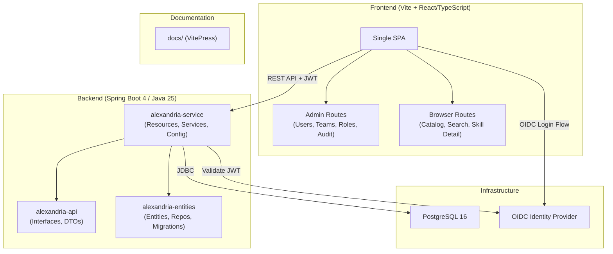
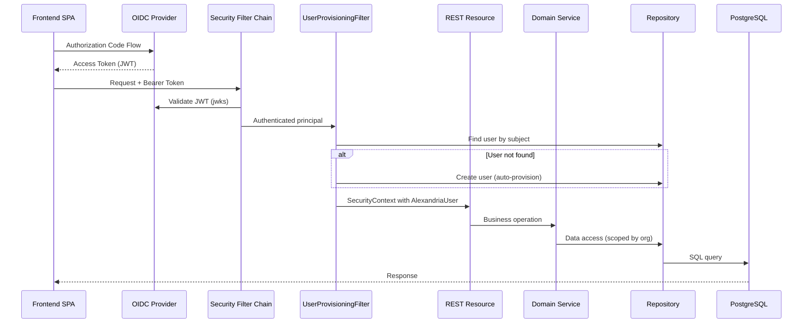
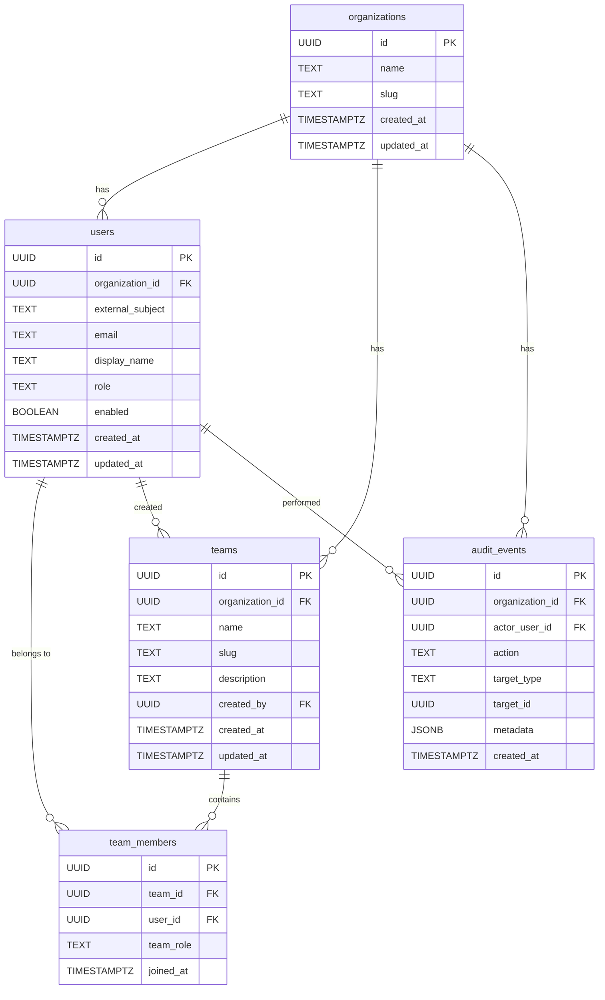

# Design Document: Alexandria First Step

## Overview

This design covers the foundational layer of the Alexandria platform — establishing project structure, database schema for identity management, OIDC authentication, user auto-provisioning, team management, RBAC, audit logging, health endpoints, documentation site, and two React/TypeScript frontend applications (Admin and Skill Browser) served as a single Vite-based SPA with role-gated routing.

The system uses a layered modular monolith architecture: a Spring Boot 4 backend with strict module separation (api, entities, service), a PostgreSQL database evolved via Flyway migrations, and a React/TypeScript frontend built with Vite communicating via REST.

## Architecture

### High-Level System Diagram



### Backend Module Dependency

```
alexandria-api          ← no internal deps, pure contracts
alexandria-entities     ← no internal deps, pure data layer
alexandria-service      ← depends on api + entities
```

### Request Flow



## Components and Interfaces

### Backend Components

#### alexandria-api Module

| Package | Component | Responsibility |
|---------|-----------|----------------|
| `com.alexandria.user` | `UserApi` | User endpoints interface |
| `com.alexandria.user.dto` | `UserResponse`, `UpdateRoleRequest` | User DTOs |
| `com.alexandria.team` | `TeamApi` | Team CRUD endpoints interface |
| `com.alexandria.team.dto` | `CreateTeamRequest`, `TeamResponse`, `TeamDetailResponse`, `AddMemberRequest`, `TeamMemberResponse` | Team DTOs |
| `com.alexandria.audit` | `AuditApi` | Audit events query interface |
| `com.alexandria.audit.dto` | `AuditEventResponse`, `AuditEventFilter` | Audit DTOs |
| `com.alexandria.health` | `HealthApi` | /api/me endpoint interface |
| `com.alexandria.health.dto` | `CurrentUserResponse` | Current user profile DTO |

#### alexandria-entities Module

| Package | Component | Responsibility |
|---------|-----------|----------------|
| `com.alexandria.user.entity` | `UserEntity` | JPA entity for `users` table |
| `com.alexandria.user` | `UserRepository` | Spring Data JPA repository |
| `com.alexandria.team.entity` | `TeamEntity` | JPA entity for `teams` table |
| `com.alexandria.team.entity` | `TeamMemberEntity` | JPA entity for `team_members` table |
| `com.alexandria.team` | `TeamRepository` | Spring Data JPA repository |
| `com.alexandria.team` | `TeamMemberRepository` | Spring Data JPA repository |

#### alexandria-service Module

| Package | Component | Responsibility |
|---------|-----------|----------------|
| `com.alexandria.user` | `UserResource` | REST controller implementing `UserApi` |
| `com.alexandria.user` | `UserService` / `UserServiceImpl` | User business logic |
| `com.alexandria.team` | `TeamResource` | REST controller implementing `TeamApi` |
| `com.alexandria.team` | `TeamService` / `TeamServiceImpl` | Team CRUD + membership logic |
| `com.alexandria.audit` | `AuditResource` | REST controller implementing `AuditApi` |
| `com.alexandria.audit` | `AuditService` / `AuditServiceImpl` | Audit event recording and querying |
| `com.alexandria.health` | `HealthResource` | /api/me endpoint |
| `com.alexandria.config` | `SecurityConfig` | OIDC resource server + filter chain |
| `com.alexandria.config` | `UserProvisioningFilter` | Auto-provision filter (OncePerRequestFilter) |
| `com.alexandria.config` | `OidcProperties` | Configuration properties for OIDC |
| `com.alexandria.auth` | `AlexandriaUserDetails` | Custom principal with user ID, org ID, role |
| `com.alexandria.auth` | `Role` | Enum of 7 organization-level roles |

### Frontend Components

Single Vite + React/TypeScript SPA with role-gated routing:

```
frontend/
├── src/
│   ├── main.tsx                    # Entry point
│   ├── App.tsx                     # Root with router + auth provider
│   ├── auth/
│   │   ├── AuthProvider.tsx        # OIDC context (oidc-client-ts)
│   │   ├── useAuth.ts             # Auth hook
│   │   └── ProtectedRoute.tsx     # Role-gated route wrapper
│   ├── api/
│   │   ├── client.ts              # Axios instance with token interceptor
│   │   ├── users.ts               # User API calls
│   │   ├── teams.ts               # Team API calls
│   │   ├── audit.ts               # Audit API calls
│   │   └── skills.ts              # Skill catalog API calls
│   ├── admin/
│   │   ├── AdminLayout.tsx        # Sidebar + content layout
│   │   ├── UsersPage.tsx          # User management table
│   │   ├── TeamsPage.tsx          # Team list + CRUD
│   │   ├── TeamDetailPage.tsx     # Members management
│   │   └── AuditLogsPage.tsx      # Audit event viewer
│   ├── browser/
│   │   ├── BrowserLayout.tsx      # Catalog layout
│   │   ├── CatalogPage.tsx        # Search + filter + results
│   │   ├── SkillDetailPage.tsx    # Skill detail + export
│   │   └── components/
│   │       ├── SearchBar.tsx
│   │       ├── FilterPanel.tsx
│   │       ├── SkillCard.tsx
│   │       └── LifecycleBadge.tsx
│   ├── shared/
│   │   ├── components/            # Buttons, modals, tables, pagination
│   │   ├── hooks/                 # useApi, usePagination, useDebounce
│   │   └── types/                 # Shared TypeScript types
│   └── config.ts                  # Runtime config (API base URL)
├── index.html
├── vite.config.ts
├── tsconfig.json
├── package.json
└── tailwind.config.ts
```

### API Contracts

#### User Endpoints

| Method | Path | Role Required | Request | Response |
|--------|------|---------------|---------|----------|
| GET | `/api/me` | Any authenticated | — | `CurrentUserResponse` |
| GET | `/api/users` | Org_Admin | `?page=0&size=20` | `PageResponse<UserResponse>` |
| PATCH | `/api/users/{userId}/role` | Org_Admin | `UpdateRoleRequest` | `UserResponse` |

#### Team Endpoints

| Method | Path | Role Required | Request | Response |
|--------|------|---------------|---------|----------|
| POST | `/api/teams` | Org_Admin, Catalog_Admin | `CreateTeamRequest` | `TeamResponse` (201) |
| GET | `/api/teams` | Any authenticated | `?page=0&size=20` | `PageResponse<TeamResponse>` |
| GET | `/api/teams/{teamId}` | Org_Admin | — | `TeamDetailResponse` |
| POST | `/api/teams/{teamId}/members` | Org_Admin, Team_Owner | `AddMemberRequest` | `TeamMemberResponse` (201) |
| DELETE | `/api/teams/{teamId}/members/{userId}` | Org_Admin, Team_Owner | — | 204 |

#### Audit Endpoints

| Method | Path | Role Required | Request | Response |
|--------|------|---------------|---------|----------|
| GET | `/api/audit-events` | Org_Admin, Read_Only_Auditor | `?page=0&size=20&target_type=...&action=...&start_date=...&end_date=...` | `PageResponse<AuditEventResponse>` |

#### Health Endpoints

| Method | Path | Auth | Response |
|--------|------|------|----------|
| GET | `/actuator/health` | None | `{"status":"UP"}` or `{"status":"DOWN"}` |
| GET | `/actuator/info` | None | `{"app":{"name":"alexandria","version":"..."}}` |

### DTO Definitions

```java
// --- User DTOs ---
public record UserResponse(UUID id, String email, String displayName, String role,
                           boolean enabled, UUID organizationId, Instant createdAt) {}

public record CurrentUserResponse(UUID id, String email, String displayName, String role,
                                  UUID organizationId) {}

public record UpdateRoleRequest(@NotNull @Pattern(regexp = "Org_Admin|Catalog_Admin|Reviewer|Team_Owner|Skill_Author|Skill_Consumer|Read_Only_Auditor") String role) {}

// --- Team DTOs ---
public record CreateTeamRequest(
    @NotBlank @Size(min = 2, max = 100)
    @Pattern(regexp = "^[a-zA-Z0-9 \\-_]+$") String name,
    String description) {}

public record TeamResponse(UUID id, String name, String slug, String description,
                           int memberCount, Instant createdAt) {}

public record TeamDetailResponse(UUID id, String name, String slug, String description,
                                 List<TeamMemberResponse> members, Instant createdAt) {}

public record AddMemberRequest(@NotNull UUID userId, @NotBlank @Pattern(regexp = "owner|member") String teamRole) {}

public record TeamMemberResponse(UUID userId, String email, String displayName, String teamRole, Instant joinedAt) {}

// --- Audit DTOs ---
public record AuditEventResponse(UUID id, UUID actorUserId, String actorEmail,
                                 String action, String targetType, UUID targetId,
                                 Map<String, Object> metadata, Instant createdAt) {}
```

## Data Models

### V2 Migration: Users, Teams, Team Members

```sql
-- V2__users_teams_schema.sql

-- Users
CREATE TABLE users (
    id                UUID PRIMARY KEY DEFAULT gen_random_uuid(),
    organization_id   UUID NOT NULL REFERENCES organizations(id) ON DELETE RESTRICT,
    external_subject  TEXT NOT NULL,
    email             TEXT NOT NULL,
    display_name      TEXT,
    role              TEXT NOT NULL DEFAULT 'Skill_Consumer',
    enabled           BOOLEAN NOT NULL DEFAULT TRUE,
    created_at        TIMESTAMPTZ NOT NULL DEFAULT NOW(),
    updated_at        TIMESTAMPTZ NOT NULL DEFAULT NOW()
);

CREATE UNIQUE INDEX uq_users_org_subject ON users(organization_id, external_subject);
CREATE INDEX idx_users_org_id ON users(organization_id);

-- Teams
CREATE TABLE teams (
    id                UUID PRIMARY KEY DEFAULT gen_random_uuid(),
    organization_id   UUID NOT NULL REFERENCES organizations(id) ON DELETE RESTRICT,
    name              TEXT NOT NULL,
    slug              TEXT NOT NULL,
    description       TEXT,
    created_by        UUID NOT NULL REFERENCES users(id) ON DELETE RESTRICT,
    created_at        TIMESTAMPTZ NOT NULL DEFAULT NOW(),
    updated_at        TIMESTAMPTZ NOT NULL DEFAULT NOW()
);

CREATE UNIQUE INDEX uq_teams_org_slug ON teams(organization_id, slug);
CREATE INDEX idx_teams_org_id ON teams(organization_id);
CREATE INDEX idx_teams_created_by ON teams(created_by);

-- Team Members
CREATE TABLE team_members (
    id                UUID PRIMARY KEY DEFAULT gen_random_uuid(),
    team_id           UUID NOT NULL REFERENCES teams(id) ON DELETE RESTRICT,
    user_id           UUID NOT NULL REFERENCES users(id) ON DELETE RESTRICT,
    team_role         TEXT NOT NULL,
    joined_at         TIMESTAMPTZ NOT NULL DEFAULT NOW()
);

CREATE UNIQUE INDEX uq_team_members_team_user ON team_members(team_id, user_id);
CREATE INDEX idx_team_members_team_id ON team_members(team_id);
CREATE INDEX idx_team_members_user_id ON team_members(user_id);

-- Update audit_events FK to users (actor_user_id was nullable, now can reference users)
ALTER TABLE audit_events
    ADD CONSTRAINT fk_audit_events_actor FOREIGN KEY (actor_user_id) REFERENCES users(id) ON DELETE RESTRICT;
```

### Entity Relationship Diagram



### JPA Entities

**UserEntity** extends `BaseEntity`:
- `externalSubject` (String, not null)
- `email` (String, not null)
- `displayName` (String, nullable)
- `role` (String, not null — validated via `@Pattern` at the service layer)
- `enabled` (boolean, default true)

**TeamEntity** extends `BaseEntity`:
- `name` (String, not null)
- `slug` (String, not null)
- `description` (String, nullable)
- `createdBy` (UUID, not null — FK to users)

**TeamMemberEntity** (does NOT extend BaseEntity — different column structure):
- `id` (UUID, PK)
- `teamId` (UUID, not null)
- `userId` (UUID, not null)
- `teamRole` (String, not null — "owner" or "member")
- `joinedAt` (Instant, not null)

### Security Design

#### OIDC Resource Server Configuration

```yaml
spring:
  security:
    oauth2:
      resourceserver:
        jwt:
          issuer-uri: ${OIDC_ISSUER_URI}
          audiences: ${OIDC_CLIENT_ID}
```

The `SecurityConfig` will:
1. Configure JWT resource server (validates signature, issuer, audience, expiration)
2. Permit unauthenticated access to `/actuator/health`, `/actuator/info`
3. Require authentication for all other endpoints
4. Register `UserProvisioningFilter` after `BearerTokenAuthenticationFilter`

#### UserProvisioningFilter (OncePerRequestFilter)

Executes after JWT validation:
1. Extract `sub` claim from `JwtAuthenticationToken`
2. Extract `email` claim — if missing/invalid, respond 403
3. Look up user by `(organizationId, sub)`
4. If not found → create user with `Skill_Consumer` role, log audit event
5. Build `AlexandriaUserDetails` with userId, orgId, role
6. Replace `SecurityContext` authentication with enriched principal
7. On provisioning failure → respond 500, log audit event

#### Role Enum

```java
public enum Role {
    Read_Only_Auditor(0),
    Skill_Consumer(1),
    Skill_Author(2),
    Reviewer(3),
    Team_Owner(4),
    Catalog_Admin(5),
    Org_Admin(6);

    private final int privilege;
    // Methods: hasAtLeast(Role), isAdmin(), etc.
}
```

#### RBAC Enforcement

Method-level security using `@PreAuthorize` with custom SpEL expressions:

```java
@PreAuthorize("hasRole('Org_Admin')")
@PreAuthorize("hasAnyRole('Org_Admin', 'Catalog_Admin')")
@PreAuthorize("@teamSecurity.isOwnerOrAdmin(#teamId, authentication)")
```

The `AlexandriaUserDetails` principal provides `getAuthorities()` returning a single `GrantedAuthority` matching the user's role.

### Frontend Architecture

#### Technology Choices

| Concern | Choice | Rationale |
|---------|--------|-----------|
| Build tool | Vite 6 | Fast HMR, simple config, optimized builds |
| Framework | React 19 | Specified by user, large ecosystem |
| Language | TypeScript 5.x | Type safety for DTOs and API client |
| Routing | React Router 7 | Standard for SPAs, URL-driven state |
| Styling | Tailwind CSS 4 | Utility-first, fast prototyping |
| Auth | oidc-client-ts | Mature OIDC/OAuth2 client for SPAs |
| HTTP | Axios | Interceptors for auth token, error handling |
| State | React Query (TanStack Query) | Server state caching, pagination |
| Tables | TanStack Table | Headless, flexible for admin tables |

#### Routing Structure

```
/                         → Redirect based on role
/admin/users              → User management (Org_Admin, Catalog_Admin)
/admin/teams              → Team list (Org_Admin, Catalog_Admin)
/admin/teams/:teamId      → Team detail (Org_Admin, Team_Owner)
/admin/audit              → Audit logs (Org_Admin, Read_Only_Auditor)
/catalog                  → Skill search + browse (all authenticated)
/catalog/skills/:skillId  → Skill detail (all authenticated)
/auth/callback            → OIDC callback handler
/unauthorized             → Insufficient permissions page
```

Role gating: `ProtectedRoute` checks user role before rendering child routes. Admin routes require `Org_Admin` or `Catalog_Admin`. Audit route also allows `Read_Only_Auditor`.

#### OIDC Login Flow

1. User navigates to the SPA
2. `AuthProvider` checks for valid token in memory/session storage
3. If no token → redirect to OIDC provider's authorization endpoint
4. OIDC provider authenticates user → redirects to `/auth/callback`
5. `oidc-client-ts` exchanges code for tokens (PKCE flow)
6. Access token stored in memory (not localStorage for security)
7. Axios interceptor attaches `Authorization: Bearer <token>` to API requests
8. On 401 response → trigger silent token refresh or re-login

### Documentation Site

#### Choice: VitePress

Rationale: Simple, fast, Markdown-native, generates static HTML, aligns with the Vite toolchain used by the frontend. No heavy server-side requirements.

#### Directory Structure

```
docs/
├── .vitepress/
│   └── config.ts              # Site configuration
├── index.md                   # Landing page
├── guide/
│   ├── installation.md        # Prerequisites, setup steps
│   ├── configuration.md       # Environment variables reference
│   ├── oidc-setup.md          # OIDC provider configuration
│   ├── deployment-local.md    # Docker Compose guide
│   └── deployment-aws.md      # Terraform/AWS guide
├── features/
│   ├── authentication.md      # Auth & auto-provisioning
│   ├── users.md               # User management
│   ├── teams.md               # Team management
│   ├── rbac.md                # Role-based access control
│   ├── audit.md               # Audit logging
│   └── health.md              # Health monitoring
├── api/
│   ├── overview.md            # API conventions, pagination, errors
│   ├── users.md               # User endpoints
│   ├── teams.md               # Team endpoints
│   └── audit.md               # Audit endpoints
├── troubleshooting.md         # Common failures + resolutions
└── package.json               # VitePress dev dependency
```

Build: `npm run docs:build` → `docs/.vitepress/dist/` static HTML.

### Docker Compose Updates

```yaml
services:
  postgres:
    image: postgres:16-alpine
    environment:
      POSTGRES_DB: alexandria
      POSTGRES_USER: alexandria
      POSTGRES_PASSWORD: alexandria
    ports:
      - "5432:5432"
    volumes:
      - postgres_data:/var/lib/postgresql/data
    healthcheck:
      test: ["CMD-SHELL", "pg_isready -U alexandria"]
      interval: 5s
      timeout: 5s
      retries: 5

  backend:
    build:
      context: ./backend
      dockerfile: Dockerfile
    ports:
      - "8080:8080"
    environment:
      SPRING_DATASOURCE_URL: jdbc:postgresql://postgres:5432/alexandria
      SPRING_DATASOURCE_USERNAME: alexandria
      SPRING_DATASOURCE_PASSWORD: alexandria
      OIDC_ISSUER_URI: ${OIDC_ISSUER_URI:-http://localhost:9000}
      OIDC_CLIENT_ID: ${OIDC_CLIENT_ID:-alexandria}
    depends_on:
      postgres:
        condition: service_healthy
    healthcheck:
      test: ["CMD", "curl", "-f", "http://localhost:8080/actuator/health"]
      interval: 10s
      timeout: 5s
      retries: 6
      start_period: 30s

  frontend:
    build:
      context: ./frontend
      dockerfile: Dockerfile
    ports:
      - "5173:80"
    environment:
      VITE_API_BASE_URL: http://localhost:8080
      VITE_OIDC_AUTHORITY: ${OIDC_ISSUER_URI:-http://localhost:9000}
      VITE_OIDC_CLIENT_ID: ${OIDC_CLIENT_ID:-alexandria}
    depends_on:
      - backend

volumes:
  postgres_data:
```


## Correctness Properties

*A property is a characteristic or behavior that should hold true across all valid executions of a system — essentially, a formal statement about what the system should do. Properties serve as the bridge between human-readable specifications and machine-verifiable correctness guarantees.*

### Property 1: Slug generation is a deterministic, well-formed transformation

*For any* valid team name (2–100 characters from `[a-zA-Z0-9 \-_]`), the generated slug SHALL be lowercase, contain only characters in `[a-z0-9-]`, have no consecutive hyphens, not start or end with a hyphen, and be non-empty. Additionally, two different team names that differ only in case, whitespace-vs-hyphen, or underscore-vs-hyphen should produce the same slug.

**Validates: Requirements 5.9**

### Property 2: Role enum membership validation

*For any* string value assigned to `users.role`, it SHALL be one of the seven allowed values (Org_Admin, Catalog_Admin, Reviewer, Team_Owner, Skill_Author, Skill_Consumer, Read_Only_Auditor). *For any* string not in this set, the system SHALL reject it. Similarly, *for any* `team_members.team_role` value, it SHALL be either "owner" or "member" — all other values SHALL be rejected.

**Validates: Requirements 2.9, 6.7**

### Property 3: Email claim validation on every request

*For any* authenticated request where the JWT email claim is missing, empty, or does not match a valid email format (contains `@` with a non-empty local part and domain), the system SHALL reject the request with HTTP 403 regardless of whether the user already exists in the database.

**Validates: Requirements 4.4, 4.7**

### Property 4: User provisioning idempotency

*For any* unique (organization_id, external_subject) pair from a valid JWT, the system SHALL ensure exactly one user record exists after any number of concurrent or sequential requests bearing that subject. The first request creates the user; all subsequent requests reuse the existing record without modification to its core identity fields (id, external_subject, created_at).

**Validates: Requirements 4.1, 4.2**

### Property 5: Organization data scoping

*For any* data query made by an authenticated user, the result set SHALL contain only records where `organization_id` matches the authenticated user's organization. No record belonging to a different organization SHALL appear in any API response.

**Validates: Requirements 6.10**

### Property 6: Org_Admin full access

*For any* API endpoint (excluding health/info), a request from an authenticated user with role Org_Admin SHALL NOT receive HTTP 403 Forbidden due to insufficient role-based permissions.

**Validates: Requirements 6.4**

### Property 7: Read_Only_Auditor cannot mutate

*For any* API endpoint that creates, updates, or deletes a resource (POST, PATCH, PUT, DELETE to resource endpoints), a request from a user with Read_Only_Auditor role SHALL receive HTTP 403 Forbidden.

**Validates: Requirements 6.5**

### Property 8: Restricted roles denied admin endpoints

*For any* user with role Skill_Consumer, Skill_Author, or Reviewer, attempts to access user management (GET/PATCH /api/users), team creation (POST /api/teams), role assignment, or audit log viewing endpoints SHALL receive HTTP 403 Forbidden.

**Validates: Requirements 5.6, 6.11**

### Property 9: Role privilege ordering consistency

*For any* two roles A and B where A has lower privilege than B in the defined hierarchy (Read_Only_Auditor < Skill_Consumer < Skill_Author < Reviewer < Team_Owner < Catalog_Admin < Org_Admin), role B SHALL have access to at least every endpoint that role A can access. The ordering is strict and transitive.

**Validates: Requirements 6.2**

### Property 10: Audit completeness and field correctness

*For any* governance operation (user provisioning, role change, team creation, team deletion, member addition, member removal), the system SHALL create exactly one audit event with non-null organization_id matching the operation's org, non-null action matching the operation type, non-null target_type and target_id identifying the affected entity, a created_at timestamp, and metadata containing operation-specific details.

**Validates: Requirements 7.1, 7.2, 4.3, 5.7, 5.8, 6.9**

### Property 11: Audit event ordering and filter correctness

*For any* set of audit events and any combination of filter parameters (target_type, target_id, actor_user_id, action, start_date, end_date), the returned results SHALL contain only events matching ALL provided filters (AND logic) and SHALL be ordered by created_at descending. Adding a filter SHALL never increase the result set size.

**Validates: Requirements 7.3, 7.4**

### Property 12: /api/me returns correct user profile

*For any* authenticated user with a valid user record, GET /api/me SHALL return a response where the id, email, role, and organization_id fields exactly match the corresponding database record for that user.

**Validates: Requirements 8.4**

### Property 13: Lifecycle badge mapping is exhaustive

*For any* lifecycle status value in the set {Draft, Published, Team_Approved, Company_Approved, Deprecated, Archived, Blocked}, the badge rendering function SHALL produce a non-empty visual indicator (color or icon) that is distinct from all other status values. No status value SHALL produce an undefined or fallback rendering.

**Validates: Requirements 11.9**

### Property 14: URL state round-trip for search and filters

*For any* combination of a search query string and a set of filter selections (task type, language, framework, tool, approval state, risk level, owner team, visibility), serializing the state to URL query parameters and then parsing those parameters back SHALL produce an equivalent state object. No information is lost in the round-trip.

**Validates: Requirements 11.12**

## Error Handling

### Backend Error Strategy

All errors follow the existing `ErrorResponse` pattern:

```java
public record ErrorResponse(String error, String message, Instant timestamp) {}
```

| Scenario | HTTP Status | Error Code | Message |
|----------|-------------|------------|---------|
| Invalid/expired JWT | 401 | UNAUTHORIZED | Token validation failure reason |
| Missing Authorization header | 401 | UNAUTHORIZED | "Authentication required" |
| Missing/invalid email claim | 403 | FORBIDDEN | "Missing or invalid email claim" |
| Insufficient role | 403 | FORBIDDEN | "Access denied: insufficient role" |
| Entity not found | 404 | NOT_FOUND | "{Entity} not found" |
| Duplicate slug (team creation) | 409 | CONFLICT | "Team name already taken" |
| Last owner removal | 409 | CONFLICT | "Team must have at least one owner" |
| Invalid role value | 400 | VALIDATION_ERROR | "Invalid role: {value}" |
| Validation errors | 400 | VALIDATION_ERROR | Field-level details |
| Auto-provisioning DB failure | 500 | INTERNAL_ERROR | "Account creation failed" |
| Unhandled exception | 500 | INTERNAL_ERROR | "An unexpected error occurred" |

### Audit Service Resilience

The Audit Service uses a fire-and-forget pattern with error logging:
- Audit recording failures are caught, logged at ERROR level with full event details
- The triggering operation always completes successfully regardless of audit failures
- Implementation: `try/catch` in `AuditServiceImpl` with `@Async` for non-blocking writes (optional optimization)

### Frontend Error Handling

- HTTP 401 → trigger token refresh or redirect to OIDC login
- HTTP 403 → display "insufficient permissions" notification
- HTTP 4xx → display error message from `ErrorResponse.message`
- HTTP 5xx → display generic error with retry action
- Network error → display "unable to reach server" with retry button
- All errors shown as toast notifications (auto-dismiss after 5s for 4xx, persist until dismissed for 5xx)

## Testing Strategy

### Backend Testing

#### Unit Tests (JUnit 5 + Mockito)

- **SlugGenerator**: Pure function — test transformation rules
- **Role enum**: Privilege ordering, hasAtLeast comparisons
- **UserProvisioningFilter**: Mock repository, verify creation/reuse/rejection logic
- **TeamServiceImpl**: Mock repository, verify slug generation, duplicate detection, last-owner protection
- **AuditServiceImpl**: Verify event construction, error resilience
- **RBAC expressions**: Verify SpEL evaluations for different role combinations

#### Integration Tests (Testcontainers + Spring Boot Test)

- **Migration tests**: V2 migration applies cleanly, schema matches JPA entities
- **Repository tests**: CRUD operations, unique constraint enforcement, org scoping
- **Security filter chain tests**: JWT validation, provisioning filter chain behavior
- **Full endpoint tests**: HTTP round-trips with `@SpringBootTest` + `MockMvc` using `spring-security-test` JWT mocking

#### Property-Based Tests (jqwik)

**Library choice**: [jqwik](https://jqwik.net/) — mature Java property-based testing library, integrates with JUnit 5.

**Configuration**: Minimum 100 iterations per property test.

**Tag format**: `Feature: alexandria-first-step, Property {number}: {property_text}`

Properties to implement as PBT:
- Property 1: Slug generation (pure function — ideal for PBT)
- Property 2: Role enum validation (generate random strings, verify acceptance/rejection)
- Property 3: Email validation (generate invalid email formats)
- Property 4: Provisioning idempotency (generate random subject/email pairs)
- Property 9: Role ordering transitivity (generate role pairs, verify ordering)
- Property 11: Audit filter monotonicity (adding filters never increases results)
- Property 14: URL state round-trip (generate filter combinations, verify serialization round-trip)

Properties better suited to parameterized/integration tests (not PBT):
- Properties 5–8, 10: RBAC and org scoping — require full security context, better as parameterized integration tests iterating over roles and endpoints
- Property 12: /api/me correctness — integration test with various user states
- Property 13: Badge mapping — example-based test iterating over all 7 status values

### Frontend Testing

#### Unit Tests (Vitest + React Testing Library)

- Component rendering with mock data
- Auth state management
- API client error handling
- Role-gated route behavior
- Badge rendering for all lifecycle statuses
- URL parameter serialization/deserialization

#### Property-Based Tests (fast-check)

**Library choice**: [fast-check](https://github.com/dubzzz/fast-check) — standard property-based testing for TypeScript/JavaScript.

- Property 14: URL round-trip (generate arbitrary filter combinations, verify serialize→parse identity)
- Property 13: Badge exhaustiveness (generate all status enum values, verify non-empty distinct rendering)

#### E2E Tests (Playwright — deferred to later milestone)

- Login flow via OIDC
- Admin CRUD workflows
- Catalog search and navigation

### Documentation Testing

- Build verification: `npm run docs:build` succeeds without errors
- Link checking: All internal links resolve (VitePress built-in or external tool)
