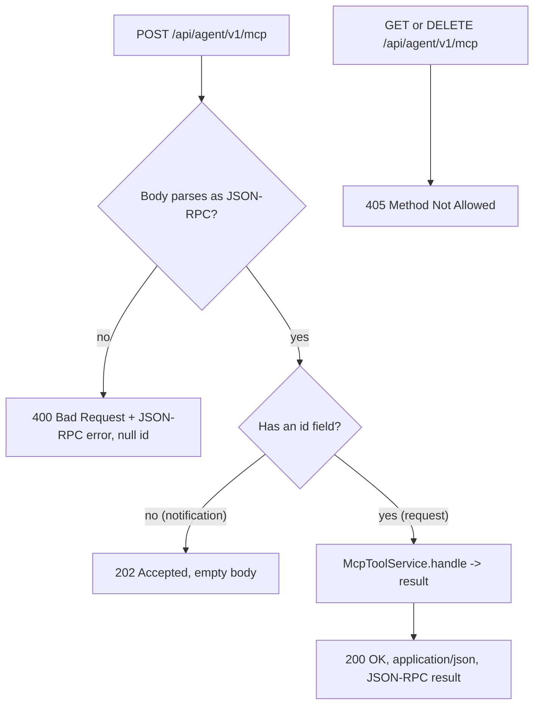

# Design Document: MCP Client Readiness

## Overview

This design makes the Alexandria Skill Resolver's MCP endpoint connectable by real MCP clients
(Claude Code, AWS Kiro, GitHub Copilot / VS Code) and adds an admin API to mint, list, and revoke
service tokens. It has two independent parts sharing no new infrastructure:

1. **Transport compliance** — adjust the existing `McpResource` so the JSON-RPC endpoint conforms to
   the MCP Streamable HTTP transport for the request/response (non-streaming) case: relaxed content
   negotiation, `202 Accepted` with no body for notifications, `GET`/`DELETE` → `405`, and tolerance
   of the `MCP-Protocol-Version` header. No SSE, no sessions.

2. **Service-token minting** — a new `Org_Admin`-only API (`ServiceTokenAdminApi` +
   `ServiceTokenResource` + `ServiceTokenAdminService`) to create a token (secret revealed once),
   list tokens, and revoke a token, reusing the existing `service_tokens` table, `ServiceTokenEntity`,
   and `ServiceTokenRepository`.

The design deliberately reuses everything already built by the Skill Resolver spec. The transport
part touches one class (`McpResource`); the token part follows the exact `*Api` interface +
`@PreAuthorize` resource + service convention used by `UserResource` / `TaxonomyResource`, and adds
**no schema change** — the `service_tokens` table already carries every column needed (`name`,
`token_hash`, `token_prefix`, `scope`, `created_by`, `expires_at`, `revoked_at`, `last_used_at`).

**Deployment context.** Alexandria runs in the customer VPC (ECS Fargate / Kubernetes behind an
ALB), reached by remote HTTP MCP clients that send no browser `Origin`. Transport security is TLS at
the load balancer plus the mandatory bearer-token auth and org-scoped ACL already enforced on
`/api/agent/**`. DNS-rebinding `Origin` validation and localhost binding — which target
locally-bound servers — are intentionally out of scope.

Key decisions:

- **Keep the JSON-response, stateless shape.** The transport spec explicitly allows a server to
  answer a request with a single `application/json` object and to omit session management. This is
  the minimal compliant surface for a synchronous tool server and avoids SSE/session complexity.
- **Distinguish requests from notifications by the presence of `id`.** A JSON-RPC message with no
  `id` is a notification → `202` no body; a message with an `id` is a request → `200` with a result.
- **Loosen content negotiation at the controller, not the security layer.** Remove the strict
  `consumes`/`produces` from the mapping and write JSON explicitly, so a dual `Accept` header or a
  `charset` parameter never triggers `406`/`415`.
- **Secret is generated with `SecureRandom`, hashed with SHA-256, and revealed once.** Storage
  matches exactly what `ServiceTokenAuthFilter` already validates (SHA-256 hex of the presented
  secret, `alx_` prefix), so minted tokens authenticate with zero filter changes.
- **Token responses never carry the secret or hash after creation.** List/revoke expose only prefix
  + metadata.

## Architecture

### Component map

```text
alexandria-api        com.alexandria.agent.admin.ServiceTokenAdminApi          (REST contract)
                      com.alexandria.agent.admin.dto.CreateServiceTokenRequest
                      com.alexandria.agent.admin.dto.CreateServiceTokenResponse  (secret, once)
                      com.alexandria.agent.admin.dto.ServiceTokenResponse        (metadata only)

alexandria-service    com.alexandria.agent.admin.ServiceTokenResource           (@RestController, @PreAuthorize)
                      com.alexandria.agent.admin.ServiceTokenAdminService / Impl (mint/list/revoke)
                      com.alexandria.agent.mcp.McpResource                       (transport changes)
                      com.alexandria.config.ServiceTokenHasher                   (shared SHA-256 helper)

alexandria-entities   com.alexandria.agent.entity.ServiceTokenEntity            (reused, unchanged)
                      com.alexandria.agent.ServiceTokenRepository               (add org-scoped queries)
```

No new tables. No changes to the resolver core, hooks, or tool-search. `ServiceTokenAuthFilter` is
refactored only to call the shared hashing helper (no behavior change).

### MCP request classification flow (transport)



### Service-token minting flow

```mermaid
sequenceDiagram
    participant Admin as Org_Admin (curl/UI)
    participant Res as ServiceTokenResource
    participant Svc as ServiceTokenAdminService
    participant Repo as ServiceTokenRepository
    participant Audit as AuditService

    Admin->>Res: POST /api/agent/v1/service-tokens {name, expiresAt?}
    Note over Res: @PreAuthorize hasRole('Org_Admin')
    Res->>Svc: create(name, expiresAt, identity)
    Svc->>Svc: secret = "alx_" + base64url(SecureRandom 32B)
    Svc->>Svc: hash = ServiceTokenHasher.sha256Hex(secret); prefix = secret[0..12]
    Svc->>Repo: save(ServiceTokenEntity{org, name, hash, prefix, scope, createdBy, expiresAt})
    Svc->>Audit: record("service_token.created", token id)
    Svc-->>Res: CreateServiceTokenResponse(id, name, prefix, scope, expiresAt, rawSecret)
    Res-->>Admin: 201 { id, name, tokenPrefix, scope, expiresAt, token: "<secret shown once>" }
```

## Components and Changes

### 1. Transport — `McpResource` (alexandria-service)

The current controller is:

```java
@PostMapping(consumes = MediaType.APPLICATION_JSON_VALUE, produces = MediaType.APPLICATION_JSON_VALUE)
public ResponseEntity<JsonNode> handle(@RequestBody JsonNode request) { ... }
```

Three problems: (a) the strict `consumes`/`produces` can 415/406 against a dual `Accept` or a
`charset` parameter; (b) it always returns a JSON body, so notifications get a JSON-RPC result
instead of `202`; (c) there is no explicit `GET`/`DELETE` → `405`.

**Revised controller** (behavioral shape; final code in tasks):

```java
@RestController
@RequestMapping("/api/agent/v1/mcp")
@RequiredArgsConstructor
public class McpResource {

    private final McpToolService toolService;

    // No consumes/produces restriction: accept any Content-Type/Accept, decide the response shape.
    @PostMapping
    public ResponseEntity<?> handle(@RequestBody JsonNode request) {
        AlexandriaUserDetails identity = currentIdentity();

        // A JSON-RPC message with a method and no "id" is a notification -> 202, no body.
        // notifications/initialized and any id-less method are acknowledged this way.
        boolean isNotification = request == null || !request.has("id") || request.get("id").isNull();
        if (isNotification) {
            return ResponseEntity.accepted().build();          // 202, empty
        }

        JsonNode response = toolService.handle(request, identity);
        return ResponseEntity.ok()
                .contentType(MediaType.APPLICATION_JSON)
                .body(response);
    }

    @GetMapping
    public ResponseEntity<Void> get() {
        return ResponseEntity.status(HttpStatus.METHOD_NOT_ALLOWED).build();   // no SSE stream offered
    }

    @DeleteMapping
    public ResponseEntity<Void> delete() {
        return ResponseEntity.status(HttpStatus.METHOD_NOT_ALLOWED).build();   // no session teardown
    }

    private AlexandriaUserDetails currentIdentity() { /* SecurityContext read, as today */ }
}
```

Notes:

- `@RequestBody JsonNode` continues to bind the JSON body; removing `consumes` lets Spring accept a
  `Content-Type` with parameters. If a client sends a body that isn't valid JSON, Spring's message
  converter throws and the existing `GlobalExceptionHandler` maps it to `400` (Requirement 2.4); a
  JSON-RPC error object with a null `id` is acceptable but not required.
- The `MCP-Protocol-Version` header is not required or validated; absence is fine (Requirement 4).
- `McpToolService.handle(...)` is unchanged for requests. Its current `notifications/initialized`
  branch (which returned a JSON result) is now unreachable over HTTP because the controller answers
  id-less messages with `202` before calling the service; that branch can be left as-is or removed.
  `ping` carries an `id` (it is a request) and continues to return a JSON-RPC result via `handle`.

**Content-negotiation subtlety.** Returning `ResponseEntity<?>` with an explicit
`.contentType(APPLICATION_JSON)` writes `application/json` regardless of the request's `Accept`,
which the spec's client MUST accept. Spring's default JSON message converter handles `JsonNode`
(Jackson 3, `tools.jackson`), consistent with the rest of the agent endpoints.

### 2. `ServiceTokenRepository` — org-scoped queries (alexandria-entities)

Add the queries the admin API needs (all org-scoped):

```java
List<ServiceTokenEntity> findByOrganizationIdOrderByCreatedAtDesc(UUID organizationId);

Optional<ServiceTokenEntity> findByIdAndOrganizationId(UUID id, UUID organizationId);
```

`findByTokenHash` (used by `ServiceTokenAuthFilter`) stays as-is.

### 3. `alexandria-api` — DTOs and REST contract

Under `com.alexandria.agent.admin.dto`, Java records matching the existing DTO style:

```java
public record CreateServiceTokenRequest(
        @NotBlank String name,
        Instant expiresAt            // optional; null = no expiry
) {}

// Returned ONCE at creation — the only response that carries the secret.
public record CreateServiceTokenResponse(
        UUID id,
        String name,
        String tokenPrefix,
        String scope,
        Instant expiresAt,
        String token                 // full alx_ secret, shown once, never stored/returned again
) {}

// Metadata view for list — never carries secret or hash.
public record ServiceTokenResponse(
        UUID id,
        String name,
        String tokenPrefix,
        String scope,
        UUID createdBy,
        Instant createdAt,
        Instant expiresAt,
        Instant revokedAt,
        Instant lastUsedAt
) {}
```

REST contract `com.alexandria.agent.admin.ServiceTokenAdminApi`:

```java
@RequestMapping("/api/agent/v1/service-tokens")
public interface ServiceTokenAdminApi {

    @PostMapping
    ResponseEntity<CreateServiceTokenResponse> create(@Valid @RequestBody CreateServiceTokenRequest request);

    @GetMapping
    ResponseEntity<List<ServiceTokenResponse>> list();

    @DeleteMapping("/{tokenId}")
    ResponseEntity<Void> revoke(@PathVariable UUID tokenId);
}
```

> Path choice: `/api/agent/v1/service-tokens` keeps agent-facing concerns grouped under
> `/api/agent/v1`. It is an **admin** operation (Org_Admin only), but it governs agent credentials,
> so it lives alongside the other agent endpoints rather than under `/api/users`.

### 4. `alexandria-service` — `ServiceTokenResource`

Thin `@RestController implements ServiceTokenAdminApi`, mirroring `UserResource`'s
`@PreAuthorize("hasRole('Org_Admin')")` convention and `currentUser()` pattern:

```java
@RestController
@RequiredArgsConstructor
public class ServiceTokenResource implements ServiceTokenAdminApi {

    private final ServiceTokenAdminService service;

    @Override
    @PreAuthorize("hasRole('Org_Admin')")
    public ResponseEntity<CreateServiceTokenResponse> create(CreateServiceTokenRequest request) {
        return ResponseEntity.status(HttpStatus.CREATED)
                .body(service.create(request.name(), request.expiresAt(), currentUser()));
    }

    @Override
    @PreAuthorize("hasRole('Org_Admin')")
    public ResponseEntity<List<ServiceTokenResponse>> list() {
        return ResponseEntity.ok(service.list(currentUser()));
    }

    @Override
    @PreAuthorize("hasRole('Org_Admin')")
    public ResponseEntity<Void> revoke(UUID tokenId) {
        service.revoke(tokenId, currentUser());
        return ResponseEntity.noContent().build();
    }

    private AlexandriaUserDetails currentUser() { /* same SecurityContext read as SkillResource */ }
}
```

`@PreAuthorize` needs `@EnableMethodSecurity`, which `SecurityConfig` already declares. A caller
lacking `Org_Admin` gets `403` from Spring Security.

### 5. `alexandria-service` — `ServiceTokenAdminService` / `Impl`

```java
public interface ServiceTokenAdminService {
    CreateServiceTokenResponse create(String name, Instant expiresAt, AlexandriaUserDetails admin);
    List<ServiceTokenResponse> list(AlexandriaUserDetails admin);
    void revoke(UUID tokenId, AlexandriaUserDetails admin);
}
```

`ServiceTokenAdminServiceImpl` (`@Service @Transactional`):

- **create** — generate the secret and persist the hash:
  ```java
  byte[] raw = new byte[32];
  SECURE_RANDOM.nextBytes(raw);
  String secret = "alx_" + Base64.getUrlEncoder().withoutPadding().encodeToString(raw);
  String hash = ServiceTokenHasher.sha256Hex(secret);   // same algorithm as ServiceTokenAuthFilter
  String prefix = secret.substring(0, 12);              // non-secret display fragment
  ```
  Build a `ServiceTokenEntity` with the admin's `organizationId`, `name`, `hash`, `prefix`,
  `scope = "agent_read"`, `createdBy = admin.userId()`, and `expiresAt`; save; record
  `AuditService.record(orgId, admin.userId(), "service_token.created", "service_token", id, {...})`.
  Return `CreateServiceTokenResponse` including the raw `secret` — the only time it leaves the server.
- **list** — `findByOrganizationIdOrderByCreatedAtDesc(admin.organizationId())` → map to
  `ServiceTokenResponse` (no secret/hash).
- **revoke** — `findByIdAndOrganizationId(tokenId, admin.organizationId())` → `404` if absent (a
  dedicated `ServiceTokenNotFoundException` mapped in `GlobalExceptionHandler`); if `revokedAt` is
  null set it to `now()` and save; record `service_token.revoked` audit. Idempotent: an
  already-revoked token returns success and keeps its original timestamp.

### 6. `ServiceTokenHasher` (shared helper) + `ServiceTokenAuthFilter` refactor

`ServiceTokenAuthFilter` currently hashes inline (`MessageDigest` SHA-256 → `HexFormat`). Extract that
into `com.alexandria.config.ServiceTokenHasher.sha256Hex(String)` and have both the filter and the
admin service call it. This guarantees a minted token hashes to exactly what the filter looks up
(Property 6), and removes the risk of the two implementations drifting. The filter's behavior is
otherwise unchanged.

### 7. Configuration

No new configuration for either part. The token API reuses existing security and audit
infrastructure; the transport change is code-only.

### 8. Client setup documentation (deliverable)

A `docs/` page showing the exact config for each client, using a minted `alx_` token. Each begins
with the `POST /api/agent/v1/service-tokens` call (as Org_Admin) to obtain the token:

- **Claude Code** — `.mcp.json` / `claude mcp add-json`:
  `{ "mcpServers": { "alexandria": { "type": "http", "url": "https://<host>/api/agent/v1/mcp", "headers": { "Authorization": "Bearer alx_..." } } } }`
- **Copilot / VS Code** — `.vscode/mcp.json`:
  `{ "servers": { "alexandria": { "type": "http", "url": "https://<host>/api/agent/v1/mcp", "headers": { "Authorization": "Bearer alx_..." } } } }`
- **Kiro** — `.kiro/settings/mcp.json`:
  `{ "mcpServers": { "alexandria": { "url": "https://<host>/api/agent/v1/mcp", "headers": { "Authorization": "Bearer alx_..." } } } }`

## Data Models

### No new tables

The `service_tokens` table (from `V8__skill_resolver.sql`) already has every field the minting API
needs. `ServiceTokenEntity` is reused unchanged. Per Requirement 9.3, **no** Flyway migration is
added.

### Reserved / unchanged

`resolver_policies`, the resolver DTOs, and the resolve/fetch contract are untouched.
`ServiceTokenAuthFilter` changes only to call the shared hasher.

## Correctness Properties

### Property 1: Notification vs request classification

*For any* well-formed JSON-RPC message posted to the MCP endpoint: if it has no `id`, the response
is `202` with an empty body; if it has an `id`, the response is `200` with a JSON-RPC result carrying
the same `id`.

**Validates: Requirements 2.1, 2.2, 2.3**

### Property 2: Content-negotiation tolerance

*For any* POST with `Content-Type: application/json` (with or without a `charset` parameter) and an
`Accept` header containing `application/json` and/or `text/event-stream` (or absent), the endpoint
does not respond `406` or `415`, and a request yields `application/json`.

**Validates: Requirements 1.1, 1.2, 1.3, 1.4**

### Property 3: Method handling

`GET` and `DELETE` on the MCP endpoint return `405`. The endpoint never requires an
`Mcp-Session-Id`.

**Validates: Requirements 3.1, 3.2, 3.3, 3.4**

### Property 4: Auth preserved

*For any* MCP request without a valid credential, the response is `401`; with a valid credential,
per-identity ACL and governance are enforced exactly as before. No transport-level path (`GET`
405, notification `202`) returns skill data.

**Validates: Requirements 5.1, 5.2, 5.3**

### Property 5: Secret revealed once, never stored raw

*For any* created token, the create response contains a full `alx_` secret; the stored row contains
only its SHA-256 hash and a prefix; and no subsequent list response contains the secret or hash.

**Validates: Requirements 6.2, 6.3, 6.4**

### Property 6: Minted token authenticates

*For any* token minted via the API, presenting its secret as `Authorization: Bearer <secret>`
authenticates through the existing `ServiceTokenAuthFilter` (shared SHA-256 hashing), and resolves
the token's organization.

**Validates: Requirements 6.2, 8.4**

### Property 7: Org scoping and revocation

*For any* admin, list and revoke operate only on tokens in the admin's organization; a token id from
another org yields `404`; revoking sets `revoked_at` and causes subsequent auth with that token to
fail; revoke is idempotent.

**Validates: Requirements 7.1, 7.2, 7.3, 7.4, 7.5, 7.6**

### Property 8: Admin-only

*For any* caller without `Org_Admin`, create/list/revoke return `403`.

**Validates: Requirements 6.1, 7.1, 7.2**

## Testing Strategy

Follows the established split: jqwik/Mockito unit tests (no Spring) and Testcontainers
`@SpringBootTest` + MockMvc integration tests (single shared container + capped Hikari pool, per the
resolver test-infra fix).

### Transport (integration — extend `McpEndpointIntegrationTest`)

- **Notification → 202**: POST `notifications/initialized` (no `id`) → `202`, empty body (Property 1).
- **Request → 200**: `initialize` / `tools/list` / `tools/call` still return JSON-RPC results
  (regression, Requirement 9.1).
- **Dual Accept header**: POST `tools/list` with `Accept: application/json, text/event-stream` →
  `200 application/json` (Property 2).
- **Charset content-type**: POST with `Content-Type: application/json; charset=utf-8` → not `415`.
- **GET / DELETE → 405** (Property 3).
- **Unauthenticated → 401** (regression, Property 4).
- **Malformed body → 400** (Requirement 2.4).

### Service-token API (unit + integration)

- **Unit (`ServiceTokenAdminServiceImpl`, Mockito)**: create builds an entity with the admin's org,
  `agent_read` scope, a hash equal to `ServiceTokenHasher.sha256Hex(secret)` whose secret starts with
  `alx_`, and a 12-char prefix; the returned response carries the raw secret; audit recorded
  (Property 5). Revoke sets `revoked_at`; idempotent on an already-revoked token (Property 7).
- **Hashing parity (unit)**: `ServiceTokenHasher.sha256Hex` of a secret equals the value the filter
  looks up for the same secret — guarantees Property 6 without a running server.
- **Integration (`@SpringBootTest` + MockMvc, new `ServiceTokenAdminIntegrationTest`)**:
  - Org_Admin creates a token → `201`, response `token` starts `alx_`; **immediately use that token**
    as a bearer against `POST /api/agent/v1/skills/resolve` → `200` (end-to-end Property 6).
  - List returns the token by prefix with **no** `token`/`tokenHash` field (Property 5).
  - Revoke → `204`; the same token then fails resolve with `401` (Property 7).
  - Revoke a non-existent id → `404`; revoke twice → second still `204` (idempotent).
  - Cross-org: an admin in org A cannot list or revoke a token created in org B (`404`) (Property 7).
  - Non-admin (Skill_Consumer) create/list/revoke → `403` (Property 8).

### Regression

- The full existing `McpEndpointIntegrationTest`, `ServiceTokenAuthIntegrationTest`,
  `ToolSearchEndpointIntegrationTest`, resolver unit/integration tests, and `./mvnw verify` remain
  green (Requirement 9).

## Rollout / Sequencing

1. Extract `ServiceTokenHasher`; refactor `ServiceTokenAuthFilter` to use it (no behavior change).
2. Transport changes to `McpResource` + tests.
3. Repository queries + token DTOs + `ServiceTokenAdminApi`.
4. `ServiceTokenAdminService`/`Impl` + `ServiceTokenResource` + `@PreAuthorize` + audit + not-found mapping.
5. Integration tests (mint → authenticate → revoke → 401; cross-org; non-admin 403).
6. Client setup docs for Claude Code, Kiro, Copilot.
7. `./mvnw verify` green.
