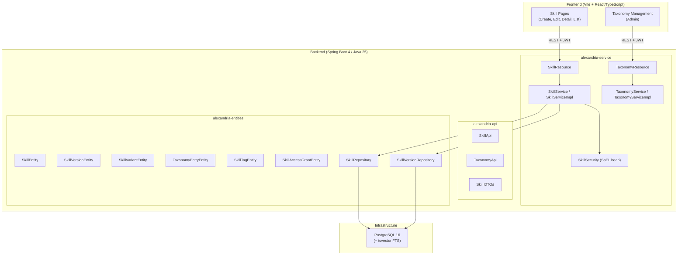
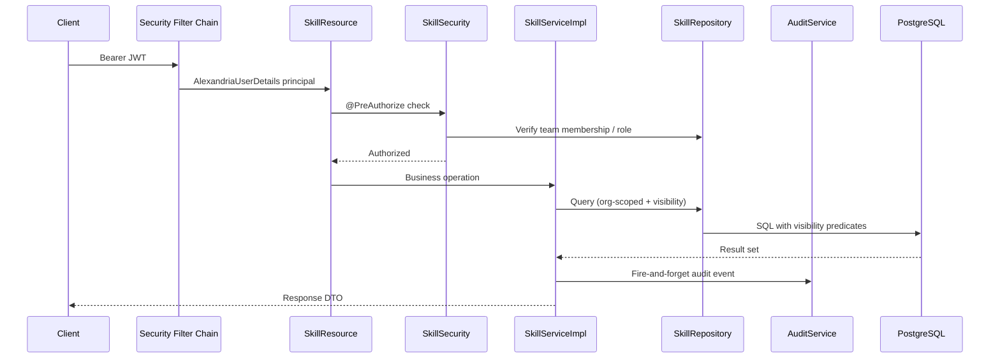
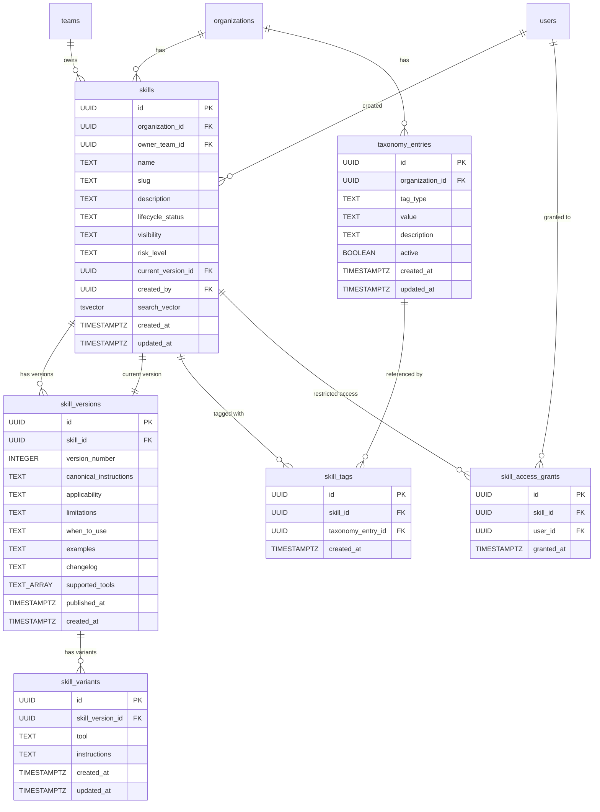

# Design Document: Skill CRUD

## Overview

This design covers Milestone 2a of the Alexandria platform — the core Skill CRUD subsystem. It introduces the ability to create, retrieve, edit, version, publish, delete, and manage skills with tool-specific variants, a controlled tag taxonomy, visibility enforcement at the query layer, and full-text search over skill content and tags.

The design builds on the existing foundation (OIDC auth, RBAC, teams, audit logging) and follows the same layered modular monolith architecture: Spring Boot 4 backend with strict module separation (`alexandria-api`, `alexandria-entities`, `alexandria-service`), PostgreSQL 16 database evolved via Flyway migrations, and a React/TypeScript frontend.

Key architectural decisions:
- **Immutable versioning**: Published skill content is never mutated; edits to published skills create new versions
- **Query-layer visibility enforcement**: Visibility predicates are applied at the repository/SQL level so unauthorized skills are never loaded into memory
- **PostgreSQL tsvector full-text search**: Skill name, description, canonical instructions, and tags are indexed with `tsvector` for fast, relevant search without external search infrastructure
- **Controlled taxonomy**: Tag values are managed centrally by Catalog_Admins; skills reference taxonomy entries by FK, ensuring consistency

## Architecture

### High-Level Integration Diagram



### Request Flow for Skill Operations



## Components and Interfaces

### Backend Components

#### alexandria-api Module (New Packages)

| Package | Component | Responsibility |
|---------|-----------|----------------|
| `com.alexandria.skill` | `SkillApi` | Skill CRUD endpoints interface |
| `com.alexandria.skill.dto` | `CreateSkillRequest` | Skill creation DTO |
| `com.alexandria.skill.dto` | `UpdateSkillRequest` | Skill edit DTO (partial) |
| `com.alexandria.skill.dto` | `SkillResponse` | Full skill detail response |
| `com.alexandria.skill.dto` | `SkillSummaryResponse` | Skill list item response |
| `com.alexandria.skill.dto` | `SkillVersionResponse` | Version detail response |
| `com.alexandria.skill.dto` | `PublishValidationResponse` | Publish failure details |
| `com.alexandria.skill.dto` | `ChangeVisibilityRequest` | Visibility update DTO |
| `com.alexandria.skill.variant` | `SkillVariantApi` | Variant CRUD endpoints interface |
| `com.alexandria.skill.variant.dto` | `CreateVariantRequest` | Variant creation DTO |
| `com.alexandria.skill.variant.dto` | `VariantResponse` | Variant detail response |
| `com.alexandria.taxonomy` | `TaxonomyApi` | Taxonomy management endpoints |
| `com.alexandria.taxonomy.dto` | `CreateTaxonomyEntryRequest` | New taxonomy entry DTO |
| `com.alexandria.taxonomy.dto` | `TaxonomyEntryResponse` | Taxonomy entry response |
| `com.alexandria.taxonomy.dto` | `TaxonomyGroupResponse` | Grouped taxonomy response |

#### alexandria-entities Module (New Packages)

| Package | Component | Responsibility |
|---------|-----------|----------------|
| `com.alexandria.skill.entity` | `SkillEntity` | JPA entity for `skills` table |
| `com.alexandria.skill.entity` | `SkillVersionEntity` | JPA entity for `skill_versions` table |
| `com.alexandria.skill.entity` | `SkillVariantEntity` | JPA entity for `skill_variants` table |
| `com.alexandria.skill.entity` | `SkillTagEntity` | JPA entity for `skill_tags` join table |
| `com.alexandria.skill.entity` | `SkillAccessGrantEntity` | JPA entity for `skill_access_grants` table |
| `com.alexandria.skill` | `SkillRepository` | Spring Data JPA repository with visibility queries |
| `com.alexandria.skill` | `SkillVersionRepository` | Version persistence |
| `com.alexandria.skill` | `SkillVariantRepository` | Variant persistence |
| `com.alexandria.skill` | `SkillTagRepository` | Tag associations |
| `com.alexandria.skill` | `SkillAccessGrantRepository` | Restricted-visibility access grants |
| `com.alexandria.taxonomy.entity` | `TaxonomyEntryEntity` | JPA entity for `taxonomy_entries` table |
| `com.alexandria.taxonomy` | `TaxonomyEntryRepository` | Taxonomy persistence |

#### alexandria-service Module (New Packages)

| Package | Component | Responsibility |
|---------|-----------|----------------|
| `com.alexandria.skill` | `SkillResource` | REST controller implementing `SkillApi` |
| `com.alexandria.skill` | `SkillService` | Business logic interface |
| `com.alexandria.skill` | `SkillServiceImpl` | Skill lifecycle implementation |
| `com.alexandria.skill` | `SkillSlugGenerator` | Slug generation with collision resolution |
| `com.alexandria.skill.variant` | `SkillVariantResource` | REST controller implementing `SkillVariantApi` |
| `com.alexandria.skill.variant` | `SkillVariantService` | Variant business logic interface |
| `com.alexandria.skill.variant` | `SkillVariantServiceImpl` | Variant CRUD implementation |
| `com.alexandria.taxonomy` | `TaxonomyResource` | REST controller implementing `TaxonomyApi` |
| `com.alexandria.taxonomy` | `TaxonomyService` | Taxonomy business logic interface |
| `com.alexandria.taxonomy` | `TaxonomyServiceImpl` | Taxonomy CRUD implementation |
| `com.alexandria.config` | `SkillSecurity` | SpEL bean for skill-scoped authorization |

### REST API Contracts

#### Skill Endpoints

| Method | Path | Auth Required | Request | Response |
|--------|------|---------------|---------|----------|
| POST | `/api/skills` | Skill_Author+ | `CreateSkillRequest` | `SkillResponse` (201) |
| GET | `/api/skills` | Any authenticated | `?page&size&status&visibility&teamId&search&slug` | `PageResponse<SkillSummaryResponse>` |
| GET | `/api/skills/{skillId}` | Any authenticated | — | `SkillResponse` |
| PUT | `/api/skills/{skillId}` | Team member / Admin | `UpdateSkillRequest` | `SkillResponse` |
| DELETE | `/api/skills/{skillId}` | Team member / Admin | — | 204 |
| POST | `/api/skills/{skillId}/publish` | Team member / Admin | — | `SkillResponse` |
| PATCH | `/api/skills/{skillId}/visibility` | Team member / Admin | `ChangeVisibilityRequest` | `SkillResponse` |
| GET | `/api/skills/{skillId}/versions` | Any authenticated | `?page&size` | `PageResponse<SkillVersionResponse>` |
| GET | `/api/skills/{skillId}/versions/{versionNumber}` | Any authenticated | — | `SkillVersionResponse` |

#### Variant Endpoints

| Method | Path | Auth Required | Request | Response |
|--------|------|---------------|---------|----------|
| POST | `/api/skills/{skillId}/versions/{versionNumber}/variants` | Team member / Admin | `CreateVariantRequest` | `VariantResponse` (201) |
| PUT | `/api/skills/{skillId}/versions/{versionNumber}/variants/{tool}` | Team member / Admin | `CreateVariantRequest` | `VariantResponse` |
| DELETE | `/api/skills/{skillId}/versions/{versionNumber}/variants/{tool}` | Team member / Admin | — | 204 |

#### Taxonomy Endpoints

| Method | Path | Auth Required | Request | Response |
|--------|------|---------------|---------|----------|
| GET | `/api/taxonomy` | Any authenticated | — | `List<TaxonomyGroupResponse>` |
| GET | `/api/taxonomy/{tagType}` | Any authenticated | — | `List<TaxonomyEntryResponse>` |
| POST | `/api/taxonomy/{tagType}` | Catalog_Admin+ | `CreateTaxonomyEntryRequest` | `TaxonomyEntryResponse` (201) |
| PUT | `/api/taxonomy/{tagType}/{tagId}` | Catalog_Admin+ | `CreateTaxonomyEntryRequest` | `TaxonomyEntryResponse` |
| PATCH | `/api/taxonomy/{tagType}/{tagId}/deactivate` | Catalog_Admin+ | — | `TaxonomyEntryResponse` |

### DTO Definitions

```java
// --- Skill DTOs ---
public record CreateSkillRequest(
    @NotBlank @Size(min = 3, max = 200) String name,
    @NotBlank @Size(min = 1, max = 2000) String description,
    @NotNull UUID ownerTeamId,
    @NotBlank @Size(min = 1, max = 100000) String canonicalInstructions
) {}

public record UpdateSkillRequest(
    @Size(min = 3, max = 200) String name,
    @Size(min = 1, max = 2000) String description,
    @Size(min = 1, max = 100000) String canonicalInstructions,
    String applicability,
    String limitations,
    String whenToUse,
    String examples,
    @Size(min = 1, max = 2000) String changelog,
    List<UUID> tagIds,
    List<String> supportedTools,
    String riskLevel
) {}

public record SkillResponse(
    UUID id,
    String name,
    String slug,
    String description,
    UUID ownerTeamId,
    String ownerTeamName,
    String lifecycleStatus,
    String visibility,
    String riskLevel,
    int currentVersionNumber,
    String canonicalInstructions,
    String applicability,
    String limitations,
    String whenToUse,
    String examples,
    String changelog,
    List<TagResponse> tags,
    List<String> supportedTools,
    List<VariantResponse> variants,
    UUID createdBy,
    Instant createdAt,
    Instant updatedAt,
    Instant publishedAt
) {}

public record SkillSummaryResponse(
    UUID id,
    String name,
    String slug,
    String description,
    String ownerTeamName,
    String lifecycleStatus,
    String visibility,
    String riskLevel,
    int currentVersionNumber,
    List<TagResponse> tags,
    Instant updatedAt
) {}

public record SkillVersionResponse(
    UUID id,
    int versionNumber,
    String canonicalInstructions,
    String applicability,
    String limitations,
    String whenToUse,
    String examples,
    String changelog,
    List<VariantResponse> variants,
    Instant createdAt,
    Instant publishedAt
) {}

public record ChangeVisibilityRequest(
    @NotBlank @Pattern(regexp = "private|team|organization|restricted") String visibility
) {}

public record TagResponse(UUID id, String type, String value) {}

// --- Variant DTOs ---
public record CreateVariantRequest(
    @NotBlank @Pattern(regexp = "generic|github_copilot|codex|cursor|aws_kiro|sourcegraph_cody|claude_code|jetbrains_ai|internal_agent")
    String tool,
    @NotBlank @Size(min = 1, max = 100000) String instructions
) {}

public record VariantResponse(
    UUID id,
    String tool,
    String instructions,
    Instant createdAt,
    Instant updatedAt
) {}

// --- Taxonomy DTOs ---
public record CreateTaxonomyEntryRequest(
    @NotBlank @Size(min = 1, max = 100) String value,
    @Size(max = 500) String description
) {}

public record TaxonomyEntryResponse(
    UUID id,
    String tagType,
    String value,
    String description,
    boolean active,
    Instant createdAt
) {}

public record TaxonomyGroupResponse(
    String tagType,
    List<TaxonomyEntryResponse> entries
) {}

public record PublishValidationResponse(
    String error,
    String message,
    List<String> missingFields,
    Instant timestamp
) {}
```

## Data Models

### V4 Migration: Skills, Versions, Variants, Taxonomy

```sql
-- V4__skills_schema.sql

-- Taxonomy entries (controlled vocabulary)
CREATE TABLE taxonomy_entries (
    id                UUID PRIMARY KEY DEFAULT gen_random_uuid(),
    organization_id   UUID NOT NULL REFERENCES organizations(id) ON DELETE RESTRICT,
    tag_type          TEXT NOT NULL CHECK (tag_type IN ('task_type', 'tool', 'language', 'framework')),
    value             TEXT NOT NULL,
    description       TEXT,
    active            BOOLEAN NOT NULL DEFAULT TRUE,
    created_at        TIMESTAMPTZ NOT NULL DEFAULT NOW(),
    updated_at        TIMESTAMPTZ NOT NULL DEFAULT NOW()
);

CREATE UNIQUE INDEX uq_taxonomy_org_type_value ON taxonomy_entries(organization_id, tag_type, LOWER(value));
CREATE INDEX idx_taxonomy_org_type ON taxonomy_entries(organization_id, tag_type);

-- Skills (core entity)
CREATE TABLE skills (
    id                  UUID PRIMARY KEY DEFAULT gen_random_uuid(),
    organization_id     UUID NOT NULL REFERENCES organizations(id) ON DELETE RESTRICT,
    owner_team_id       UUID NOT NULL REFERENCES teams(id) ON DELETE RESTRICT,
    name                TEXT NOT NULL,
    slug                TEXT NOT NULL,
    description         TEXT NOT NULL,
    lifecycle_status    TEXT NOT NULL DEFAULT 'Draft'
                        CHECK (lifecycle_status IN ('Draft', 'Published', 'Team_Approved',
                               'Company_Approved', 'Deprecated', 'Archived', 'Blocked')),
    visibility          TEXT NOT NULL DEFAULT 'private'
                        CHECK (visibility IN ('private', 'team', 'organization', 'restricted')),
    risk_level          TEXT CHECK (risk_level IN ('low', 'medium', 'high', 'restricted')),
    current_version_id  UUID,  -- FK added after skill_versions table
    created_by          UUID NOT NULL REFERENCES users(id) ON DELETE RESTRICT,
    created_at          TIMESTAMPTZ NOT NULL DEFAULT NOW(),
    updated_at          TIMESTAMPTZ NOT NULL DEFAULT NOW()
);

CREATE UNIQUE INDEX uq_skills_org_slug ON skills(organization_id, slug);
CREATE INDEX idx_skills_org_id ON skills(organization_id);
CREATE INDEX idx_skills_owner_team ON skills(owner_team_id);
CREATE INDEX idx_skills_lifecycle ON skills(organization_id, lifecycle_status);
CREATE INDEX idx_skills_visibility ON skills(organization_id, visibility);
CREATE INDEX idx_skills_created_by ON skills(created_by);

-- Skill versions (immutable content snapshots)
CREATE TABLE skill_versions (
    id                    UUID PRIMARY KEY DEFAULT gen_random_uuid(),
    skill_id              UUID NOT NULL REFERENCES skills(id) ON DELETE CASCADE,
    version_number        INTEGER NOT NULL,
    canonical_instructions TEXT NOT NULL,
    applicability         TEXT,
    limitations           TEXT,
    when_to_use           TEXT,
    examples              TEXT,
    changelog             TEXT,
    supported_tools       TEXT[] NOT NULL DEFAULT '{}',
    published_at          TIMESTAMPTZ,
    created_at            TIMESTAMPTZ NOT NULL DEFAULT NOW()
);

CREATE UNIQUE INDEX uq_skill_versions_skill_number ON skill_versions(skill_id, version_number);
CREATE INDEX idx_skill_versions_skill ON skill_versions(skill_id);

-- Add FK from skills.current_version_id to skill_versions
ALTER TABLE skills
    ADD CONSTRAINT fk_skills_current_version FOREIGN KEY (current_version_id)
    REFERENCES skill_versions(id) ON DELETE SET NULL;

-- Skill variants (tool-specific instructions per version)
CREATE TABLE skill_variants (
    id                UUID PRIMARY KEY DEFAULT gen_random_uuid(),
    skill_version_id  UUID NOT NULL REFERENCES skill_versions(id) ON DELETE CASCADE,
    tool              TEXT NOT NULL CHECK (tool IN ('generic', 'github_copilot', 'codex', 'cursor',
                      'aws_kiro', 'sourcegraph_cody', 'claude_code', 'jetbrains_ai', 'internal_agent')),
    instructions      TEXT NOT NULL,
    created_at        TIMESTAMPTZ NOT NULL DEFAULT NOW(),
    updated_at        TIMESTAMPTZ NOT NULL DEFAULT NOW()
);

CREATE UNIQUE INDEX uq_skill_variants_version_tool ON skill_variants(skill_version_id, tool);
CREATE INDEX idx_skill_variants_version ON skill_variants(skill_version_id);

-- Skill tags (join table between skills and taxonomy_entries)
CREATE TABLE skill_tags (
    id                UUID PRIMARY KEY DEFAULT gen_random_uuid(),
    skill_id          UUID NOT NULL REFERENCES skills(id) ON DELETE CASCADE,
    taxonomy_entry_id UUID NOT NULL REFERENCES taxonomy_entries(id) ON DELETE RESTRICT,
    created_at        TIMESTAMPTZ NOT NULL DEFAULT NOW()
);

CREATE UNIQUE INDEX uq_skill_tags_skill_entry ON skill_tags(skill_id, taxonomy_entry_id);
CREATE INDEX idx_skill_tags_skill ON skill_tags(skill_id);
CREATE INDEX idx_skill_tags_entry ON skill_tags(taxonomy_entry_id);

-- Skill access grants (for "restricted" visibility)
CREATE TABLE skill_access_grants (
    id                UUID PRIMARY KEY DEFAULT gen_random_uuid(),
    skill_id          UUID NOT NULL REFERENCES skills(id) ON DELETE CASCADE,
    user_id           UUID NOT NULL REFERENCES users(id) ON DELETE CASCADE,
    granted_at        TIMESTAMPTZ NOT NULL DEFAULT NOW()
);

CREATE UNIQUE INDEX uq_skill_access_grants_skill_user ON skill_access_grants(skill_id, user_id);
CREATE INDEX idx_skill_access_grants_skill ON skill_access_grants(skill_id);
CREATE INDEX idx_skill_access_grants_user ON skill_access_grants(user_id);

-- Full-text search index (tsvector column on skills)
ALTER TABLE skills ADD COLUMN search_vector tsvector;

-- Trigger function to update search_vector
CREATE OR REPLACE FUNCTION skills_search_vector_update() RETURNS trigger AS $$
BEGIN
    NEW.search_vector :=
        setweight(to_tsvector('english', COALESCE(NEW.name, '')), 'A') ||
        setweight(to_tsvector('english', COALESCE(NEW.description, '')), 'B');
    RETURN NEW;
END;
$$ LANGUAGE plpgsql;

CREATE TRIGGER trg_skills_search_vector
    BEFORE INSERT OR UPDATE OF name, description ON skills
    FOR EACH ROW EXECUTE FUNCTION skills_search_vector_update();

-- GIN index for full-text search
CREATE INDEX idx_skills_search_vector ON skills USING GIN(search_vector);

-- Function to rebuild search vector including tags (called by application after tag changes)
-- The application will also include canonical_instructions content in search via a separate
-- materialized search approach (query-time ts_rank with skill_versions content)
```

### Entity Relationship Diagram



### JPA Entities

**SkillEntity** extends `BaseEntity`:
- `ownerTeamId` (UUID, not null — FK to teams)
- `name` (String, not null)
- `slug` (String, not null)
- `description` (String, not null)
- `lifecycleStatus` (String, not null — default "Draft")
- `visibility` (String, not null — default "private")
- `riskLevel` (String, nullable)
- `currentVersionId` (UUID, nullable — FK to skill_versions)
- `createdBy` (UUID, not null — FK to users)
- `searchVector` (String, insertable=false, updatable=false — managed by DB trigger)

**SkillVersionEntity**:
- `id` (UUID, PK)
- `skillId` (UUID, not null — FK to skills)
- `versionNumber` (int, not null)
- `canonicalInstructions` (String, not null)
- `applicability` (String, nullable)
- `limitations` (String, nullable)
- `whenToUse` (String, nullable)
- `examples` (String, nullable)
- `changelog` (String, nullable)
- `supportedTools` (List<String>, mapped as TEXT[] via `@JdbcTypeCode`)
- `publishedAt` (Instant, nullable)
- `createdAt` (Instant, not null)

**SkillVariantEntity**:
- `id` (UUID, PK)
- `skillVersionId` (UUID, not null — FK to skill_versions)
- `tool` (String, not null)
- `instructions` (String, not null)
- `createdAt` (Instant, not null)
- `updatedAt` (Instant, not null)

**SkillTagEntity**:
- `id` (UUID, PK)
- `skillId` (UUID, not null — FK to skills)
- `taxonomyEntryId` (UUID, not null — FK to taxonomy_entries)
- `createdAt` (Instant, not null)

**SkillAccessGrantEntity**:
- `id` (UUID, PK)
- `skillId` (UUID, not null — FK to skills)
- `userId` (UUID, not null — FK to users)
- `grantedAt` (Instant, not null)

**TaxonomyEntryEntity** extends `BaseEntity`:
- `tagType` (String, not null — one of: task_type, tool, language, framework)
- `value` (String, not null)
- `description` (String, nullable)
- `active` (boolean, default true)

### Repository Interfaces

```java
@Repository
public interface SkillRepository extends JpaRepository<SkillEntity, UUID> {

    Optional<SkillEntity> findByIdAndOrganizationId(UUID id, UUID organizationId);

    Optional<SkillEntity> findByOrganizationIdAndSlug(UUID organizationId, String slug);

    boolean existsByOrganizationIdAndSlug(UUID organizationId, String slug);

    /**
     * Paginated skill list with visibility enforcement.
     * Uses a native query with visibility predicates.
     */
    @Query(value = """
        SELECT s.* FROM skills s
        WHERE s.organization_id = :orgId
          AND (
            s.visibility = 'organization'
            OR (s.visibility = 'team' AND s.owner_team_id IN (
                SELECT tm.team_id FROM team_members tm WHERE tm.user_id = :userId))
            OR (s.visibility = 'private' AND s.created_by = :userId)
            OR (s.visibility = 'restricted' AND (
                s.created_by = :userId
                OR EXISTS (SELECT 1 FROM skill_access_grants sag
                           WHERE sag.skill_id = s.id AND sag.user_id = :userId)))
            OR :isOrgAdmin = true
          )
          AND (:status IS NULL OR s.lifecycle_status = :status)
          AND (:teamId IS NULL OR s.owner_team_id = :teamId)
          AND (:searchQuery IS NULL OR s.search_vector @@ plainto_tsquery('english', :searchQuery))
        ORDER BY s.updated_at DESC
        """, nativeQuery = true)
    Page<SkillEntity> findVisibleSkills(
        @Param("orgId") UUID orgId,
        @Param("userId") UUID userId,
        @Param("isOrgAdmin") boolean isOrgAdmin,
        @Param("status") String status,
        @Param("teamId") UUID teamId,
        @Param("searchQuery") String searchQuery,
        Pageable pageable
    );
}

@Repository
public interface SkillVersionRepository extends JpaRepository<SkillVersionEntity, UUID> {

    Page<SkillVersionEntity> findBySkillIdOrderByVersionNumberDesc(UUID skillId, Pageable pageable);

    Optional<SkillVersionEntity> findBySkillIdAndVersionNumber(UUID skillId, int versionNumber);

    int countBySkillId(UUID skillId);
}

@Repository
public interface SkillVariantRepository extends JpaRepository<SkillVariantEntity, UUID> {

    List<SkillVariantEntity> findBySkillVersionId(UUID skillVersionId);

    Optional<SkillVariantEntity> findBySkillVersionIdAndTool(UUID skillVersionId, String tool);

    boolean existsBySkillVersionIdAndTool(UUID skillVersionId, String tool);
}

@Repository
public interface TaxonomyEntryRepository extends JpaRepository<TaxonomyEntryEntity, UUID> {

    List<TaxonomyEntryEntity> findByOrganizationIdOrderByTagTypeAscValueAsc(UUID organizationId);

    List<TaxonomyEntryEntity> findByOrganizationIdAndTagTypeOrderByValueAsc(UUID organizationId, String tagType);

    boolean existsByOrganizationIdAndTagTypeAndValueIgnoreCase(UUID organizationId, String tagType, String value);

    List<TaxonomyEntryEntity> findByOrganizationIdAndIdIn(UUID organizationId, List<UUID> ids);
}

@Repository
public interface SkillTagRepository extends JpaRepository<SkillTagEntity, UUID> {

    List<SkillTagEntity> findBySkillId(UUID skillId);

    void deleteBySkillId(UUID skillId);

    boolean existsByTaxonomyEntryId(UUID taxonomyEntryId);
}

@Repository
public interface SkillAccessGrantRepository extends JpaRepository<SkillAccessGrantEntity, UUID> {

    boolean existsBySkillIdAndUserId(UUID skillId, UUID userId);

    void deleteBySkillId(UUID skillId);
}
```

### Visibility Enforcement Strategy

Visibility is enforced at the **query layer** — the `SkillRepository.findVisibleSkills()` native query includes predicates that filter out skills the requesting user cannot see. This ensures:

1. **No information leakage**: Unauthorized skills are never loaded from the database
2. **Performance**: The database does the filtering, not application code
3. **Consistency**: A single query path for all list/search operations

The visibility logic:
- `organization`: All users in the same org can see it
- `team`: Only members of the owning team can see it
- `private`: Only the creator can see it
- `restricted`: Only explicitly granted users (via `skill_access_grants`) and the creator can see it
- `Org_Admin` override: Org admins can always see everything

For single-skill retrieval (`GET /api/skills/{skillId}`), the service layer performs the same visibility check after loading the skill, returning 404 if the user lacks access (preventing enumeration attacks).

### Full-Text Search Strategy

The full-text search uses PostgreSQL's built-in `tsvector`/`tsquery`:

1. **Trigger-maintained index**: A DB trigger updates `skills.search_vector` on INSERT/UPDATE of `name` or `description` fields
2. **Weighted ranking**: Name gets weight 'A' (highest), description gets weight 'B'
3. **Tag inclusion**: When tags are assigned/removed, the application updates the search vector to include tag values (weight 'C')
4. **Content search**: For searching canonical instructions, the query joins with `skill_versions` at query time using `ts_rank` for relevance scoring
5. **GIN index**: Enables fast full-text lookups without sequential scans

### SkillSecurity Bean

```java
@Component("skillSecurity")
@RequiredArgsConstructor
public class SkillSecurity {

    private final SkillRepository skillRepository;
    private final TeamMemberRepository teamMemberRepository;

    /**
     * Returns true if the user can edit the skill (team member, Catalog_Admin, or Org_Admin).
     */
    public boolean canEdit(UUID skillId, Authentication authentication) {
        AlexandriaUserDetails user = extractUserDetails(authentication);
        if (user == null) return false;
        if (user.role().isAdmin()) return true;

        return skillRepository.findByIdAndOrganizationId(skillId, user.organizationId())
            .map(skill -> teamMemberRepository
                .findByTeamIdAndUserId(skill.getOwnerTeamId(), user.userId())
                .isPresent())
            .orElse(false);
    }

    /**
     * Returns true if the user can view the skill based on visibility rules.
     */
    public boolean canView(UUID skillId, Authentication authentication) {
        AlexandriaUserDetails user = extractUserDetails(authentication);
        if (user == null) return false;
        if (user.role() == Role.Org_Admin) return true;

        return skillRepository.findByIdAndOrganizationId(skillId, user.organizationId())
            .map(skill -> isVisibleTo(skill, user))
            .orElse(false);
    }
}
```

### Slug Generation

The `SkillSlugGenerator` follows the same pattern as team slug generation but adds collision resolution with numeric suffixes:

```java
public class SkillSlugGenerator {

    public static String generateSlug(String name) {
        String slug = name.toLowerCase();
        slug = slug.replace(' ', '-').replace('_', '-');
        slug = slug.replaceAll("[^a-z0-9\\-]", "");
        slug = slug.replaceAll("-{2,}", "-");
        slug = slug.replaceAll("^-+|-+$", "");
        return slug;
    }

    public String generateUniqueSlug(String name, UUID orgId, SkillRepository repository) {
        String base = generateSlug(name);
        if (!repository.existsByOrganizationIdAndSlug(orgId, base)) {
            return base;
        }
        int suffix = 2;
        while (repository.existsByOrganizationIdAndSlug(orgId, base + "-" + suffix)) {
            suffix++;
        }
        return base + "-" + suffix;
    }
}
```


## Correctness Properties

*A property is a characteristic or behavior that should hold true across all valid executions of a system — essentially, a formal statement about what the system should do. Properties serve as the bridge between human-readable specifications and machine-verifiable correctness guarantees.*

### Property 1: Slug generation produces well-formed, unique identifiers

*For any* valid skill name (3–200 characters), the generated slug SHALL be non-empty, lowercase, contain only characters in `[a-z0-9-]`, have no consecutive hyphens, and not start or end with a hyphen. Furthermore, *for any* organization with existing slugs, the slug generator SHALL produce a slug that does not collide with any existing slug in that organization (appending a numeric suffix if needed).

**Validates: Requirements 1.2, 1.3**

### Property 2: Skill creation invariants

*For any* valid skill creation request, the resulting skill SHALL have `lifecycle_status = "Draft"`, `visibility = "private"`, `organization_id` matching the authenticated user's organization, a `current_version_id` pointing to a version with `version_number = 1` and `changelog = "Initial draft"`, and `created_by` matching the authenticated user's ID.

**Validates: Requirements 1.1, 1.7, 1.9, 1.10**

### Property 3: Edit authority enforcement

*For any* skill and any authenticated user, the user SHALL be granted edit access if and only if the user is a member of the skill's owning team OR the user has Catalog_Admin role OR the user has Org_Admin role. All other users SHALL receive HTTP 403 for edit, publish, visibility change, variant management, and delete operations.

**Validates: Requirements 1.5, 3.5, 4.6, 5.8, 6.9, 8.3**

### Property 4: Input validation rejects invalid payloads

*For any* skill creation or update request where any field violates its length constraints (name < 3 or > 200, description < 1 or > 2000, canonical instructions < 1 or > 100000) or where required fields are missing, the system SHALL return HTTP 400 with field-level error messages identifying each invalid field. The skill state SHALL remain unchanged.

**Validates: Requirements 1.8, 3.10**

### Property 5: Visibility enforcement

*For any* skill and any authenticated user, the user SHALL be able to view the skill if and only if: (a) the skill's visibility is "organization" and the user is in the same org, OR (b) the skill's visibility is "team" and the user is a member of the owning team, OR (c) the skill's visibility is "private" and the user is the creator, OR (d) the skill's visibility is "restricted" and the user is in the access grant list or is the creator, OR (e) the user has Org_Admin role. In all other cases, the system SHALL return HTTP 404 with no skill metadata leaked in the response.

**Validates: Requirements 2.4, 5.1, 5.2, 5.3, 5.4, 5.9**

### Property 6: Versioning behavior based on lifecycle state

*For any* skill in Draft status, an edit request SHALL update the current version in-place without incrementing the version number. *For any* skill in Published, Team_Approved, or Company_Approved status, an edit request SHALL create a new version with `version_number` incremented by 1, revert the skill's `lifecycle_status` to Draft, and require a non-empty changelog (1–2000 chars). The previous version SHALL remain immutable.

**Validates: Requirements 3.1, 3.2, 3.3, 3.4**

### Property 7: Partial update preserves omitted fields

*For any* skill update request containing a subset of updatable fields, all fields NOT included in the request SHALL retain their current values after the update. Only explicitly provided fields SHALL be modified.

**Validates: Requirements 3.9**

### Property 8: Lifecycle state machine constraints

*For any* skill, publish SHALL only succeed when `lifecycle_status = "Draft"` (returning 409 otherwise). Delete SHALL only succeed when `lifecycle_status = "Draft"` (returning 409 otherwise). Edit SHALL be rejected with 409 when `lifecycle_status` is Deprecated, Archived, or Blocked.

**Validates: Requirements 3.6, 4.4, 8.2**

### Property 9: Publish validation completeness

*For any* Draft skill missing one or more required metadata fields (at least one task_type tag, visibility set, at least one supported tool, risk_level set, applicability non-empty, at least one example), a publish request SHALL return HTTP 422 with a response body listing exactly the set of missing fields — no false positives and no false negatives.

**Validates: Requirements 4.1, 4.2**

### Property 10: Variant resolution with fallback

*For any* skill version and any tool identifier, if a variant exists for that tool on that version, the system SHALL return the variant's tool-specific instructions. If no variant exists for the requested tool, the system SHALL return the skill version's canonical instructions. The resolution SHALL never return empty content for a valid version.

**Validates: Requirements 6.5, 6.6**

### Property 11: Unique variant per tool per version

*For any* skill version, at most one variant SHALL exist for each tool identifier. Attempting to create a second variant for the same tool on the same version SHALL return HTTP 409 Conflict.

**Validates: Requirements 6.4**

### Property 12: Tag validation against active taxonomy

*For any* set of tag IDs assigned to a skill, ALL tag IDs must reference taxonomy entries that (a) exist, (b) belong to the same organization, and (c) have `active = true`. If any tag ID fails these checks, the entire tag assignment SHALL be rejected with HTTP 422, and the skill's tags SHALL remain unchanged.

**Validates: Requirements 7.2**

### Property 13: Taxonomy value uniqueness within type

*For any* tag type within an organization, taxonomy entry values SHALL be unique when compared case-insensitively. Attempting to create a taxonomy entry with a value that matches an existing entry (ignoring case) in the same tag type SHALL return HTTP 409 Conflict.

**Validates: Requirements 7.10**

### Property 14: Taxonomy deactivation preserves existing references

*For any* taxonomy entry that is deactivated, all existing skill-tag associations referencing that entry SHALL remain intact. However, any subsequent attempt to assign the deactivated entry to a new skill SHALL be rejected with HTTP 422.

**Validates: Requirements 7.5, 7.12**

### Property 15: Skill retrieval round-trip

*For any* skill created with valid inputs, retrieving that skill by ID SHALL return a response where every field (name, slug, description, lifecycle_status, visibility, owner_team_id, created_by, version content) exactly matches the stored state. No data corruption or field transposition SHALL occur during serialization/deserialization.

**Validates: Requirements 2.1**

### Property 16: Version list ordering

*For any* skill with multiple versions, retrieving the version list SHALL return versions in strictly descending order by version_number, with no gaps in the sequence.

**Validates: Requirements 2.6**

## Error Handling

### Error Response Strategy

All errors follow the existing `ErrorResponse` pattern established in the first-step design:

```java
public record ErrorResponse(String error, String message, Instant timestamp) {}
```

For publish validation failures, an extended response is used:

```java
public record PublishValidationResponse(
    String error,
    String message,
    List<String> missingFields,
    Instant timestamp
) {}
```

### Error Mapping Table

| Scenario | HTTP Status | Error Code | Message |
|----------|-------------|------------|---------|
| Invalid/missing request fields | 400 | VALIDATION_ERROR | Field-level details |
| Invalid visibility value | 400 | VALIDATION_ERROR | "Invalid visibility: {value}" |
| Invalid tool identifier | 400 | VALIDATION_ERROR | "Invalid tool. Valid: generic, github_copilot, ..." |
| Insufficient role/not team member | 403 | FORBIDDEN | "Access denied: insufficient permissions" |
| Skill not found or not visible | 404 | NOT_FOUND | "Skill not found" |
| Team not found in organization | 404 | NOT_FOUND | "Team not found" |
| Version not found | 404 | NOT_FOUND | "Version not found" |
| Variant not found | 404 | NOT_FOUND | "Variant not found" |
| Slug collision (should not happen due to suffix logic) | 409 | CONFLICT | "Skill name conflict" |
| Duplicate variant for tool on version | 409 | CONFLICT | "Variant already exists for tool: {tool}" |
| Duplicate taxonomy value | 409 | CONFLICT | "Taxonomy entry already exists: {value}" |
| Edit rejected for terminal lifecycle | 409 | CONFLICT | "Skill cannot be edited in {status} state" |
| Delete rejected for non-Draft | 409 | CONFLICT | "Only Draft skills can be deleted" |
| Publish rejected for non-Draft | 409 | CONFLICT | "Only Draft skills can be published" |
| Publish validation failed | 422 | UNPROCESSABLE_ENTITY | "Missing required metadata for publishing" |
| Invalid tag IDs | 422 | UNPROCESSABLE_ENTITY | "Invalid tags: {details}" |
| Unhandled exception | 500 | INTERNAL_ERROR | "An unexpected error occurred" |

### Audit Service Resilience

Following the established fire-and-forget pattern:
- All skill/variant/taxonomy audit recording uses `try/catch` with ERROR-level logging on failure
- Business operations always complete regardless of audit failures
- As specified in Requirements 6.11 and 8.4: "IF the Audit_Service fails to record the event, THE Skill_Service SHALL allow the operation to complete successfully and log the audit failure at ERROR level"

### Global Exception Handler

A `@RestControllerAdvice` class handles exception-to-response mapping:

```java
@RestControllerAdvice
public class SkillExceptionHandler {

    @ExceptionHandler(SkillNotFoundException.class)
    ResponseEntity<ErrorResponse> handleNotFound(SkillNotFoundException ex) {
        return ResponseEntity.status(404)
            .body(ErrorResponse.of("NOT_FOUND", ex.getMessage()));
    }

    @ExceptionHandler(SkillConflictException.class)
    ResponseEntity<ErrorResponse> handleConflict(SkillConflictException ex) {
        return ResponseEntity.status(409)
            .body(ErrorResponse.of("CONFLICT", ex.getMessage()));
    }

    @ExceptionHandler(PublishValidationException.class)
    ResponseEntity<PublishValidationResponse> handlePublishValidation(PublishValidationException ex) {
        return ResponseEntity.status(422)
            .body(new PublishValidationResponse("UNPROCESSABLE_ENTITY",
                "Missing required metadata for publishing",
                ex.getMissingFields(), Instant.now()));
    }

    @ExceptionHandler(MethodArgumentNotValidException.class)
    ResponseEntity<ErrorResponse> handleValidation(MethodArgumentNotValidException ex) {
        String details = ex.getBindingResult().getFieldErrors().stream()
            .map(e -> e.getField() + ": " + e.getDefaultMessage())
            .collect(Collectors.joining(", "));
        return ResponseEntity.status(400)
            .body(ErrorResponse.of("VALIDATION_ERROR", details));
    }
}
```

## Testing Strategy

### Backend Testing

#### Unit Tests (JUnit 5 + Mockito)

- **SkillSlugGenerator**: Pure function — test transformation rules, collision resolution
- **SkillServiceImpl**: Mock repositories, verify creation defaults, versioning logic, lifecycle transitions, partial updates
- **SkillVariantServiceImpl**: Mock repositories, verify variant resolution/fallback logic
- **TaxonomyServiceImpl**: Mock repositories, verify uniqueness checks, deactivation behavior
- **SkillSecurity bean**: Mock repositories, verify access decisions for all (role, membership, visibility) combinations
- **Publish validation logic**: Verify exact missing-field detection for various incomplete skills

#### Integration Tests (Testcontainers + Spring Boot Test)

- **V4 migration**: Verify schema applies cleanly, constraints work (unique indexes, check constraints, FKs)
- **Repository tests**: CRUD operations with visibility queries, full-text search with GIN index
- **Full endpoint tests**: HTTP round-trips with `MockMvc` + JWT mocking covering all 8 requirements
- **Audit integration**: Verify audit events are recorded with correct structure after skill operations
- **Visibility enforcement end-to-end**: Create skills with different visibilities, query with different users, verify correct filtering

#### Property-Based Tests (jqwik)

**Library**: [jqwik](https://jqwik.net/) — mature, well-integrated with JUnit 5 Platform, supports arbitraries for complex domain objects.

**Configuration**: Minimum 100 iterations per property test.

**Tag format**: `Feature: skill-crud, Property {N}: {title}`

Properties to implement:
1. Slug well-formedness (pure function, very fast)
2. Skill creation invariants (mock repository, verify defaults)
3. Edit authority enforcement (generate role/membership combos)
4. Input validation rejection (generate invalid payloads)
5. Visibility enforcement (generate visibility/role/membership tuples)
6. Versioning behavior (generate lifecycle states + edits)
7. Partial update preservation (generate random field subsets)
8. Lifecycle state machine (generate states + operations)
9. Publish validation completeness (generate metadata subsets)
10. Variant resolution with fallback (generate variant sets + tool queries)
11. Unique variant constraint (generate duplicate attempts)
12. Tag validation (generate valid/invalid/inactive tag sets)
13. Taxonomy uniqueness (generate case variations)
14. Taxonomy deactivation (generate existing references + new assignments)
15. Retrieval round-trip (generate full skill data)
16. Version list ordering (generate multi-version skills)

### Frontend Testing

#### Component Tests (Vitest + React Testing Library)

- Skill creation form validation (required fields, length limits)
- Skill editor with partial update support
- Visibility selector component
- Tag picker with taxonomy integration
- Variant editor (tool selection + content)
- Lifecycle badge rendering
- Publish validation error display

#### Integration Tests

- Full skill creation flow (form → API → confirmation)
- Skill list with search and filters
- Version history navigation
- Visibility change workflow

### Frontend Components

#### New Pages

| Component | Route | Purpose |
|-----------|-------|---------|
| `SkillCreatePage` | `/catalog/skills/new` | Skill creation form |
| `SkillEditPage` | `/catalog/skills/:skillId/edit` | Skill editing with versioning awareness |
| `SkillDetailPage` | `/catalog/skills/:skillId` | Full skill detail view (existing, enhanced) |
| `SkillVersionsPage` | `/catalog/skills/:skillId/versions` | Version history list |
| `SkillVersionDetailPage` | `/catalog/skills/:skillId/versions/:versionNumber` | Specific version view |
| `TaxonomyManagementPage` | `/admin/taxonomy` | Taxonomy CRUD (admin only) |

#### New Components

| Component | Purpose |
|-----------|---------|
| `SkillForm` | Reusable form for create/edit with validation |
| `MarkdownEditor` | Markdown editor for canonical instructions |
| `TagPicker` | Multi-select tag picker with taxonomy autocomplete |
| `VisibilitySelector` | Dropdown with visibility options and descriptions |
| `LifecycleStatusBadge` | Color-coded badge for lifecycle states |
| `RiskLevelBadge` | Badge for risk level display |
| `VariantEditor` | Tool selector + instructions editor for variants |
| `VariantTabs` | Tab view showing all variants for a version |
| `PublishChecklist` | Publish readiness display showing missing metadata |
| `VersionTimeline` | Visual timeline of version history |
| `SkillSearchFilters` | Filter panel (status, visibility, team, tags) |

#### API Client Extensions

```typescript
// src/api/skills.ts
export const skillsApi = {
  create: (data: CreateSkillRequest) => client.post<SkillResponse>('/api/skills', data),
  list: (params: SkillListParams) => client.get<PageResponse<SkillSummaryResponse>>('/api/skills', { params }),
  getById: (id: string) => client.get<SkillResponse>(`/api/skills/${id}`),
  update: (id: string, data: UpdateSkillRequest) => client.put<SkillResponse>(`/api/skills/${id}`, data),
  delete: (id: string) => client.delete(`/api/skills/${id}`),
  publish: (id: string) => client.post<SkillResponse>(`/api/skills/${id}/publish`),
  changeVisibility: (id: string, visibility: string) =>
    client.patch<SkillResponse>(`/api/skills/${id}/visibility`, { visibility }),
  listVersions: (id: string, params: PaginationParams) =>
    client.get<PageResponse<SkillVersionResponse>>(`/api/skills/${id}/versions`, { params }),
  getVersion: (id: string, versionNumber: number) =>
    client.get<SkillVersionResponse>(`/api/skills/${id}/versions/${versionNumber}`),
  createVariant: (skillId: string, versionNumber: number, data: CreateVariantRequest) =>
    client.post<VariantResponse>(`/api/skills/${skillId}/versions/${versionNumber}/variants`, data),
  updateVariant: (skillId: string, versionNumber: number, tool: string, data: CreateVariantRequest) =>
    client.put<VariantResponse>(`/api/skills/${skillId}/versions/${versionNumber}/variants/${tool}`, data),
  deleteVariant: (skillId: string, versionNumber: number, tool: string) =>
    client.delete(`/api/skills/${skillId}/versions/${versionNumber}/variants/${tool}`),
};

// src/api/taxonomy.ts
export const taxonomyApi = {
  getAll: () => client.get<TaxonomyGroupResponse[]>('/api/taxonomy'),
  getByType: (type: string) => client.get<TaxonomyEntryResponse[]>(`/api/taxonomy/${type}`),
  create: (type: string, data: CreateTaxonomyEntryRequest) =>
    client.post<TaxonomyEntryResponse>(`/api/taxonomy/${type}`, data),
  update: (type: string, id: string, data: CreateTaxonomyEntryRequest) =>
    client.put<TaxonomyEntryResponse>(`/api/taxonomy/${type}/${id}`, data),
  deactivate: (type: string, id: string) =>
    client.patch<TaxonomyEntryResponse>(`/api/taxonomy/${type}/${id}/deactivate`),
};
```
