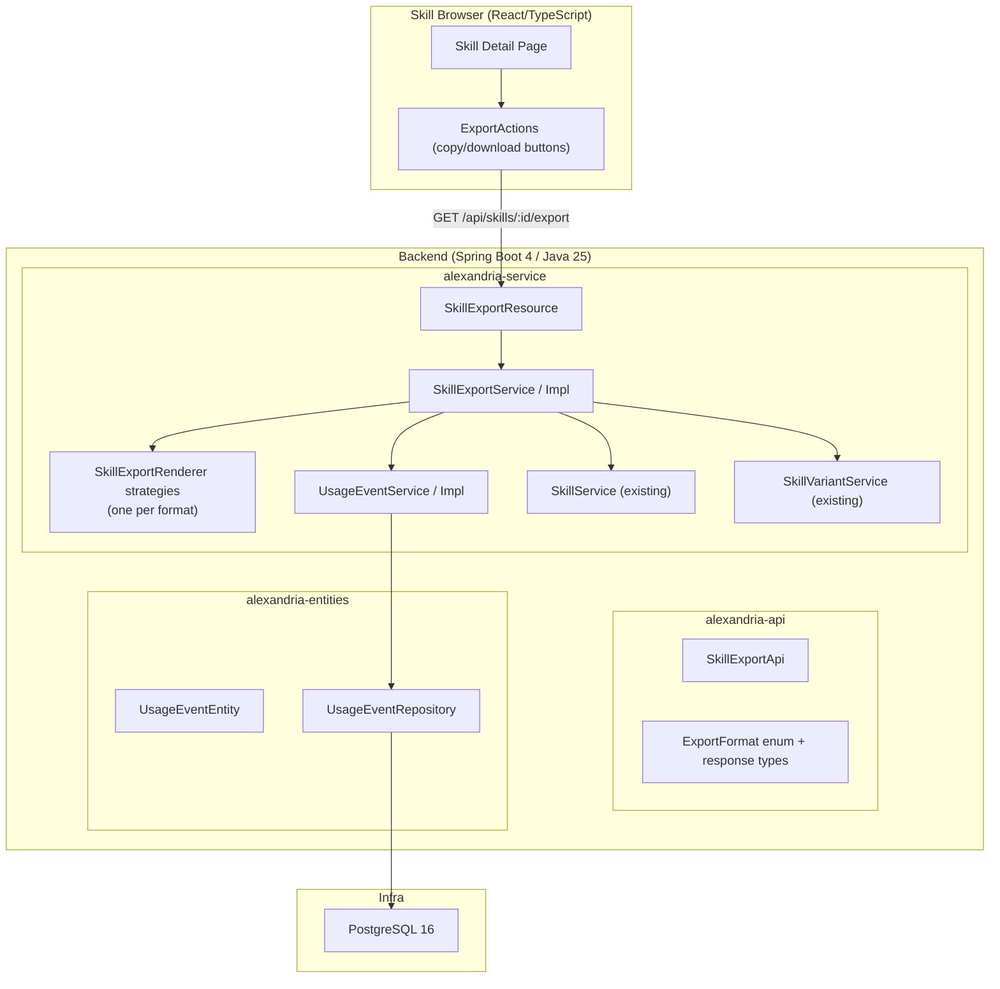
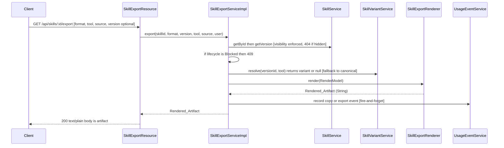

# Design Document: Skill Export

## Overview

This design covers Milestone 2b — **Skill Export** — which renders a skill's content
(any version the requesting user is allowed to see, except `Blocked`) into tool-specific
formats for copy or download, and captures copy/export **usage events** as the first slice
of usage tracking.

It builds on `skill-crud` (skills, versions, variants, visibility) and reuses the
established modular-monolith architecture: Spring Boot 4 backend split into
`alexandria-api` (interfaces + DTOs), `alexandria-entities` (JPA + repositories),
and `alexandria-service` (business logic + controllers); PostgreSQL 16 evolved via
Flyway; React/TypeScript frontend.

Key architectural decisions:
- **Strategy-based renderers**: one `SkillExportRenderer` per Export_Format, selected
  by an `ExportFormat` enum. Adding a format later is a new renderer + enum value, no
  changes to the endpoint or service.
- **Reuse existing visibility + variant resolution**: the export service loads the skill
  through the existing visibility-enforcing `SkillService.getById`/`getVersion` paths and
  resolves variants through `SkillVariantService.resolve`, so export never re-implements
  access control or fallback.
- **Deterministic pure rendering**: renderers are pure functions of the version content —
  no timestamps, no randomness — so output is stable and unit/property-testable without a DB.
- **Append-only usage events, fire-and-forget**: a new `usage_events` table and
  `UsageEventService` mirror the audit pattern; recording never blocks or fails the export.
- **Plain-text response**: the endpoint returns the raw artifact as `text/plain` so the
  frontend can copy it verbatim or save it to a file without post-processing.

## Architecture

### High-Level Integration Diagram



### Export Request Flow



## Components and Interfaces

### 1. `alexandria-api` — contract

**`ExportFormat` enum** (`com.alexandria.skill.export.ExportFormat`):

| Enum value        | Wire value (`format` param) | Download filename       | Notes                          |
| ----------------- | --------------------------- | ----------------------- | ------------------------------ |
| `GENERIC_MARKDOWN`| `generic_markdown`          | `<slug>.md`             | Headed Markdown doc            |
| `GITHUB_COPILOT`  | `github_copilot`            | `<slug>.copilot.md`     | Prompt-style                   |
| `CODEX`           | `codex`                     | `<slug>.codex.md`       | Prompt-style                   |
| `AGENTS_MD`       | `agents_md`                 | `AGENTS.md`             | AGENTS.md fragment             |
| `CURSOR_RULE`     | `cursor_rule`               | `.cursorrules`          | Cursor rule                    |
| `KIRO_STEERING`   | `kiro_steering`             | `<slug>-steering.md`    | Kiro steering fragment         |

- The enum maps case-insensitively from the wire value; an unknown value causes the
  controller/service to raise an `IllegalArgumentException` → 400 (handled by the
  existing `GlobalExceptionHandler`).
- **Cursor filename convention:** the download filename is the legacy single-file
  `.cursorrules` because a browser download cannot create the newer `.cursor/rules/`
  directory. The rendered *content* still follows the current Cursor rule format; only the
  suggested filename differs. Chosen deliberately to keep a one-click download usable.

**`SkillExportApi`** interface: `@RequestMapping("/api/skills/{skillId}/export")`
```
GET  /api/skills/{skillId}/export
  query: format (required), version (optional int), tool (optional), source (optional: "copy"|"download", default "download")
  produces: text/plain
  returns: ResponseEntity<String>  // the Rendered_Artifact
```

**`ExportSource` enum**: `COPY`, `DOWNLOAD` (wire: `copy`, `download`; default `download`).

### 2. `alexandria-service` — rendering + orchestration

**`SkillExportRenderer` (strategy interface)**:
```java
public interface SkillExportRenderer {
    ExportFormat format();
    String render(ExportRenderModel model);
}
```
- One `@Component` implementation per format. A `SkillExportRendererRegistry` collects
  them (`List<SkillExportRenderer>` injected by Spring) into a `Map<ExportFormat, Renderer>`
  and exposes `rendererFor(format)`.
- `ExportRenderModel` is a small immutable record assembled by the service from the
  skill + resolved version + resolved instructions:
  `{ name, slug, description, instructions, applicability, whenToUse, limitations, examples, tool, riskLevel }`.
  `instructions` is already variant-resolved (variant or canonical).

**Renderer content rules** (deterministic, sanitized):
- `GENERIC_MARKDOWN`: `# <name>` then an optional `> Risk: <riskLevel>` note when a risk
  level is set, `## Instructions`, and `## Applicability` / `## When to use` /
  `## Limitations` / `## Examples` sections when present. (This is the one renderer that
  surfaces `riskLevel`, so the field on `ExportRenderModel` is used rather than dead.)
- `AGENTS_MD`: `# <name>` framed as agent guidance; instructions as the body; metadata
  as a short "Applies when / Limitations" preamble.
- `CURSOR_RULE`: a rule block with a description line and the instructions as the rule body.
- `KIRO_STEERING`: a steering Markdown fragment (front-matter-free) with the instructions
  and a "When to use" note.
- `GITHUB_COPILOT` / `CODEX`: prompt-style — a one-line role/intent header derived from
  name + description, then the instructions, then examples if present.
- **Sanitization**: content is emitted inside the document body as-is for Markdown formats
  (Markdown is plain text and already the storage format), but any content used inside a
  fenced or delimited region is fence-guarded (e.g. a code fence uses a backtick run longer
  than any run appearing in the content). No HTML is generated, so no HTML-injection surface.

**`SkillExportService`**:
```java
public interface SkillExportService {
    String export(UUID skillId, ExportFormat format, Integer versionNumber,
                  String tool, ExportSource source, AlexandriaUserDetails user);
}
```
Filename derivation is a **frontend** concern (Requirement 3.5): the browse UI already holds
the skill's `slug` and knows the chosen format, so it builds the download filename locally
(e.g. `AGENTS.md`, `.cursorrules`, `<slug>.md`). No backend `filenameFor` method is added —
it would only re-load the skill to recompute something the client already has.
- `export(...)`:
  1. If `tool` is non-null, validate it against the supported tool set (the same
     nine identifiers enforced by `SkillVariantServiceImpl`); an unknown tool →
     `IllegalArgumentException` (→ 400) **before** any DB work. A supported tool with no
     variant is not an error (it falls back to canonical in step 5).
  2. Load skill via `skillService.getById(skillId, user)` — visibility enforced (404 if hidden).
  3. If `lifecycleStatus == "Blocked"` → throw `SkillBlockedException` (→ 409).
  4. Resolve the target `SkillVersionEntity`: when `versionNumber` is provided use
     `skillService.getVersion(skillId, versionNumber, user)`, else load the skill's
     `currentVersionId`. The resolved version's `id` is the `skillVersionId` recorded in
     the usage event (this differs from `currentVersionId` when `?version=` is used).
  5. Resolve instructions: `variantService.resolve(version.id, tool)`; if it returns null
     (no variant for the tool, or `tool` is null), use the version's `canonicalInstructions`.
  6. Build `ExportRenderModel`, select renderer via registry, render.
  7. Fire-and-forget `usageEventService.record(...)` with
     `event_type = source == COPY ? "copy" : "export"` and the resolved version id.
  8. Return the artifact.
- Deprecated skills are allowed; the service adds no gate for them (the frontend warns from
  the lifecycle status it already holds).
- **Note on redundant load:** `skillService.getVersion` internally re-invokes `getById`, so a
  versioned export enforces visibility twice. This is acceptable for now (two indexed
  point-reads); if it becomes hot, add a `getByIdAndVersion` that loads both in one pass.

**`SkillExportResource`** implements `SkillExportApi`:
- `@PreAuthorize` is not required beyond authentication — visibility is enforced in the
  service via `getById`. Any authenticated org user (including `Read_Only_Auditor`, since
  export is a read action) may attempt an export; hidden skills 404. (Requirement 3.6)
- Parses `format` and `source` via the enums' case-insensitive `fromWire`; an unknown value
  surfaces as `IllegalArgumentException` → 400.
- Returns `ResponseEntity.ok().contentType(new MediaType("text","plain",StandardCharsets.UTF_8)).body(artifact)`
  so non-ASCII instruction content is transmitted correctly.

**`UsageEventService`** (mirrors `AuditService`):
```java
void record(UUID orgId, UUID actorUserId, UUID skillId, UUID skillVersionId,
            String eventType, String source, String exportFormat);
```
- Fire-and-forget; failures logged at ERROR, never thrown.

### 3. `alexandria-entities` — persistence

**V5 Flyway migration** `V5__usage_events.sql`:
```sql
CREATE TABLE usage_events (
    id                UUID PRIMARY KEY DEFAULT gen_random_uuid(),
    organization_id   UUID NOT NULL REFERENCES organizations(id) ON DELETE RESTRICT,
    skill_id          UUID NOT NULL REFERENCES skills(id) ON DELETE CASCADE,
    skill_version_id  UUID REFERENCES skill_versions(id) ON DELETE SET NULL,
    user_id           UUID REFERENCES users(id) ON DELETE SET NULL,
    event_type        TEXT NOT NULL CHECK (event_type IN ('view','copy','export')),
    source            TEXT,
    export_format     TEXT,
    created_at        TIMESTAMPTZ NOT NULL DEFAULT NOW()
);
CREATE INDEX idx_usage_events_org ON usage_events(organization_id);
CREATE INDEX idx_usage_events_skill ON usage_events(skill_id);
CREATE INDEX idx_usage_events_type_time ON usage_events(organization_id, event_type, created_at);
```
- `event_type` includes `view` for forward-compatibility with Requirement 17, though this
  milestone only writes `copy` and `export`.
- Append-only: no update/delete paths are exposed.

**`UsageEventEntity`**: fields mirroring the table; `created_at` set via `@PrePersist`;
does not extend `BaseEntity` (no `updated_at`).

**`UsageEventRepository extends JpaRepository<UsageEventEntity, UUID>`**: `save` plus, for
tests, `countBySkillIdAndEventType` and `findByOrganizationId`.

### 4. Frontend

- Replace the stubbed `exportSkill` types in `src/api/skills.ts` (browse layer) with a call
  that hits `GET /api/skills/{id}/export` and returns text; add `source`/`tool`/`version`
  params. Keep the existing `ExportActions` UI on the browse `SkillDetailPage`, wiring:
  - copy buttons → `source=copy`, write result to clipboard, show confirmation
  - download buttons → `source=download`, trigger file download with the format's filename
- Disable/hide export controls and show a "Blocked" indicator when `lifecycleStatus === 'Blocked'`;
  show a deprecation warning when `Deprecated`.
- Format list surfaced in the UI matches the six supported formats.

## Data Models

### `usage_events` (new table, V5)

The one new persistent model this milestone introduces. Append-only; written on every
successful copy/export.

| Column             | Type          | Notes                                                        |
| ------------------ | ------------- | ------------------------------------------------------------ |
| `id`               | UUID PK       | `gen_random_uuid()`                                          |
| `organization_id`  | UUID NOT NULL | FK → organizations (RESTRICT); scopes every query            |
| `skill_id`         | UUID NOT NULL | FK → skills (CASCADE)                                        |
| `skill_version_id` | UUID          | FK → skill_versions (SET NULL); the **resolved target** version |
| `user_id`          | UUID          | FK → users (SET NULL); the acting user                       |
| `event_type`       | TEXT NOT NULL | CHECK in (`view`,`copy`,`export`); this milestone writes only `copy`/`export` |
| `source`           | TEXT          | `copy` or `download` as sent by the client                   |
| `export_format`    | TEXT          | the `ExportFormat` wire value                                |
| `created_at`       | TIMESTAMPTZ   | `NOW()`; set on insert, never updated                        |

`event_type` is derived from `source`: `copy → copy`, `download → export`. The `view` value
exists only for forward compatibility (parent Requirement 17) and is unused here.

### Transient / contract models (not persisted)

- **`ExportFormat`** (enum, api): six values, each carrying its wire value and download
  filename pattern; case-insensitive `fromWire`.
- **`ExportSource`** (enum, api): `COPY`, `DOWNLOAD`; `fromWire` defaults to `DOWNLOAD`.
- **`ExportRenderModel`** (record, service): `{ name, slug, description, instructions,
  applicability, whenToUse, limitations, examples, tool, riskLevel }` — assembled per request
  from the skill + resolved version + resolved instructions; consumed by renderers. Not stored.

No existing tables are altered.

## Error Handling

| Condition                        | Exception                    | HTTP | Handler                    |
| -------------------------------- | ---------------------------- | ---- | -------------------------- |
| Unknown format                   | `IllegalArgumentException`   | 400  | existing GlobalExceptionHandler |
| Unknown/unsupported `tool`       | `IllegalArgumentException`   | 400  | existing GlobalExceptionHandler |
| Skill hidden / not found         | `SkillNotFoundException`     | 404  | existing                   |
| Version not found                | `SkillNotFoundException`     | 404  | existing                   |
| Blocked skill                    | `SkillBlockedException` (new)| 409  | add handler mapping        |

Empty resolved instructions are **not** an error (Requirement 1.8): the renderer emits a
well-formed artifact with the name/metadata and an empty instructions section.

`SkillBlockedException` is a new `RuntimeException` in `com.alexandria.skill`; a handler
method is added to the existing `GlobalExceptionHandler` mapping it to 409 with the standard
`ErrorResponse` body (consistent with `SkillConflictException`).

## Correctness Properties

### Property 1: Format coverage

*For any* `ExportFormat` enum value and any valid render model, a renderer SHALL exist for
that format and SHALL produce a non-empty artifact. No format SHALL fall through to a default.

**Validates: Requirements 1.2**

### Property 2: Determinism

*For any* render model, rendering it twice with the same format SHALL produce byte-identical
output. Renderers SHALL contain no timestamps, randomness, or environment-dependent state.

**Validates: Requirements 1.9**

### Property 3: Content inclusion

*For any* render model and any format, the rendered artifact SHALL contain the skill name and
the resolved instructions.

**Validates: Requirements 1.7, 2.1, 2.2, 2.3, 2.4, 2.5**

### Property 4: Variant resolution

*For any* skill version and tool, when a variant exists for that tool the artifact SHALL
contain the variant instructions; otherwise it SHALL contain the canonical instructions.

**Validates: Requirements 1.4**

### Property 5: Blocked denial

*For any* format, version, and tool, exporting a skill whose `lifecycle_status` is `Blocked`
SHALL be denied with HTTP 409 and SHALL record no usage event.

**Validates: Requirements 4.1, 4.3, 5.3**

### Property 6: Usage event on success only

*For any* successful export, the system SHALL record exactly one usage event whose skill_id,
skill_version_id (the resolved target version), export_format, and source match the request,
with `event_type` derived as `copy→copy` / `download→export`. *For any* rejected export
(invalid format, invalid tool, not found, hidden, or blocked), the system SHALL record no
usage event.

**Validates: Requirements 5.1, 5.3**

### Property 7: Visibility parity

*For any* skill and authenticated user, export SHALL be permitted if and only if `getById`
would permit retrieval; otherwise the system SHALL return HTTP 404 with no skill metadata
leaked.

**Validates: Requirements 3.6**

### Property 8: Fence safety

*For any* instruction content rendered inside a delimited/fenced region, the region delimiter
SHALL be longer than the longest backtick run present in the content, so the content cannot
terminate the region early.

**Validates: Requirements 2.6**

### Property 9: Empty-instructions safety

*For any* format, a render model with empty resolved instructions SHALL still produce a
non-empty, well-formed artifact containing the skill name and an empty instructions section.

**Validates: Requirements 1.8**

### Property 10: Invalid-tool rejection

*For any* format, an export request carrying a `tool` value not in the supported tool set
SHALL be rejected with HTTP 400 and SHALL record no usage event.

**Validates: Requirements 1.6**

## Testing Strategy

- **Renderer unit + property tests** (jqwik, no Spring): properties 1–4, 8 against generated
  render models. Pure functions, fast.
- **Service tests** (Mockito): blocked denial (property 5), usage-event-on-success-only
  (property 6), variant resolution wiring, version selection.
- **Integration tests** (`@SpringBootTest` + Testcontainers, JWT-bypass post-processor):
  full `GET /api/skills/{id}/export` round-trips per format; 400 (bad format), 404 (hidden/
  missing), 409 (blocked); usage event rows written; visibility parity (property 7).
- **Frontend tests** (Vitest + RTL): copy writes to clipboard + confirmation; download
  triggers a file; blocked disables controls; error path shows a message.

## Migration & Compatibility

- Adds `V5__usage_events.sql`; no changes to existing tables.
- No changes to existing skill/variant/taxonomy APIs. The export endpoint is additive.
- Frontend change is limited to the browse export path (`api/skills.ts` + `ExportActions`).
