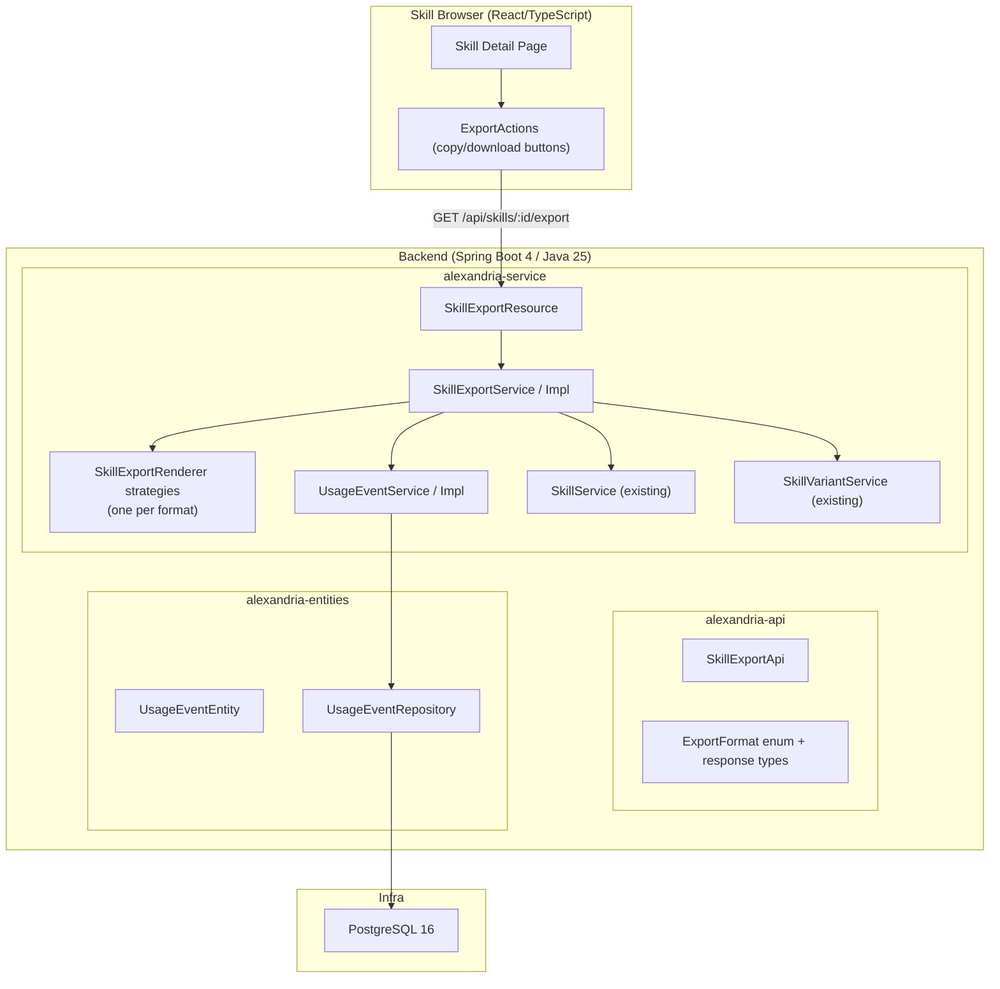
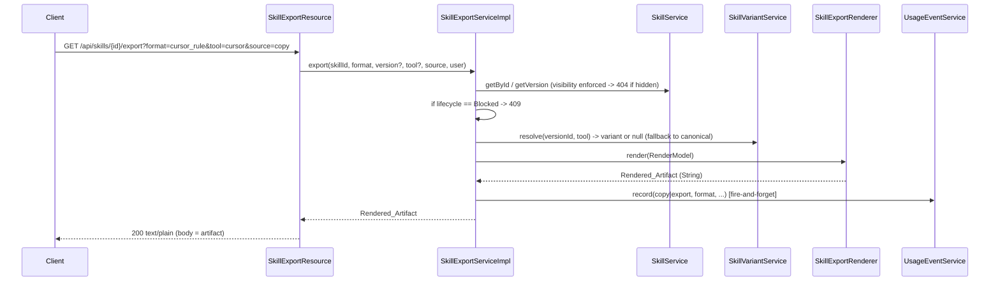

# Design Document: Skill Export

## Overview

This design covers Milestone 2b — **Skill Export** — which renders published skills
into tool-specific formats for copy or download, and captures copy/export **usage
events** as the first slice of usage tracking.

It builds on `skill-crud` (skills, versions, variants, visibility) and reuses the
established modular-monolith architecture: Spring Boot 4 backend split into
`alexandria-api` (interfaces + DTOs), `alexandria-entities` (JPA + repositories),
and `alexandria-service` (business logic + controllers); PostgreSQL 16 evolved via
Flyway; React/TypeScript frontend.

Key architectural decisions:
- **Strategy-based renderers**: one `SkillExportRenderer` per Export_Format, selected
  by an `ExportFormat` enum. Adding a format later is a new renderer + enum value, no
  changes to the endpoint or service.
- **Reuse existing visibility + variant resolution**: the export service loads the skill
  through the existing visibility-enforcing `SkillService.getById`/`getVersion` paths and
  resolves variants through `SkillVariantService.resolve`, so export never re-implements
  access control or fallback.
- **Deterministic pure rendering**: renderers are pure functions of the version content —
  no timestamps, no randomness — so output is stable and unit/property-testable without a DB.
- **Append-only usage events, fire-and-forget**: a new `usage_events` table and
  `UsageEventService` mirror the audit pattern; recording never blocks or fails the export.
- **Plain-text response**: the endpoint returns the raw artifact as `text/plain` so the
  frontend can copy it verbatim or save it to a file without post-processing.

## Architecture

### High-Level Integration Diagram



### Export Request Flow



## Components

### 1. `alexandria-api` — contract

**`ExportFormat` enum** (`com.alexandria.skill.export.ExportFormat`):

| Enum value        | Wire value (`format` param) | Download filename       | Notes                          |
| ----------------- | --------------------------- | ----------------------- | ------------------------------ |
| `GENERIC_MARKDOWN`| `generic_markdown`          | `<slug>.md`             | Headed Markdown doc            |
| `GITHUB_COPILOT`  | `github_copilot`            | `<slug>.copilot.md`     | Prompt-style                   |
| `CODEX`           | `codex`                     | `<slug>.codex.md`       | Prompt-style                   |
| `AGENTS_MD`       | `agents_md`                 | `AGENTS.md`             | AGENTS.md fragment             |
| `CURSOR_RULE`     | `cursor_rule`               | `.cursorrules`          | Cursor rule                    |
| `KIRO_STEERING`   | `kiro_steering`             | `<slug>-steering.md`    | Kiro steering fragment         |

- The enum maps case-insensitively from the wire value; an unknown value causes the
  controller/service to raise an `IllegalArgumentException` → 400 (handled by the
  existing `GlobalExceptionHandler`).

**`SkillExportApi`** interface: `@RequestMapping("/api/skills/{skillId}/export")`
```
GET  /api/skills/{skillId}/export
  query: format (required), version (optional int), tool (optional), source (optional: "copy"|"download", default "download")
  produces: text/plain
  returns: ResponseEntity<String>  // the Rendered_Artifact
```

**`ExportSource` enum**: `COPY`, `DOWNLOAD` (wire: `copy`, `download`; default `download`).

### 2. `alexandria-service` — rendering + orchestration

**`SkillExportRenderer` (strategy interface)**:
```java
public interface SkillExportRenderer {
    ExportFormat format();
    String render(ExportRenderModel model);
}
```
- One `@Component` implementation per format. A `SkillExportRendererRegistry` collects
  them (`List<SkillExportRenderer>` injected by Spring) into a `Map<ExportFormat, Renderer>`
  and exposes `rendererFor(format)`.
- `ExportRenderModel` is a small immutable record assembled by the service from the
  skill + resolved version + resolved instructions:
  `{ name, slug, description, instructions, applicability, whenToUse, limitations, examples, tool, riskLevel }`.
  `instructions` is already variant-resolved (variant or canonical).

**Renderer content rules** (deterministic, sanitized):
- `GENERIC_MARKDOWN`: `# <name>` then `## Instructions`, and `## Applicability` /
  `## When to use` / `## Limitations` / `## Examples` sections when present.
- `AGENTS_MD`: `# <name>` framed as agent guidance; instructions as the body; metadata
  as a short "Applies when / Limitations" preamble.
- `CURSOR_RULE`: a rule block with a description line and the instructions as the rule body.
- `KIRO_STEERING`: a steering Markdown fragment (front-matter-free) with the instructions
  and a "When to use" note.
- `GITHUB_COPILOT` / `CODEX`: prompt-style — a one-line role/intent header derived from
  name + description, then the instructions, then examples if present.
- **Sanitization**: content is emitted inside the document body as-is for Markdown formats
  (Markdown is plain text and already the storage format), but any content used inside a
  fenced or delimited region is fence-guarded (e.g. a code fence uses a backtick run longer
  than any run appearing in the content). No HTML is generated, so no HTML-injection surface.

**`SkillExportService`**:
```java
public interface SkillExportService {
    String export(UUID skillId, ExportFormat format, Integer versionNumber,
                  String tool, ExportSource source, AlexandriaUserDetails user);
    String filenameFor(UUID skillId, ExportFormat format, AlexandriaUserDetails user);
}
```
- `export(...)`:
  1. Load skill via `skillService.getById(skillId, user)` — visibility enforced (404 if hidden).
  2. If `lifecycleStatus == "Blocked"` → throw `SkillBlockedException` (→ 409).
  3. Resolve the target version: `versionNumber` if provided (via `skillService.getVersion`),
     else the skill's current version.
  4. Resolve instructions: `variantService.resolve(versionId, tool)`; if null, use canonical.
  5. Build `ExportRenderModel`, select renderer via registry, render.
  6. Fire-and-forget `usageEventService.record(...)` with `event_type = source == COPY ? "copy" : "export"`.
  7. Return the artifact.
- Deprecated skills are allowed; the service adds no gate for them (the frontend warns).

**`SkillExportResource`** implements `SkillExportApi`:
- `@PreAuthorize` is not required beyond authentication — visibility is enforced in the
  service via `getById`. (Any authenticated org user may attempt an export; hidden skills 404.)
- Returns `ResponseEntity.ok().contentType(TEXT_PLAIN).body(artifact)`.

**`UsageEventService`** (mirrors `AuditService`):
```java
void record(UUID orgId, UUID actorUserId, UUID skillId, UUID skillVersionId,
            String eventType, String source, String exportFormat);
```
- Fire-and-forget; failures logged at ERROR, never thrown.

### 3. `alexandria-entities` — persistence

**V5 Flyway migration** `V5__usage_events.sql`:
```sql
CREATE TABLE usage_events (
    id                UUID PRIMARY KEY DEFAULT gen_random_uuid(),
    organization_id   UUID NOT NULL REFERENCES organizations(id) ON DELETE RESTRICT,
    skill_id          UUID NOT NULL REFERENCES skills(id) ON DELETE CASCADE,
    skill_version_id  UUID REFERENCES skill_versions(id) ON DELETE SET NULL,
    user_id           UUID REFERENCES users(id) ON DELETE SET NULL,
    event_type        TEXT NOT NULL CHECK (event_type IN ('view','copy','export')),
    source            TEXT,
    export_format     TEXT,
    created_at        TIMESTAMPTZ NOT NULL DEFAULT NOW()
);
CREATE INDEX idx_usage_events_org ON usage_events(organization_id);
CREATE INDEX idx_usage_events_skill ON usage_events(skill_id);
CREATE INDEX idx_usage_events_type_time ON usage_events(organization_id, event_type, created_at);
```
- `event_type` includes `view` for forward-compatibility with Requirement 17, though this
  milestone only writes `copy` and `export`.
- Append-only: no update/delete paths are exposed.

**`UsageEventEntity`**: fields mirroring the table; `created_at` set via `@PrePersist`;
does not extend `BaseEntity` (no `updated_at`).

**`UsageEventRepository extends JpaRepository<UsageEventEntity, UUID>`**: `save` plus, for
tests, `countBySkillIdAndEventType` and `findByOrganizationId`.

### 4. Frontend

- Replace the stubbed `exportSkill` types in `src/api/skills.ts` (browse layer) with a call
  that hits `GET /api/skills/{id}/export` and returns text; add `source`/`tool`/`version`
  params. Keep the existing `ExportActions` UI on the browse `SkillDetailPage`, wiring:
  - copy buttons → `source=copy`, write result to clipboard, show confirmation
  - download buttons → `source=download`, trigger file download with the format's filename
- Disable/hide export controls and show a "Blocked" indicator when `lifecycleStatus === 'Blocked'`;
  show a deprecation warning when `Deprecated`.
- Format list surfaced in the UI matches the six supported formats.

## Error Handling

| Condition                        | Exception                    | HTTP | Handler                    |
| -------------------------------- | ---------------------------- | ---- | -------------------------- |
| Unknown format                   | `IllegalArgumentException`   | 400  | existing GlobalExceptionHandler |
| Skill hidden / not found         | `SkillNotFoundException`     | 404  | existing                   |
| Version not found                | `SkillNotFoundException`     | 404  | existing                   |
| Blocked skill                    | `SkillBlockedException` (new)| 409  | add handler mapping        |

`SkillBlockedException` is a new `RuntimeException` in `com.alexandria.skill`; a handler
method is added to the existing `GlobalExceptionHandler` mapping it to 409 with the standard
`ErrorResponse` body (consistent with `SkillConflictException`).

## Correctness Properties (for property-based tests)

1. **Format coverage** — for every `ExportFormat` enum value, a renderer exists and produces
   a non-empty artifact for any valid render model. (No format falls through to a default.)
2. **Determinism** — rendering the same model twice yields identical output.
3. **Content inclusion** — the rendered artifact contains the skill name and the resolved
   instructions for every format.
4. **Variant resolution** — when a variant exists for the requested tool, the artifact
   contains the variant instructions; otherwise it contains the canonical instructions.
5. **Blocked denial** — for any format/version/tool, exporting a Blocked skill is denied
   and records no usage event.
6. **Usage event on success only** — a successful export records exactly one usage event with
   matching skill/version/format/source; a rejected export records none.
7. **Visibility parity** — export access is granted/denied under exactly the same visibility
   rules as `getById` (hidden → 404, no leakage).
8. **Fence safety** — rendered output for delimited regions uses a fence longer than any
   backtick run present in the content, so content cannot terminate the region early.

## Testing Strategy

- **Renderer unit + property tests** (jqwik, no Spring): properties 1–4, 8 against generated
  render models. Pure functions, fast.
- **Service tests** (Mockito): blocked denial (property 5), usage-event-on-success-only
  (property 6), variant resolution wiring, version selection.
- **Integration tests** (`@SpringBootTest` + Testcontainers, JWT-bypass post-processor):
  full `GET /api/skills/{id}/export` round-trips per format; 400 (bad format), 404 (hidden/
  missing), 409 (blocked); usage event rows written; visibility parity (property 7).
- **Frontend tests** (Vitest + RTL): copy writes to clipboard + confirmation; download
  triggers a file; blocked disables controls; error path shows a message.

## Migration & Compatibility

- Adds `V5__usage_events.sql`; no changes to existing tables.
- No changes to existing skill/variant/taxonomy APIs. The export endpoint is additive.
- Frontend change is limited to the browse export path (`api/skills.ts` + `ExportActions`).
