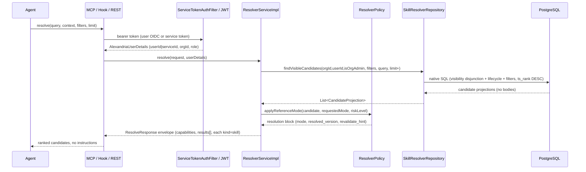
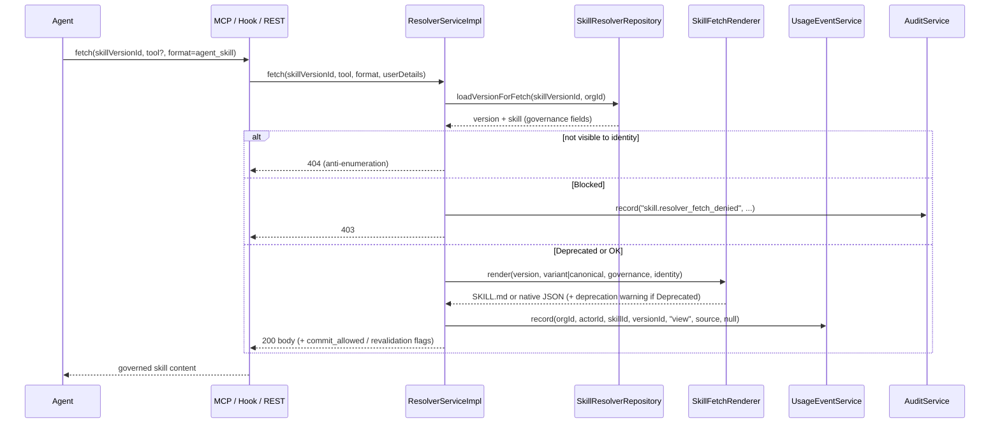
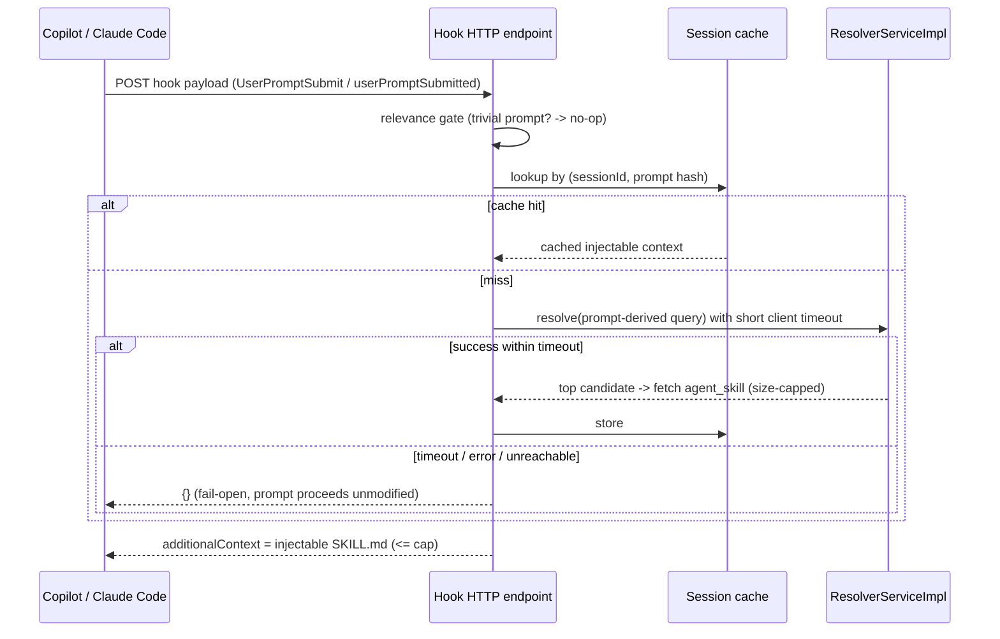

# Design Document: Skill Resolver

## Overview

The **Skill Resolver** adds an agent-facing retrieval layer over the existing Phase 1 registry.
It exposes two operations — **resolve** (cheap, ranked candidates) and **fetch** (governed full
instructions) — and two delivery surfaces on top of them: an **MCP adapter** (pull mode, the
agent's model chooses to call it) and a **hooks adapter** (push mode, the harness deterministically
calls it at a lifecycle point). A Claude-native `tool_reference` tool-search backend is a fast
follow on the same core.

The design principle is **thin adapters over a shared core**. All governance, ACL, ranking, and
formatting live in one protocol-agnostic service; MCP, hooks, and tool-search are transport shells
that translate wire formats and pass through an authenticated identity. This keeps the "beat
LLM-only on tokens and governance" behavior in exactly one place and makes every surface obey the
same rules.

The resolver reuses, rather than replaces, the registry's foundations:

- **ACL** — the visibility disjunction already implemented in `SkillRepository.findVisibleSkills`
  (query layer) plus the `enforceVisibility` / `SkillSecurity` application-layer checks. The
  resolver adds a candidate-projection query that carries the **same** visibility predicate.
- **Search** — the PostgreSQL `tsvector search_vector` column and `ts_rank` ordering. Resolve is
  the same FTS the catalog list uses, projected into a candidate shape. Phase 2 semantic search
  plugs in behind the unchanged resolve contract.
- **Security** — the OIDC/JWT resource server and the `AlexandriaAuthentication` /
  `AlexandriaUserDetails` principal. The resolver adds a **service-token** authentication path that
  produces the same principal type, so all downstream ACL code is unchanged.
- **Governance** — `lifecycle_status`, `visibility`, `risk_level` on `SkillEntity`; the
  `skill_versions` / `skill_variants` model; the `AuditService` and `UsageEventService`
  fire-and-forget recorders.

Key architectural decisions:

- **New `agent` domain package** (`com.alexandria.agent`) across the three Maven modules, keeping
  the agent-facing contract separate from the human-facing `skill` API while delegating to shared
  services.
- **Resolver core as a service, adapters as controllers/servers.** `ResolverService` owns
  resolve + fetch; `AgentResolverResource` (REST), the MCP server, and the hook endpoint are thin.
- **Candidate projection reuses the ACL predicate.** A new repository method mirrors the
  `findVisibleSkills` visibility disjunction exactly, returning a lightweight projection (no
  instruction bodies) ordered by `ts_rank`.
- **Format rendering is a strategy.** `agent_skill` (SKILL.md) and `alexandria_native` (JSON) are
  two renderers behind a `SkillFetchRenderer` interface; `agent_skill` is the default.
- **Embedded identity is universal.** Every candidate and every fetch carries
  `skill_id` / `skill_version_id` / `source_instance`; SKILL.md carries it in the `metadata` map.
- **Service tokens are hashed at rest** and resolve to a read-only agent principal scoped to one
  organization.
- **The envelope is forward-compatible from day one** — `kind`, `invocation` (null),
  `relationships` (empty), and `capabilities` (`invoke`/`compose` false) are present but inert.

## Architecture

### Module and package layout

The resolver follows the established three-module split. New code lives under a new `agent` domain.

```text
alexandria-api        com.alexandria.agent.dto           (resolve/fetch request + response records)
                      com.alexandria.agent.AgentResolverApi  (REST contract interface)

alexandria-entities   com.alexandria.agent.entity.ServiceTokenEntity
                      com.alexandria.agent.entity.ResolverPolicyEntity
                      com.alexandria.agent.ServiceTokenRepository
                      com.alexandria.agent.ResolverPolicyRepository
                      com.alexandria.skill.SkillResolverRepository        (candidate projection + version resolution)
                      db/migration/V8__skill_resolver.sql

alexandria-service    com.alexandria.agent.ResolverService / ResolverServiceImpl   (core: resolve + fetch)
                      com.alexandria.agent.AgentResolverResource                   (REST adapter)
                      com.alexandria.agent.render.SkillFetchRenderer               (interface)
                      com.alexandria.agent.render.AgentSkillRenderer               (SKILL.md)
                      com.alexandria.agent.render.NativeRenderer                   (JSON)
                      com.alexandria.agent.mcp.*                                   (MCP adapter — Task 5)
                      com.alexandria.agent.hook.*                                  (hook adapter — Task 7)
                      com.alexandria.agent.toolsearch.*                            (tool_reference — Task 8)
                      com.alexandria.config.ServiceTokenAuthFilter                 (new auth path)
                      com.alexandria.config.ResolverPolicy                         (@Component, risk policy)
```

### Layered flow

```mermaid
flowchart TD
    subgraph Agents
      CC[Claude Code / Desktop]
      CP[Copilot / VS Code]
      SDK[Agent SDK app]
    end

    subgraph Adapters[Thin adapters]
      MCP[MCP server: resolve_skill / fetch_skill]
      HOOK[Hook HTTP endpoint]
      TS[tool_reference backend]
      REST[AgentResolverResource REST]
    end

    CORE[ResolverService core: resolve + fetch]
    RENDER[SkillFetchRenderer: agent_skill / native]
    REPO[SkillResolverRepository: ACL-scoped candidate + version resolution]
    GOV[Governance gates + ResolverPolicy]
    DB[(PostgreSQL: skills / versions / variants + tsvector)]

    CC --> MCP
    CC --> HOOK
    CP --> MCP
    CP --> HOOK
    SDK --> TS
    MCP --> CORE
    HOOK --> CORE
    TS --> CORE
    REST --> CORE
    CORE --> GOV
    CORE --> RENDER
    CORE --> REPO
    REPO --> DB
```



### Resolve request flow



### Fetch request flow



### Push-mode (hook) flow



## Components and Changes

### 1. `alexandria-api` — DTOs and REST contract

New records under `com.alexandria.agent.dto`. All are Java records, matching the existing DTO
convention (e.g. `SkillSummaryResponse`).

**Resolve request:**

```java
public record ResolveRequest(
        String query,
        ResolveContext context,       // nullable
        ResolveFilters filters,       // nullable
        String referenceMode,         // nullable -> defaults to floating_latest_approved
        Integer limit                 // nullable -> default 5, clamped to 25
) {}

public record ResolveContext(
        List<String> languages,
        List<String> frameworks,
        String tool,
        String activeFilePath
) {}

public record ResolveFilters(
        List<String> lifecycleStates, // e.g. Team_Approved, Company_Approved, Archived
        List<String> riskLevels,
        List<String> tools
) {}
```

**Resolve response (the forward-compatible envelope):**

```java
public record ResolveResponse(
        String queryId,
        String schemaVersion,               // "1.0"
        Capabilities capabilities,          // resolve/fetch true, invoke/compose false
        List<ResolveResult> results
) {}

public record Capabilities(boolean resolve, boolean fetch, boolean invoke, boolean compose) {}

public record ResolveResult(
        String kind,                        // "skill"
        SkillRef ref,                       // embedded identity
        String name,
        String summary,
        double score,
        Governance governance,
        List<String> matchReasons,
        Resolution resolution,
        Delivery delivery,
        Object invocation,                  // null (reserved)
        List<Object> relationships          // empty (reserved)
) {}

public record SkillRef(UUID skillId, UUID skillVersionId, String sourceInstance) {}

public record Governance(
        String lifecycleStatus,
        String riskLevel,
        String visibility,
        String ownerTeam,
        boolean deprecated,
        String deprecationReason
) {}

public record Resolution(
        String mode,                        // pinned / floating_latest_approved / floating_latest_published
        String resolvedVersion,             // resolved version number as string
        boolean commitAllowed,
        boolean requiresRevalidation,
        String revalidateHint               // stable ref for a future revalidation endpoint
) {}

public record Delivery(String fetchHref, List<String> formats) {}
```

**Fetch response (native format):**

```java
public record NativeSkillResponse(
        SkillRef ref,
        Governance governance,
        Resolution resolution,
        NativeContent content,
        NativeVariant variant               // selected variant or canonical fallback
) {}

public record NativeContent(
        String canonicalInstructions,
        String whenToUse,
        String applicability,
        String limitations,
        String examples
) {}

public record NativeVariant(String tool, String instructions, boolean isCanonicalFallback) {}
```

For `format=agent_skill`, the endpoint returns `text/markdown` (the rendered SKILL.md) rather than
a JSON record.

**REST contract interface** `AgentResolverApi` (implemented by `AgentResolverResource`):

```java
@RequestMapping("/api/agent/v1/skills")
public interface AgentResolverApi {

    @PostMapping("/resolve")
    ResponseEntity<ResolveResponse> resolve(@Valid @RequestBody ResolveRequest request);

    @GetMapping("/{skillVersionId}/instructions")
    ResponseEntity<?> fetch(
            @PathVariable UUID skillVersionId,
            @RequestParam(required = false) String tool,
            @RequestParam(defaultValue = "agent_skill") String format);
}
```

### 2. `alexandria-entities` — repository projection, version resolution, new tables

#### `SkillResolverRepository`

A new repository (or added methods on `SkillRepository`) carrying the **same visibility
disjunction** as `findVisibleSkills`, but projecting a lightweight candidate and honoring resolver
filters. It never selects instruction bodies.

```java
@Query(value = """
    SELECT s.id AS skill_id,
           s.current_version_id AS skill_version_id,
           s.name AS name,
           s.description AS description,
           s.slug AS slug,
           s.lifecycle_status AS lifecycle_status,
           s.risk_level AS risk_level,
           s.visibility AS visibility,
           s.owner_team_id AS owner_team_id,
           s.deprecation_reason AS deprecation_reason,
           ts_rank(s.search_vector, plainto_tsquery('english', :query), 1) AS score
    FROM skills s
    WHERE s.organization_id = :orgId
      AND (
        s.visibility = 'organization'
        OR (s.visibility = 'team' AND s.owner_team_id IN (
            SELECT tm.team_id FROM team_members tm WHERE tm.user_id = :userId))
        OR (s.visibility = 'private' AND s.created_by = :userId)
        OR (s.visibility = 'restricted' AND (
            s.created_by = :userId
            OR EXISTS (SELECT 1 FROM skill_access_grants sag
                       WHERE sag.skill_id = s.id AND sag.user_id = :userId)))
        OR :isOrgAdmin = true
      )
      AND s.lifecycle_status <> 'Blocked'
      AND (:includeArchived = true OR s.lifecycle_status <> 'Archived')
      AND s.search_vector @@ plainto_tsquery('english', :query)
    ORDER BY score DESC, s.updated_at DESC, s.id
    LIMIT :limit
    """, nativeQuery = true)
List<CandidateProjection> findVisibleCandidates(
        @Param("orgId") UUID orgId,
        @Param("userId") UUID userId,
        @Param("isOrgAdmin") boolean isOrgAdmin,
        @Param("includeArchived") boolean includeArchived,
        @Param("query") String query,
        @Param("limit") int limit);
```

`CandidateProjection` is a Spring Data interface projection. Lifecycle/risk/tool `filters` from the
request are applied as additional AND predicates (added to this query the same way `findVisibleSkills`
composes optional filters); they are omitted here for brevity but mirror that method's pattern. The
deterministic tiebreak `score DESC, updated_at DESC, s.id` satisfies Requirement 1.7.

**Version resolution** for reference modes (Requirement 5) uses helper queries:

```java
// latest Company_Approved else Team_Approved version id for a skill
Optional<UUID> findLatestApprovedVersionId(UUID skillId);
// latest Published-or-higher version id for a skill
Optional<UUID> findLatestPublishedVersionId(UUID skillId);
```

Approval state is derived from the skill's `lifecycle_status` combined with the version published
timestamp; the exact projection is finalized against the lifecycle spec at implementation time.

#### `loadVersionForFetch`

Loads a `skill_versions` row joined to its `skills` row **scoped by organization**, returning the
governance fields needed to apply gates. The application layer then re-runs the visibility check
(mirroring `enforceVisibility`) before rendering.

#### New tables — `V8__skill_resolver.sql`

```sql
-- V8__skill_resolver.sql

-- Service tokens for non-interactive agent authentication (Requirement 9)
CREATE TABLE service_tokens (
    id               UUID PRIMARY KEY DEFAULT gen_random_uuid(),
    organization_id  UUID NOT NULL REFERENCES organizations(id) ON DELETE RESTRICT,
    name             TEXT NOT NULL,
    token_hash       TEXT NOT NULL,               -- SHA-256 of the presented secret; secret never stored
    token_prefix     TEXT NOT NULL,               -- short non-secret prefix for lookup/display
    scope            TEXT NOT NULL DEFAULT 'agent_read'
                     CHECK (scope IN ('agent_read')),
    created_by       UUID REFERENCES users(id) ON DELETE SET NULL,
    expires_at       TIMESTAMPTZ,
    revoked_at       TIMESTAMPTZ,
    last_used_at     TIMESTAMPTZ,
    created_at       TIMESTAMPTZ NOT NULL DEFAULT NOW()
);

CREATE UNIQUE INDEX uq_service_tokens_hash ON service_tokens(token_hash);
CREATE INDEX idx_service_tokens_org ON service_tokens(organization_id);
CREATE INDEX idx_service_tokens_prefix ON service_tokens(token_prefix);

-- Organization-level resolver policy for agent commit/reference handling (Requirement 7)
CREATE TABLE resolver_policies (
    id                        UUID PRIMARY KEY DEFAULT gen_random_uuid(),
    organization_id           UUID NOT NULL REFERENCES organizations(id) ON DELETE RESTRICT,
    high_risk_policy          TEXT NOT NULL DEFAULT 'pin_and_revalidate'
                              CHECK (high_risk_policy IN ('permissive', 'pin_and_revalidate', 'block_commit')),
    restricted_risk_policy    TEXT NOT NULL DEFAULT 'pin_and_revalidate'
                              CHECK (restricted_risk_policy IN ('permissive', 'pin_and_revalidate', 'block_commit')),
    default_reference_mode    TEXT NOT NULL DEFAULT 'floating_latest_approved'
                              CHECK (default_reference_mode IN ('pinned', 'floating_latest_approved', 'floating_latest_published')),
    updated_at                TIMESTAMPTZ NOT NULL DEFAULT NOW(),
    created_at                TIMESTAMPTZ NOT NULL DEFAULT NOW()
);

CREATE UNIQUE INDEX uq_resolver_policies_org ON resolver_policies(organization_id);
```

`ServiceTokenEntity` extends `BaseEntity` (it is tenant-owned). `ResolverPolicyEntity` likewise.
When no `resolver_policies` row exists for an org, the service applies the code default from
Requirement 7.4 (permissive low/medium, pin-and-revalidate high/restricted).

### 3. `alexandria-service` — resolver core

#### `ResolverService` / `ResolverServiceImpl`

```java
public interface ResolverService {
    ResolveResponse resolve(ResolveRequest request, AlexandriaUserDetails identity);
    FetchResult fetch(UUID skillVersionId, String tool, String format, AlexandriaUserDetails identity);
}
```

`ResolveServiceImpl` mirrors the `SkillServiceImpl.list` shape: derive `isOrgAdmin` from
`identity.role() == Role.Org_Admin`, clamp `limit` to `[1,25]`, call
`SkillResolverRepository.findVisibleCandidates`, then for each candidate apply `ResolverPolicy`
to compute the `Resolution` block and build `match_reasons` from the query/context overlap
(framework/language/tool/approval). It assembles the envelope with
`capabilities(resolve=true, fetch=true, invoke=false, compose=false)`, `kind="skill"`,
`invocation=null`, `relationships=[]`.

`fetch` implements the gate ladder exactly as the sequence diagram: org-scoped load →
visibility re-check (404 if not visible) → Blocked (403 + audit) → render (Deprecated adds a
warning) → usage event (`view`) → return. The `view` usage type is the reserved value already noted
in `UsageEventService`. The `source` argument carries the adapter (`mcp`, `hook`, `rest`).

#### `ResolverPolicy` (`@Component`)

Analogous to the existing `SkillSecurity` bean. Given a candidate's `risk_level`, the requested
reference mode, and the org's `ResolverPolicyEntity` (or code defaults), it returns the effective
`Resolution` (forcing `pinned` + `requiresRevalidation=true` for high/restricted under
`pin_and_revalidate`; setting `commitAllowed=false` under `block_commit`).

#### Renderers

```java
public interface SkillFetchRenderer {
    String format();                         // "agent_skill" | "alexandria_native"
    FetchResult render(FetchContext ctx);    // ctx = version + skill governance + chosen variant + identity
}
```

`AgentSkillRenderer` emits a `SKILL.md`: frontmatter with only the six portable fields
(`name`, `description`, `license`, `compatibility`, `metadata`, `allowed-tools`), Alexandria
governance/identity in the `metadata` map, and a Markdown body assembled from when-to-use,
instructions (variant or canonical fallback), limitations, and examples. It wraps the body in the
`<!-- alexandria:start ... -->` / `<!-- alexandria:end -->` markers carrying identity + version
(Requirement 6.3) and sanitizes the body (Requirement 3.7). `NativeRenderer` emits
`NativeSkillResponse`. Renderers are resolved from a `Map<String, SkillFetchRenderer>` keyed by
`format()`, defaulting to `agent_skill`.

#### `AgentResolverResource`

Thin `@RestController implements AgentResolverApi`, resolving the current identity with the same
`currentUser()` pattern used in `SkillResource` (read `AlexandriaAuthentication` from the
`SecurityContextHolder`). For `fetch`, it content-negotiates: `agent_skill` → `text/markdown`,
`alexandria_native` → JSON.

### 4. `alexandria-service` — authentication (`ServiceTokenAuthFilter`)

A new `OncePerRequestFilter` registered in `SecurityConfig` **before** the JWT resource server, or
positioned so that a non-JWT bearer token is recognized. It:

1. Reads the `Authorization: Bearer <token>` header; if the token matches the service-token format
   (e.g. an `alx_` prefix), it hashes it (SHA-256), looks it up by `token_hash`, checks
   `revoked_at`/`expires_at`, updates `last_used_at`, and constructs an `AlexandriaAuthentication`
   carrying an `AlexandriaUserDetails` whose `role()` is a read-only agent role and whose
   `organizationId()` is the token's org.
2. If the token is not a service token, it does nothing and lets the existing
   `BearerTokenAuthenticationFilter` + `UserProvisioningFilter` handle OIDC JWTs.

Because the filter produces the same `AlexandriaUserDetails` principal type, **all downstream ACL
code (`findVisibleCandidates`, `enforceVisibility`, `ResolverPolicy`) is unchanged**. The agent
scope maps to a role at or below `Skill_Consumer` so authoring/review/approve is impossible
(Requirement 9.6). Endpoints under `/api/agent/**` accept either principal; the rest of the API is
unaffected.

### 5. `alexandria-service` — MCP adapter (Task 5)

`com.alexandria.agent.mcp` hosts an MCP server exposing two tools:

- `resolve_skill` — inputs mirror `ResolveRequest`; returns the candidate list (no bodies).
- `fetch_skill` — inputs: `skillVersionId`, optional `tool`, optional `format`; returns the fetched
  skill.

Tool descriptions are detailed and keyword-rich so the model selects them accurately
(Requirement 10.4). The adapter extracts the caller credential and calls `ResolverService`
directly (in-process) or via the REST contract (out-of-process deployment), passing the resolved
`AlexandriaUserDetails`. Only two tool definitions are advertised up front, so harnesses with
tool-search deferral never preload catalog content (Requirement 10.7). Packaging exposes a
configurable instance URL + credential per the self-hosted model.

### 6. `alexandria-service` — hooks adapter (Task 7)

`com.alexandria.agent.hook` exposes `POST /api/agent/v1/hooks/{harness}` (or a single endpoint with
harness detection). It:

- Parses both Copilot (camelCase `userPromptSubmitted`, snake_case VS Code shape) and Claude Code
  (PascalCase `UserPromptSubmit`) payloads into a common `HookInvocation`.
- Applies a **relevance gate** (skip trivial/non-task prompts).
- Checks a **session cache** keyed by `(sessionId, promptHash)`.
- On miss, calls `ResolverService.resolve` with a **client timeout** well under the harness limit
  (config default e.g. 5s, versus Claude Code's 30s prompt-hook timeout), takes the top candidate,
  fetches `agent_skill`, and **size-caps** the injected content (config default e.g. 8 KB).
- Returns the harness-appropriate injection field (`additionalContext` / `modifiedTransformedPrompt`).
- **Fails open**: any error/timeout/unreachable returns an empty decision so the prompt proceeds
  unmodified (Requirements 11.4, 11.5).
- For `preToolUse` / `PreToolUse`, supports a governance-enforcement mode that denies/annotates a
  tool call tied to a `Blocked`/unsafe skill (Requirement 11.8).

Default trigger behavior is admin-configurable (`sessionStart` seeding + `UserPromptSubmit`
injection); the concrete default is confirmed at the start of Task 7 (Requirement 11.9).

### 7. `alexandria-service` — tool-search backend (Task 8, fast follow)

`com.alexandria.agent.toolsearch` returns Claude `tool_reference`-style discovery results from a
resolve query, enforcing the same ACL/governance/org scoping. Built after MCP + hooks; does not
block the MVP (Requirement 12.3).

### 8. Configuration (environment variables)

All resolver config is env-var driven (Requirement 13.5), surfaced via a `@ConfigurationProperties`
bean (mirroring `OidcProperties` / `OrganizationProperties`):

```text
ALEXANDRIA_INSTANCE_URL              # source_instance embedded in identity (Requirement 6.4)
RESOLVER_DEFAULT_REFERENCE_MODE      # default floating_latest_approved
RESOLVER_MAX_LIMIT                   # default 25
RESOLVER_HOOK_TIMEOUT_MS             # default 5000
RESOLVER_HOOK_MAX_INJECT_BYTES       # default 8192
RESOLVER_HIGH_RISK_POLICY            # default pin_and_revalidate
RESOLVER_RESTRICTED_RISK_POLICY      # default pin_and_revalidate
```

## Data Models

### New tables

`service_tokens` and `resolver_policies` as defined in `V8__skill_resolver.sql` above. Both carry
`organization_id` per the platform convention, and `ServiceTokenEntity` / `ResolverPolicyEntity`
extend `BaseEntity`.

### No changes to existing skill tables

The resolver reads the existing `skills`, `skill_versions`, `skill_variants`, `skill_tags`,
`taxonomy_entries`, `skill_access_grants`, `team_members`, and `usage_events` tables unchanged. It
adds no columns to `skills`. The existing `search_vector` GIN index and B-tree filter indexes serve
resolve; no new skill index is required for the FTS path (Requirement 14.1).

### Reserved / inert model fields

`invocation` (null), `relationships` (empty), and `capabilities.invoke/compose` (false) exist in
the response records but map to no persisted state. They are placeholders for a future orchestration
spec and are never populated in this spec (Requirement 8.6).

## Correctness Properties

### Property 1: Resolve never leaks unauthorized skills

*For any* identity and any query, the set of skills returned by resolve SHALL be a subset of the
skills the same identity would see via the human catalog list for the same org. Private/team/
restricted skills outside the identity's ACL SHALL never appear, and `Blocked` skills SHALL never
appear.

**Validates: Requirements 2.1, 2.2, 2.4, 2.6**

### Property 2: Resolve determinism

*For any* two identical resolve requests against identical data, the ordered list of candidate
identities SHALL be equal, with ties broken by `score DESC, updated_at DESC, skill_id`.

**Validates: Requirement 1.7**

### Property 3: Resolve carries no instruction bodies

*For any* resolve response, no candidate SHALL contain canonical instructions, variant instructions,
examples, or limitations text. Those fields SHALL be absent from the candidate projection.

**Validates: Requirement 1.4**

### Property 4: Fetch gate ladder

*For any* fetch: IF the target is not visible to the identity, the response SHALL be 404; ELSE IF
the skill is `Blocked`, the response SHALL be 403 with no content; ELSE the response SHALL be 200,
and IF the skill is `Deprecated` the body SHALL carry a deprecation warning. ACL SHALL be
re-evaluated at fetch time independent of resolve.

**Validates: Requirements 4.1, 4.2, 4.3, 4.4**

### Property 5: Variant fallback

*For any* fetch with a `tool`, IF a variant exists for that tool on the version, its instructions
SHALL be returned; ELSE the canonical instructions SHALL be returned and flagged as a canonical
fallback.

**Validates: Requirement 3.5**

### Property 6: Embedded identity is universal

*For any* resolve candidate and *any* fetch response in *either* format, `skill_id`,
`skill_version_id`, and `source_instance` SHALL be present; in `agent_skill` they SHALL appear in
the frontmatter `metadata` map.

**Validates: Requirements 6.1, 6.2**

### Property 7: Agent Skills frontmatter is spec-compliant

*For any* `agent_skill` render, the frontmatter SHALL contain only the six portable Agent Skills
fields; all Alexandria-specific data SHALL live inside `metadata`. No non-spec top-level key SHALL
be emitted.

**Validates: Requirement 3.3**

### Property 8: Reference-mode resolution

*For any* candidate, `floating_latest_approved` SHALL resolve to the latest Company_Approved else
Team_Approved version; `floating_latest_published` to the latest Published-or-higher; `pinned` to
the exact requested version. IF a floating mode has no eligible version, the skill SHALL be excluded
rather than resolving to an unapproved version.

**Validates: Requirements 5.1–5.6**

### Property 9: High/restricted risk policy

*For any* candidate whose risk is `high` or `restricted`, under `pin_and_revalidate` the effective
mode SHALL be `pinned` with `requiresRevalidation=true` regardless of the requested mode; under
`block_commit` the response SHALL carry `commitAllowed=false`. Under no configured policy, the
code default (permissive low/medium, pin-and-revalidate high/restricted) SHALL apply.

**Validates: Requirements 7.2, 7.3, 7.4**

### Property 10: Envelope forward-compatibility is inert

*For any* resolve response, `capabilities.invoke` and `capabilities.compose` SHALL be false, every
result's `kind` SHALL be `"skill"`, `invocation` SHALL be null, and `relationships` SHALL be empty
— and none of these SHALL alter any behavior in this spec.

**Validates: Requirements 8.1–8.6**

### Property 11: Service-token scoping and revocation

*For any* service token, requests SHALL resolve to the token's organization only; a revoked or
expired token SHALL yield 401; and the token's scope SHALL never permit authoring/review/approve/
admin operations.

**Validates: Requirements 9.2, 9.5, 9.6**

### Property 12: Hook fail-open and bounded injection

*For any* hook invocation, IF resolution errors or exceeds the client timeout, the hook SHALL return
an empty decision (prompt proceeds unmodified); WHEN it succeeds, the injected content SHALL not
exceed the configured byte cap.

**Validates: Requirements 11.3, 11.4, 11.5**

## Testing Strategy

Follows the established split: jqwik property/unit tests (Mockito, no Spring context) and
Testcontainers `@SpringBootTest` integration tests (real PostgreSQL, MockMvc, seeded org/user/team,
`AlexandriaAuthentication` in the SecurityContext).

### Repository integration tests (`@SpringBootTest` + Testcontainers)

- **ACL parity**: seed skills across all four visibility levels + access grants; assert
  `findVisibleCandidates` returns exactly the same skill set as `findVisibleSkills` for the same
  identity (Property 1).
- **Blocked/Archived exclusion**: assert Blocked never returned; Archived excluded unless requested.
- **Ranking + determinism**: seed skills where the query term hits name vs instructions; assert
  order and stable tiebreak (Property 2).
- **Reference-mode resolution**: seed a skill with Draft/Published/Team_Approved/Company_Approved
  versions; assert each mode resolves to the correct version and that a skill with no approved
  version is excluded under floating_latest_approved (Property 8).
- **Fetch load + org scoping**: assert `loadVersionForFetch` is org-scoped and returns governance
  fields.

### Service unit tests (jqwik + Mockito)

- **Gate ladder** (Property 4): parametrized over {not-visible, Blocked, Deprecated, OK} asserting
  404 / 403 / 200+warning / 200.
- **Variant fallback** (Property 5): with and without a matching variant.
- **Risk policy** (Property 9): matrix of {low,medium,high,restricted} × {permissive,
  pin_and_revalidate, block_commit, unconfigured}.
- **Envelope invariants** (Property 10): assert capabilities/kind/invocation/relationships on every
  generated response.
- **Limit clamping**: `limit` > 25 clamps to 25; blank query → 400.

### Rendering tests (jqwik + unit)

- **Frontmatter compliance** (Property 7): parse the rendered SKILL.md frontmatter; assert only the
  six portable keys at top level and identity/governance inside `metadata`.
- **Embedded identity** (Property 6): both formats always carry ref identity; markers present in the
  SKILL.md body.
- **Sanitization**: instructions containing script/HTML are neutralized in the rendered body.

### Security tests (`@SpringBootTest` + spring-security-test)

- **Cross-org denial** (Property 11): a service token for org A cannot resolve/fetch org B skills.
- **Revocation/expiry**: revoked and expired tokens yield 401.
- **Scope**: an agent principal cannot reach authoring/review endpoints.
- **Private-skill non-leakage**: resolve as a non-member returns no private/team skills of another
  team; fetch of a non-visible skill returns 404.

### Adapter tests

- **MCP round trip** (integration): `resolve_skill` then `fetch_skill` end-to-end against the core
  with identity passthrough; assert governance gates observed.
- **Hook fail-open + cap** (Property 12): simulate timeout/unreachable → empty decision; simulate
  success → injected content within the byte cap; relevance gate skips trivial prompts; session
  cache prevents duplicate resolves.

### Non-functional

- **Latency smoke** (integration, optional/tagged): resolve p95 < 500ms and fetch p95 < 300ms on a
  seeded catalog, reusing existing indexes (Requirements 14.1, 14.2).
