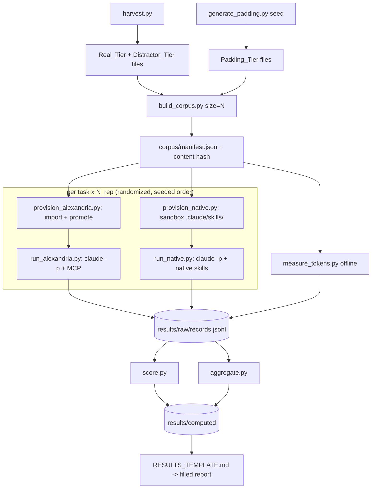

# Design Document: Skill Retrieval Benchmark

## Overview

This design defines a reproducible experiment that compares two ways of putting the *right skill* in
front of a coding agent, measured on three axes — **token cost**, **retrieval latency**, and
**accuracy** — for **Claude Code** in the first pass:

- **Alexandria_Condition** — skills live server-side; the client sees two MCP tools
  (`resolve_skill`, `fetch_skill`). Retrieval is a server-side Postgres full-text ranked search that
  returns a short candidate list; the model then fetches exactly one skill body on demand.
- **Native_Condition** — skills live in `.claude/skills/`. Per Anthropic's documented mechanism, the
  agent **pre-loads the `name` + `description` of every installed skill into its system prompt at
  startup** (~tens-to-hundreds of tokens each), and reads a full `SKILL.md` only when a request
  matches it (progressive disclosure). Selection is learned LLM behavior via a dispatcher tool, not
  keyword matching.

That architectural asymmetry is the whole point: native context cost grows ~linearly with library
size (every skill's frontmatter is always resident), while Alexandria's resident cost is ~flat in
library size (two tool schemas) with a per-task cost (one resolve result + one fetched body). The
experiment therefore treats **Library_Size (N)** as the primary independent variable and reports
every metric as a function of N.

All experiment artifacts live under a single top-level **`experiments/`** folder. The harness talks
to Alexandria only through its public API and the existing importer; it changes **no** product code.

### What is directly measured vs. modeled (stated up front, per Requirement 8)

Being honest about this drives the whole design:

| Metric | Alexandria_Condition | Native_Condition |
|---|---|---|
| **Token cost** | Directly counted from captured MCP payloads (tool schemas + resolve result + fetched body) with a fixed tokenizer. | **Directly computed** from the corpus files with the same tokenizer: resident = Σ frontmatter(name+description) over all N skills; per-task = resident + full body of the matched skill. This follows the documented preload+progressive-disclosure model exactly; it is a *model of the mechanism*, not a scrape of Claude's private prompt, and is labeled as such. |
| **Reported token usage (corroboration)** | Claude Code `--output-format json` usage block per run. | Same. |
| **Retrieval latency** | Directly measured wall-clock of `resolve_skill` + one `fetch_skill` at the HTTP client boundary. | Directly measured wall-clock of the client loading the matched `SKILL.md` from disk into context (file read + parse). Frontmatter preload is a startup cost, measured separately as a one-time cost, not per task. |
| **Accuracy (model-choice)** | Directly observed: which `skillVersionId` the transcript shows `fetch_skill` was called with. | Directly observed: which skill the transcript shows the `Skill` dispatcher tool invoked. |
| **Accuracy (recall@k)** | Directly observed: gold slug present in `resolve_skill` results. | Modeled: gold slug present in the top-k of the same offline FTS ranking OR present at all in the resident frontmatter set (k = N for native, since all descriptions are resident). Reported with that caveat. |

The token-cost and recall@k rows for native are **models of a documented mechanism**, computed
deterministically and disclosed as such in the results (Requirement 8.1, 8.3). Everything else is a
direct observation of a real Claude Code run.

Key decisions:

- **Claude Code headless mode is the execution engine.** Runs are driven by
  `claude -p "<task>" --output-format json` (non-interactive), which returns the final result plus a
  machine-readable transcript and usage block. This gives an objective per-run record of tool calls
  (skill invocation, MCP calls) and token usage — the objective signals Requirements 3.4/5.4 need.
- **One fixed tokenizer for all offline counts.** `tiktoken` with a pinned encoding, applied
  identically to both conditions, so Context_Token_Cost is reproducible and client-independent
  (Requirement 3.1). Claude's own tokenizer differs slightly; that is why tokenizer counts are the
  *primary* comparable metric and Claude's reported usage is *corroboration*, not the reverse.
- **Corpus is built once, hashed, and frozen per experiment version.** A manifest pins every skill's
  tier, slug, source, license, and content hash (Requirements 1.3, 9.8).
- **Raw per-run records are the source of truth.** The harness writes one JSON line per run; all
  aggregates (medians, IQRs, accuracy rates, per-N curves) are recomputed from those lines, so anyone
  can re-derive the conclusions (Requirement 7.4).
- **Determinism where it exists, disclosure where it doesn't.** Corpus assembly, padding generation,
  and task ordering are seeded; the LLM itself is not deterministic, which is exactly why N_rep and
  dispersion reporting exist (Requirement 6.2).

## Architecture

### `experiments/` folder layout

```text
experiments/
  README.md                         # what this is, how to run, safety notes
  PROTOCOL.md                       # hypotheses, conditions, metrics, procedure (Requirement 7.5)
  RESULTS_TEMPLATE.md               # results write-up skeleton: raw -> computed -> interpretation
  pyproject.toml / requirements.txt # pinned deps: tiktoken, httpx, pyyaml, etc. (Requirement 7.3)
  config/
    experiment.yaml                 # sizes [20,100,500], N_rep, K, seeds, model id, host, warmup count
  corpus/
    manifest.json                   # per-skill: tier, slug, name, source_url, ref, license, sha256
    real/<slug>/SKILL.md            # harvested genuine skills (Real_Tier)
    distractor/<slug>/SKILL.md      # realistic-but-wrong skills (Distractor_Tier)
    padding/<slug>/SKILL.md         # generated variant skills (Padding_Tier)
  tasks/
    task_set.v1.json                # >=50 labeled tasks (Requirement 9.9); versioned
    LABELING.md                     # labeling rationale (Requirement 5.6)
  harness/
    __init__.py
    harvest.py                      # Harvester: collect Real_Tier + record provenance/license
    generate_padding.py             # seeded variant-skill generator (Padding_Tier)
    build_corpus.py                 # assemble a size-N corpus from tiers; write manifest + hash
    provision_alexandria.py         # import + promote corpus into the running stack
    provision_native.py             # lay corpus into a sandboxed .claude/skills/ workspace
    run_alexandria.py               # execute tasks via Claude Code + MCP; capture payloads/timings
    run_native.py                   # execute tasks via Claude Code + native skills; capture transcript
    tokenizer.py                    # single fixed tokenizer wrapper (pinned encoding)
    measure_tokens.py               # offline Context_Token_Cost from captured payloads/corpus
    score.py                        # model-choice accuracy + recall@k from raw records
    aggregate.py                    # per-(metric, N, condition) medians/IQRs, accuracy rates
    run_experiment.py               # single-command entry point (Requirement 7.3)
    models.py                       # dataclasses: Task, SkillRef, RunRecord, Aggregate
  results/
    raw/<run-id>/records.jsonl      # one RunRecord per line (Requirement 7.4)
    raw/<run-id>/env.json           # machine, OS, model id+version, seeds, dep versions
    computed/<run-id>/*.csv|json    # recomputed aggregates + per-N curves
```

### Provisioning and run flow



### Guardrails for halting (Requirement 1.4, 5.6)

- `build_corpus.py` / `provision_*` abort the whole run if any skill fails to load into either
  condition; no partial results are emitted.
- `run_experiment.py` validates the Task_Set has a version, a stored path, and a `LABELING.md`
  before any run; a missing component aborts before execution.

## Components and Changes

### 1. Harvester — `harness/harvest.py` (Requirement 9.2, 9.3, 9.8)

Collects Real_Tier skills from documented sources and records provenance. Confirmed by
investigation: `anthropics/skills` is the one repo shipping real `SKILL.md` files in the standard
layout (19 skills); the large "awesome-skills" repos are link lists, so the harvester follows those
links to the underlying vendor/official repos rather than expecting files in the list repo itself.

```python
@dataclass(frozen=True)
class HarvestSource:
    kind: str            # "github_repo" | "github_dir"
    owner_repo: str      # e.g. "anthropics/skills"
    ref: str             # commit sha or tag (pinned for reproducibility)
    subpath: str = ""    # e.g. "skills"

@dataclass(frozen=True)
class HarvestedSkill:
    slug: str
    name: str
    description: str
    body: str            # full SKILL.md content
    source_url: str
    ref: str
    license: str         # SPDX id or "UNKNOWN" (recorded, never silently dropped)
    sha256: str
```

Behavior:
- Walk each source's tree at the pinned `ref`, take every `**/SKILL.md`, parse frontmatter with
  PyYAML (block-scalar aware — reusing the logic already proven in `scripts/import_anthropic_skills.py`).
- Record `source_url`, `ref`, resolved `license` (from repo license API; `UNKNOWN` if none).
- **Skip and log** anything that fails to fetch or parse; never include a malformed skill
  (Requirement 9.3).
- De-duplicate by `(name, sha256)` so the same skill referenced from multiple lists appears once.
- Output: `corpus/real/<slug>/SKILL.md` + manifest rows. A curated `sources.yaml` (checked in) lists
  the pinned sources so a re-run harvests the identical set.

Distractor_Tier is seeded from real skills that are *near* the tasks' domains but never their gold
answer (e.g. keep "image processing" real skills as distractors for PDF tasks). The harvester tags
tier in the manifest; the task labels (below) decide which slugs are eligible as gold.

### 2. Padding generator — `harness/generate_padding.py` (Requirement 9.5, 2.4)

Produces realistic **variant** skills: the same concept as a real skill, re-expressed for a
different language/framework/technology, deterministically and seeded. Not LLM-generated (that would
be non-reproducible); instead a **template-driven** expansion over a fixed matrix.

```python
CONCEPTS = ["pdf-processing", "spreadsheet-generation", "web-scraping", "api-client",
            "unit-testing", "data-visualization", ...]           # derived from real skills
STACKS   = [("python","pypdf"), ("node","pdf-lib"), ("rust","lopdf"),
            ("go","unidoc"), ("java","pdfbox"), ...]              # language/framework pairs

def generate(target_n: int, seed: int, reserved_slugs: set[str]) -> list[GeneratedSkill]:
    rng = random.Random(seed)
    # deterministic cartesian walk of CONCEPTS x STACKS, skipping any slug that
    # collides with a real/distractor slug (reserved_slugs), until target_n reached.
```

Each generated skill has a distinct `slug` like `pdf-processing-rust-lopdf`, a plausible
`name`/`description`, and a templated body of representative size (so padding contributes realistic
token mass, not empty filler). Guarantees:
- Deterministic for a given `(target_n, seed)` (Requirement 2.4, 9.5).
- Never collides with a real/distractor slug, so a Padding skill can never be a gold answer
  (Requirement 9.4).
- Because padding variants are *plausible*, they act as hard distractors — which makes accuracy a
  real test and forces gold labels to pin the exact slug (Requirement 9.7).

### 3. Corpus builder — `harness/build_corpus.py` (Requirements 1.1, 1.3, 9.1, 9.6)

Given a target N and the config, assembles a corpus = all Real_Tier + all Distractor_Tier + enough
Padding_Tier to reach N; writes the files and a `manifest.json`:

```json
{
  "experiment_version": "v1",
  "library_size": 100,
  "seed": 1234,
  "content_hash": "sha256:...",       // hash over sorted (slug, sha256) pairs
  "skills": [
    {"slug": "pdf", "tier": "real", "name": "Pdf", "source_url": "...", "ref": "...",
     "license": "Proprietary", "sha256": "..."},
    {"slug": "pdf-processing-rust-lopdf", "tier": "padding", "sha256": "..."}
  ]
}
```

The same manifest drives both conditions, guaranteeing byte-identical content (Requirement 1.1). The
`content_hash` is recorded in every RunRecord (Requirement 1.3).

### 4. Provisioning

- **`provision_alexandria.py`** — mint an Org_Admin token (reusing the documented
  `client_secret=any` OIDC flow), run the existing importer against the size-N corpus into a clean
  org, and promote the skills to resolvable state via the API/SQL path already documented in the
  resolver manual test. Verifies count == N before proceeding, else halts (Requirement 1.4).
- **`provision_native.py`** — create an isolated workspace directory and copy the size-N corpus into
  `<workspace>/.claude/skills/<slug>/SKILL.md`. Claude Code is launched with that workspace as CWD so
  it discovers exactly this corpus and nothing else. Verifies count == N, else halts.

### 5. Run drivers (Requirements 3, 4, 5)

Both drivers execute each task with `claude -p "<task prompt>" --output-format json` and capture the
JSON transcript. The task prompt is **identical** across conditions (Requirement 6.1); only the
environment differs (MCP server configured vs. native skills dir populated).

**`run_alexandria.py`:**
- Configures the Alexandria MCP server (minted token) for the Claude Code invocation.
- Wraps the MCP calls so it can capture the `resolve_skill` request/response payloads and the
  `fetch_skill` argument (`skillVersionId`) and time each at the HTTP boundary (Retrieval_Latency,
  Req 4.2). Implemented via a thin local MCP proxy the harness points Claude at, which forwards to
  Alexandria and logs payloads+timings — so capture never depends on Claude exposing internals.
- Records: resolve candidates (for recall@k), fetched slug (for model-choice), latencies, and
  Claude's reported usage.

**`run_native.py`:**
- Runs Claude Code in the provisioned native workspace.
- Parses the transcript for the `Skill` dispatcher tool invocation to get the chosen skill slug
  (model-choice, Req 5.4).
- Retrieval_Latency = measured time to read+parse the matched `SKILL.md` from disk (Req 4.3), plus a
  separately-recorded one-time frontmatter-preload cost.
- Records Claude's reported usage for corroboration.

Both write a `RunRecord` per (task, condition, N, rep):

```python
@dataclass
class RunRecord:
    run_id: str
    experiment_version: str
    condition: str            # "alexandria" | "native"
    library_size: int
    content_hash: str
    task_id: str
    gold_skill: str | None    # slug, or None for "no skill applies"
    rep: int
    is_warmup: bool
    chosen_skill: str | None  # slug the agent actually used (model-choice)
    resolve_candidates: list[str] | None   # slugs surfaced (recall@k; alexandria=real, native=modeled)
    retrieval_latency_ms: float
    end_to_end_latency_ms: float | None
    reported_usage: dict | None            # claude usage block
    model_id: str
    model_version: str | None
    seed: int
    timestamp: str
```

### 6. Offline token measurement — `harness/measure_tokens.py` (Requirement 3)

Uses the single pinned tokenizer for both conditions:

- **Alexandria per task** = tokens(resolve_skill schema) + tokens(fetch_skill schema)
  + tokens(resolve result payload) + tokens(fetched body). Resident part (schemas) is constant in N.
- **Native per task** = Σ over all N skills of tokens(frontmatter name+description)  [resident]
  + tokens(full body of the matched skill)  [progressive disclosure].

Both exclude the shared task prompt and model output (Requirement 3.2, 3.3). The function is pure and
recomputable from the manifest + captured payloads, so a third party reproduces the same numbers
(Requirement 3.5). This is where the **crossover curve** comes from: native grows with N, Alexandria
is flat + per-task; the report plots both against N.

### 7. Scoring — `harness/score.py` (Requirement 5)

- **Model_Choice_Accuracy** = mean over runs of `chosen_skill == gold_skill` (and for
  "no skill applies" tasks, `chosen_skill is None`). Reported per (condition, N) with a 95%
  bootstrap CI over tasks×reps.
- **Retrieval_Recall_at_K** = mean over runs of `gold_skill in resolve_candidates[:K]`. For native,
  `resolve_candidates` is the modeled ranking (all descriptions resident, offline FTS-ranked), K
  documented; the caveat is emitted into the results.
- No subjective grading anywhere (Requirement 5.4, Non-Goal).

### 8. Aggregation — `harness/aggregate.py` (Requirement 6.2)

Recomputes, from `records.jsonl`, per (metric, condition, N):
- token cost: median + IQR of Context_Token_Cost, plus mean Reported_Token_Usage;
- latency: median + IQR, cold vs. warm split (Req 4.4), warm-up excluded from primary stats but
  retained+labeled in raw (Req 6.5);
- accuracy: rate + bootstrap CI.
Outputs tidy CSV/JSON for plotting and the results write-up.

### 9. Entry point — `harness/run_experiment.py` (Requirement 7.3)

```
python -m harness.run_experiment \
    --config config/experiment.yaml \
    --sizes 20,100,500 \
    --conditions alexandria,native \
    --nrep 5 \
    --warmup 1
```

Validates task-set completeness and provisioning, records `env.json` (machine, OS, model id+version,
all seeds, dependency versions — Requirements 6.4, 7.6), runs the matrix in seeded-random task order
(Req 6.3), and writes raw records. Aggregation/scoring can be re-run standalone over the raw records.

## Data Models

### Task_Set schema — `tasks/task_set.v1.json`

```json
{
  "version": "v1",
  "labeling_doc": "tasks/LABELING.md",
  "tasks": [
    {
      "id": "t001",
      "prompt": "Extract all tables from a scanned PDF and save them as CSV.",
      "gold_skill": "pdf",
      "rationale": "Explicit PDF table extraction; the 'pdf' skill is the intended match.",
      "distractor_notes": "pdf-processing-rust-lopdf padding variant must NOT be accepted."
    },
    {
      "id": "t050",
      "prompt": "Refactor this variable name.",
      "gold_skill": null,
      "rationale": "Trivial edit; no skill should be invoked (no-skill-applies control)."
    }
  ]
}
```

At least 50 tasks (Requirement 9.9), a mix of clear-match, near-variant-trap, and no-skill-applies
controls. Every `gold_skill` is a Real_Tier slug or `null` (Requirement 9.4, 9.7). Frozen for v1.

### Corpus manifest

As shown in §3 — per-skill tier, provenance, license, and hash (Requirements 1.3, 9.8).

### RunRecord / env.json

As shown in §5, plus `env.json` capturing machine, OS, model id+version (recorded together or neither
per Requirement 6.4), seeds, and pinned dependency versions.

## Correctness / Validity Properties

### Property 1: Identical corpus across conditions
For a given N and seed, the set of `(slug, sha256)` provisioned into the Alexandria_Condition equals
the set laid into the Native_Condition; the manifest `content_hash` matches in both RunRecords.
**Validates: Requirements 1.1, 1.3.**

### Property 2: Size-resolved reporting
Every reported metric exists as a value per (condition, N) for each configured N; no metric is
reported only as a single N-collapsed aggregate.
**Validates: Requirements 2.3, 9.6.**

### Property 3: Padding never gold, deterministic
For any `(N, seed)`, `generate_padding` yields the same slugs; none intersects a Real_Tier or
Distractor_Tier slug; no `gold_skill` in the Task_Set is a Padding/Distractor slug.
**Validates: Requirements 2.2, 2.4, 9.4, 9.5, 9.7.**

### Property 4: Token counts reproducible and mechanism-faithful
`measure_tokens` is a pure function of (manifest, captured payloads, pinned tokenizer): same inputs →
same counts. Native resident cost = Σ frontmatter tokens over N; native per-task adds exactly the one
matched body; Alexandria resident cost is independent of N.
**Validates: Requirements 3.1, 3.2, 3.3, 3.5.**

### Property 5: Objective model-choice signal
`chosen_skill` for each run is derived from a logged tool-call signal (fetch_skill arg for
Alexandria; Skill dispatcher invocation for native), never from grading output text.
**Validates: Requirements 5.2, 5.4.**

### Property 6: Reproducibility from raw
All aggregates and conclusions are recomputable by running `aggregate.py` + `score.py` over
`records.jsonl` alone; the folder is self-contained and product code is untouched.
**Validates: Requirements 7.1, 7.2, 7.4.**

### Property 7: Provenance and halting
Every Real_Tier skill carries source+license in the manifest; corpus-load failure or an incomplete
Task_Set halts before any measured run.
**Validates: Requirements 1.4, 5.6, 9.8, 9.3.**

### Property 8: Disclosed proxies
The results document labels native token cost and native recall@k as *models of the documented
mechanism* and states the direction/magnitude of any bias.
**Validates: Requirements 8.1, 8.3, 8.4.**

## Testing Strategy

This is a measurement harness, not product code, so testing centers on the *deterministic* parts
(everything except the LLM) plus a small end-to-end smoke run.

- **Unit (pytest):**
  - `generate_padding` determinism and no-collision with reserved slugs (Property 3).
  - `build_corpus` produces a stable `content_hash` for a fixed (N, seed) and identical tier sets
    for both conditions (Property 1).
  - `measure_tokens` purity: fixed inputs → fixed counts; native resident scales linearly with N and
    Alexandria resident is constant in N on a synthetic manifest (Property 4).
  - `score` computes correct model-choice/recall on hand-built RunRecords, including the
    "no-skill-applies" case (Property 5).
  - Task-set validation rejects a set missing version/path/labeling (Requirement 5.6).
  - Frontmatter parser parity with the proven importer logic on the block-scalar skills.
- **Integration smoke (opt-in, needs the running stack + Claude Code):**
  - Provision N=20 into both conditions; run 2 tasks × 1 rep each; assert a RunRecord is written with
    a non-null `chosen_skill`, a positive `retrieval_latency_ms`, and a token cost for each condition.
    This proves the pipeline end-to-end without asserting on the (non-deterministic) accuracy value.
- **Reproducibility check:** re-running `aggregate.py`/`score.py` over the same `records.jsonl`
  yields byte-identical `computed/` outputs (Property 6).

No changes to Alexandria's Java test suites; `./mvnw` is unaffected (Requirement 7.2).

## Threats to Validity (carried into RESULTS_TEMPLATE.md — Requirement 8)

- **Native token/recall are modeled, not scraped.** They follow Anthropic's documented
  preload+progressive-disclosure mechanism and are computed deterministically; if Claude's actual
  disclosure differs (e.g. compression, partial preload), the native resident cost could be *lower*
  than modeled — a bias that would *understate* Alexandria's advantage, so the direction is
  conservative for the Alexandria hypothesis. Stated explicitly.
- **Tokenizer mismatch.** `tiktoken` ≈ but ≠ Claude's tokenizer; used only for the *comparable*
  cross-condition metric, with Claude's reported usage shown alongside.
- **LLM non-determinism.** Mitigated by N_rep + dispersion + bootstrap CIs, not eliminated.
- **Selection is apples-to-oranges by construction.** Native = LLM picks from resident descriptions;
  Alexandria = FTS rank then LLM fetch. This is the real comparison of the two products, but it is
  *not* a pure retrieval-algorithm benchmark; the results say so.
- **Single machine, single model, Claude Code only, this corpus, these N.** Conclusions scoped
  accordingly (Requirement 8.2).

## Rollout / Sequencing

1. Scaffold `experiments/` (folder, pinned deps, config, PROTOCOL, RESULTS_TEMPLATE, README).
2. `models.py`, `tokenizer.py`, task-set schema + validation + `LABELING.md`.
3. Harvester + `sources.yaml` (Real_Tier + Distractor_Tier) with provenance/license.
4. Padding generator + corpus builder + manifest/hashing (+ unit tests).
5. Provisioning (Alexandria + native sandbox) with halting guards.
6. Run drivers (MCP proxy capture; native transcript parse).
7. `measure_tokens` + `score` + `aggregate` (+ unit tests).
8. `run_experiment` entry point; end-to-end smoke at N=20.
9. Author the 50-task set; freeze v1.
10. Full run at 20/100/500; fill RESULTS from raw; write threats-to-validity.
