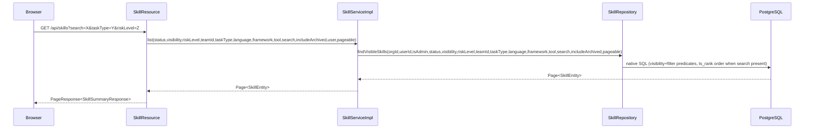
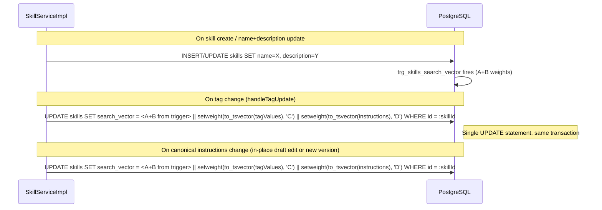

# Design Document: Skill Search

## Overview

This design covers Milestone 2c — **Skill Search** — which completes Phase 1's governed skill
registry by extending the existing PostgreSQL full-text search (FTS), adding relevance-ranked
ordering, wiring all filter dimensions end-to-end, and unifying the two divergent frontend search
UIs into a single coherent experience.

The existing FTS infrastructure from Milestone 2a provides:
- A `tsvector search_vector` column on `skills`, maintained by a DB trigger on `name`
  and `description` (weights A and B respectively).
- A GIN index `idx_skills_search_vector`.
- A `findVisibleSkills` native query in `SkillRepository` using `@@ plainto_tsquery`.
- Results ordered by `updated_at DESC` regardless of search relevance.

This milestone extends that foundation within the Phase 1 constraint of PostgreSQL-only search,
without any external search infrastructure.

Key architectural decisions:
- **Application-layer tag + instruction indexing**: The DB trigger handles name/description.
  Tag values (weight C) and canonical instructions (weight D) are injected in the same service
  transaction as the change, keeping the vector consistent without a separate async job.
- **In-query ts_rank relevance ordering**: The native SQL query conditionally orders by
  `ts_rank` when a search term is present. No application-layer sorting.
- **Taxonomy-filter as join predicate**: Taxonomy dimension filters (taskType, language, etc.)
  are resolved as a join to `skill_tags`/`taxonomy_entries` inside the same native query.
- **Single frontend search module**: Both browse and authoring layers share one API client
  function/hook, eliminating the duplicated-and-divergent search logic.
- **Live taxonomy in filter UI**: Filter dropdowns are populated from `GET /api/taxonomy`, not
  hardcoded arrays.

## Architecture

### Search Request Flow



### Search Vector Update Flow



## Components and Changes

### 1. `alexandria-entities` — `SkillRepository`

Replace the single `findVisibleSkills` method with an updated version that:
- Adds `visibility`, `riskLevel` filter params (previously ignored or absent).
- Adds four taxonomy dimension params: `taskType`, `language`, `framework`, `tool`.
- Applies `ts_rank` ordering when `searchQuery` is non-null.
- Adds the `countQuery` annotation for lean pagination counts.

Add a new `@Modifying @Transactional` method for rebuilding the search vector:

```java
@Modifying
@Transactional
@Query(value = """
    UPDATE skills
    SET search_vector =
        setweight(to_tsvector('english', COALESCE(name, '')), 'A') ||
        setweight(to_tsvector('english', COALESCE(description, '')), 'B') ||
        setweight(to_tsvector('english', COALESCE(:tagValues, '')), 'C') ||
        setweight(to_tsvector('english', COALESCE(:instructions, '')), 'D')
    WHERE id = :skillId
    """, nativeQuery = true)
void rebuildSearchVector(
    @Param("skillId") UUID skillId,
    @Param("tagValues") String tagValues,
    @Param("instructions") String instructions
);
```

**Updated `findVisibleSkills` signature:**

```java
Page<SkillEntity> findVisibleSkills(
    @Param("orgId") UUID orgId,
    @Param("userId") UUID userId,
    @Param("isOrgAdmin") boolean isOrgAdmin,
    @Param("status") String status,
    @Param("visibility") String visibility,
    @Param("riskLevel") String riskLevel,
    @Param("teamId") UUID teamId,
    @Param("taskType") String taskType,
    @Param("language") String language,
    @Param("framework") String framework,
    @Param("tool") String tool,
    @Param("searchQuery") String searchQuery,
    @Param("includeArchived") boolean includeArchived,
    Pageable pageable
);
```

**Updated native SQL query:**

```sql
SELECT s.* FROM skills s
WHERE s.organization_id = :orgId
  AND (
    s.visibility = 'organization'
    OR (s.visibility = 'team' AND s.owner_team_id IN (
        SELECT tm.team_id FROM team_members tm WHERE tm.user_id = :userId))
    OR (s.visibility = 'private' AND s.created_by = :userId)
    OR (s.visibility = 'restricted' AND (
        s.created_by = :userId
        OR EXISTS (SELECT 1 FROM skill_access_grants sag
                   WHERE sag.skill_id = s.id AND sag.user_id = :userId)))
    OR :isOrgAdmin = true
  )
  AND s.lifecycle_status <> 'Blocked'
  AND (:includeArchived = true OR :status = 'Archived' OR s.lifecycle_status <> 'Archived')
  AND (:status IS NULL OR s.lifecycle_status = :status)
  AND (:visibility IS NULL OR s.visibility = :visibility)
  AND (:riskLevel IS NULL OR s.risk_level = :riskLevel)
  AND (:teamId IS NULL OR s.owner_team_id = :teamId)
  AND (:taskType IS NULL OR EXISTS (
        SELECT 1 FROM skill_tags st
        JOIN taxonomy_entries te ON te.id = st.taxonomy_entry_id
        WHERE st.skill_id = s.id
          AND te.tag_type = 'task_type'
          AND LOWER(te.value) = LOWER(:taskType)
          AND te.active = true))
  AND (:language IS NULL OR EXISTS (
        SELECT 1 FROM skill_tags st
        JOIN taxonomy_entries te ON te.id = st.taxonomy_entry_id
        WHERE st.skill_id = s.id
          AND te.tag_type = 'language'
          AND LOWER(te.value) = LOWER(:language)
          AND te.active = true))
  AND (:framework IS NULL OR EXISTS (
        SELECT 1 FROM skill_tags st
        JOIN taxonomy_entries te ON te.id = st.taxonomy_entry_id
        WHERE st.skill_id = s.id
          AND te.tag_type = 'framework'
          AND LOWER(te.value) = LOWER(:framework)
          AND te.active = true))
  AND (:tool IS NULL OR EXISTS (
        SELECT 1 FROM skill_tags st
        JOIN taxonomy_entries te ON te.id = st.taxonomy_entry_id
        WHERE st.skill_id = s.id
          AND te.tag_type = 'tool'
          AND LOWER(te.value) = LOWER(:tool)
          AND te.active = true))
  AND (:searchQuery IS NULL OR s.search_vector @@ plainto_tsquery('english', :searchQuery))
ORDER BY
  CASE WHEN :searchQuery IS NULL THEN 0.0
       ELSE ts_rank(s.search_vector, plainto_tsquery('english', :searchQuery), 1)
  END DESC,
  s.updated_at DESC
```

**Companion count query:**

```sql
SELECT COUNT(*) FROM skills s
WHERE s.organization_id = :orgId
  AND (
    s.visibility = 'organization'
    OR (s.visibility = 'team' AND s.owner_team_id IN (
        SELECT tm.team_id FROM team_members tm WHERE tm.user_id = :userId))
    OR (s.visibility = 'private' AND s.created_by = :userId)
    OR (s.visibility = 'restricted' AND (
        s.created_by = :userId
        OR EXISTS (SELECT 1 FROM skill_access_grants sag
                   WHERE sag.skill_id = s.id AND sag.user_id = :userId)))
    OR :isOrgAdmin = true
  )
  AND s.lifecycle_status <> 'Blocked'
  AND (:includeArchived = true OR :status = 'Archived' OR s.lifecycle_status <> 'Archived')
  AND (:status IS NULL OR s.lifecycle_status = :status)
  AND (:visibility IS NULL OR s.visibility = :visibility)
  AND (:riskLevel IS NULL OR s.risk_level = :riskLevel)
  AND (:teamId IS NULL OR s.owner_team_id = :teamId)
  AND (:taskType IS NULL OR EXISTS (
        SELECT 1 FROM skill_tags st
        JOIN taxonomy_entries te ON te.id = st.taxonomy_entry_id
        WHERE st.skill_id = s.id AND te.tag_type = 'task_type'
          AND LOWER(te.value) = LOWER(:taskType) AND te.active = true))
  AND (:language IS NULL OR EXISTS (
        SELECT 1 FROM skill_tags st
        JOIN taxonomy_entries te ON te.id = st.taxonomy_entry_id
        WHERE st.skill_id = s.id AND te.tag_type = 'language'
          AND LOWER(te.value) = LOWER(:language) AND te.active = true))
  AND (:framework IS NULL OR EXISTS (
        SELECT 1 FROM skill_tags st
        JOIN taxonomy_entries te ON te.id = st.taxonomy_entry_id
        WHERE st.skill_id = s.id AND te.tag_type = 'framework'
          AND LOWER(te.value) = LOWER(:framework) AND te.active = true))
  AND (:tool IS NULL OR EXISTS (
        SELECT 1 FROM skill_tags st
        JOIN taxonomy_entries te ON te.id = st.taxonomy_entry_id
        WHERE st.skill_id = s.id AND te.tag_type = 'tool'
          AND LOWER(te.value) = LOWER(:tool) AND te.active = true))
  AND (:searchQuery IS NULL OR s.search_vector @@ plainto_tsquery('english', :searchQuery))
```

### 2. `alexandria-service` — `SkillService` and `SkillServiceImpl`

#### `SkillService.list` signature update

```java
Page<SkillEntity> list(
    String status,
    String visibility,
    String riskLevel,
    UUID teamId,
    String taskType,
    String language,
    String framework,
    String tool,
    String searchQuery,
    boolean includeArchived,
    AlexandriaUserDetails userDetails,
    Pageable pageable
);
```

#### `SkillServiceImpl.list` update

Wire all new parameters through to `skillRepository.findVisibleSkills`. Remove the silent
visibility drop that existed in `SkillResource` (where visibility was accepted but never
forwarded).

The `isOrgAdmin` flag passed to `findVisibleSkills` uses `userDetails.role() == Role.Org_Admin`
(the existing behaviour). This intentionally limits the "see all skills regardless of
visibility" bypass to Org_Admins only. Catalog_Admins can govern skills (deprecate, block,
archive, restore) but are subject to the same visibility rules as other users for listing.
This is a deliberate product decision: governance authority does not imply unrestricted read
access. If this decision changes, update `isOrgAdmin` to `userDetails.role().isAdmin()` and
adjust the behaviour of `enforceVisibility` in `SkillServiceImpl` to match.

#### `rebuildSearchVector` helper

Add a private `rebuildSearchVector(SkillEntity skill)` method that:
1. Loads all active tag values for the skill via `skillTagRepository.findBySkillId` +
   `taxonomyEntryRepository.findAllById`, joining their values with a space separator.
2. Loads the canonical instructions of the current version via `skillVersionRepository.findById`
   on `skill.getCurrentVersionId()` (null-safe).
3. Calls `skillRepository.rebuildSearchVector(skill.getId(), tagValues, instructions)`.

This method is called at the end of:
- `create(...)` — after the initial skill + version are saved and tags are set.
- `update(...)` — after `handleTagUpdate` and all version content changes have been applied.
  `handleTagUpdate` is always called from within `update` or `create`, never standalone, so
  calling `rebuildSearchVector` once at the outer call site is sufficient — do NOT also call
  it inside `handleTagUpdate` to avoid a redundant double-rebuild per update.

Because the DB trigger handles name/description (weights A/B) on INSERT/UPDATE of those
columns, the `rebuildSearchVector` SQL must always be called **after** the skill's `name` and
`description` have been persisted. It reads the current column values from the saved row and
re-derives A/B in the same SQL UPDATE, meaning the trigger and the helper are both correct
but complementary: the trigger fires on name/description column writes; the helper fires on
tag/instruction changes and also refreshes A/B for consistency in one round-trip. Developers
must not call `rebuildSearchVector` before the `save()` that writes the new name/description.

### 3. `alexandria-api` — `SkillApi.listSkills`

Add new query params (all optional):

```java
@GetMapping
ResponseEntity<PageResponse<SkillSummaryResponse>> listSkills(
    @RequestParam(defaultValue = "0") int page,
    @RequestParam(defaultValue = "20") int size,
    @RequestParam(required = false) String status,
    @RequestParam(required = false) String visibility,
    @RequestParam(required = false) String riskLevel,
    @RequestParam(required = false) UUID teamId,
    @RequestParam(required = false) String taskType,
    @RequestParam(required = false) String language,
    @RequestParam(required = false) String framework,
    @RequestParam(required = false) String tool,
    @RequestParam(required = false) String search,
    @RequestParam(required = false) String slug,
    @RequestParam(defaultValue = "false") boolean includeArchived
);
```

`visibility` was already on the API interface (but silently dropped in `SkillResource`). This
change ensures it's wired through. `riskLevel`, `taskType`, `language`, `framework`, `tool` are
new.

### 4. `alexandria-service` — `SkillResource.listSkills`

Update to pass all new parameters to `skillService.list`:

```java
@Override
public ResponseEntity<PageResponse<SkillSummaryResponse>> listSkills(
        int page, int size, String status, String visibility, String riskLevel,
        UUID teamId, String taskType, String language, String framework, String tool,
        String search, String slug, boolean includeArchived) {
    AlexandriaUserDetails user = currentUser();

    if (slug != null && !slug.isBlank()) {
        SkillEntity skill = skillService.getBySlug(slug, user);
        SkillSummaryResponse summary = responseMapper.toSummaryResponse(skill);
        return ResponseEntity.ok(new PageResponse<>(List.of(summary), 0, 1, 1, 1));
    }

    Pageable pageable = PageRequest.of(page, size);
    Page<SkillEntity> skills = skillService.list(
            blankToNull(status), blankToNull(visibility), blankToNull(riskLevel),
            teamId, blankToNull(taskType), blankToNull(language),
            blankToNull(framework), blankToNull(tool),
            blankToNull(search), includeArchived, user, pageable);
    return ResponseEntity.ok(toPageResponse(skills.map(responseMapper::toSummaryResponse)));
}
```

### 5. Frontend — Unified Search Module

#### Canonical location: `src/api/skillsCatalog.ts`

The authoring layer's `listSkills` / `useSkills` hook in `skillsCatalog.ts` becomes the
canonical search entry point. Extend `SkillListParams` in `src/types/skill.ts`:

```typescript
export interface SkillListParams {
  page?: number
  size?: number
  search?: string
  status?: string
  visibility?: string
  riskLevel?: string
  teamId?: string
  taskType?: string
  language?: string
  framework?: string
  tool?: string
  slug?: string
  includeArchived?: boolean
}
```

Update `listSkills` in `skillsCatalog.ts` to pass all params to the backend.

#### Browse layer migration

`CatalogPage.tsx` currently imports `searchSkills` from `@/api/skills` which accepts
`SkillSearchParams` (a different, partially-overlapping type). Migrate `CatalogPage` to use
`useSkills` / `listSkills` from `@/api/skillsCatalog` via the extended `SkillListParams`.
Map the browse catalog's filter fields to the unified params:
- `query` → `search`
- `taskType` → `taskType`
- `language` → `language`
- `framework` → `framework`
- `tool` → `tool` (NOTE: this is a taxonomy `tool` tag filter, not a variant-tool filter)
- `riskLevel` → `riskLevel`
- `visibility` → `visibility`
- `ownerTeam` → `teamId` (currently a name string; align to UUID or team slug lookup)

The `searchSkills` function in `src/api/skills.ts` SHALL be removed or deprecated in favour of
the unified `listSkills`. Do not maintain two divergent implementations.

#### Query key

`skillKeys.list(params)` already incorporates all params as the key — no change needed to the
key structure, only the params object shape widening.

### 6. Frontend — `FilterPanel` Taxonomy Hydration

Replace hardcoded `TASK_TYPE_OPTIONS`, `LANGUAGE_OPTIONS`, `FRAMEWORK_OPTIONS`, `TOOL_OPTIONS`
arrays with a live taxonomy fetch:

```typescript
// In FilterPanel (or a shared hook)
const { data: taxonomy } = useQuery({
  queryKey: ['taxonomy', 'all'],
  queryFn: getAllTaxonomy,  // GET /api/taxonomy → List<TaxonomyGroupResponse>
  staleTime: 5 * 60 * 1000, // 5 min — taxonomy changes rarely
})

const optionsFor = (tagType: string) =>
  taxonomy
    ?.find(g => g.tagType === tagType)
    ?.entries.filter(e => e.active)
    .map(e => e.value) ?? []
```

The `FilterPanel` component already exists in `src/browser/components/FilterPanel.tsx`; the
`SkillSearchFilters` component exists in `src/components/skill/SkillSearchFilters.tsx`. After
this milestone both should source taxonomy options the same way.

### 7. V7 Flyway Migration (search_vector rebuild for existing data)

A new migration `V7__rebuild_search_vectors.sql` runs a one-time bulk rebuild of all existing
`search_vector` values to incorporate tag content:

```sql
-- V7__rebuild_search_vectors.sql
-- Rebuilds search_vector for all existing skills to include tag values (weight C)
-- and canonical instructions (weight D) that were not included at initial creation.

UPDATE skills s
SET search_vector =
    setweight(to_tsvector('english', COALESCE(s.name, '')), 'A') ||
    setweight(to_tsvector('english', COALESCE(s.description, '')), 'B') ||
    setweight(to_tsvector('english', COALESCE((
        SELECT string_agg(te.value, ' ')
        FROM skill_tags st
        JOIN taxonomy_entries te ON te.id = st.taxonomy_entry_id
        WHERE st.skill_id = s.id AND te.active = true
    ), '')), 'C') ||
    setweight(to_tsvector('english', COALESCE((
        SELECT sv.canonical_instructions
        FROM skill_versions sv
        WHERE sv.id = s.current_version_id
    ), '')), 'D');
```

This migration is idempotent: running it multiple times produces the same result. After
migration, the application-layer `rebuildSearchVector` method keeps the vector current for all
subsequent changes.

## Data Models

### No new tables

This milestone does not introduce new tables. Changes are:
- `skills.search_vector` is already the right type (`tsvector`) and has the GIN index.
- The trigger continues to handle A/B; the application layer adds C/D in the same transaction.

### Existing index sufficiency

The existing indexes (`idx_skills_lifecycle`, `idx_skills_visibility`, `idx_skills_owner_team`,
`idx_skills_search_vector`) cover the common filter patterns. PostgreSQL's planner will use the
GIN index for FTS predicates and the B-tree indexes for exact-value filters. The EXISTS
sub-queries for taxonomy filters are driven by `idx_skill_tags_skill` and `idx_taxonomy_org_type`.

For large catalogs (>5k skills) with simultaneous taxonomy + FTS predicates, a composite partial
index may be beneficial:

```sql
-- Optional, not required for correctness:
CREATE INDEX idx_skills_active_org_fts ON skills(organization_id)
    WHERE lifecycle_status NOT IN ('Blocked', 'Archived');
```

This index is out of scope for this milestone but should be considered if query latency
exceeds the 500ms target in Requirement 8.1.

## Correctness Properties

### Property 1: Search vector completeness

*For any* skill, after any create, update (in-place or versioned), or tag-change operation, the
skill's `search_vector` SHALL contain: name at weight 'A', description at weight 'B', all active
tag values (space-joined) at weight 'C', and the canonical instructions of the current version at
weight 'D'. If any field is null or blank, its contribution is omitted without error.

**Validates: Requirements 1.1, 1.2, 1.3, 1.5, 1.6**

### Property 2: Relevance ordering when query is present

*For any* set of skills and any non-blank search query, the skill whose search_vector produces
the highest `ts_rank` score for that query SHALL appear before any skill with a lower score.
When two skills tie in ts_rank, the more recently updated one SHALL appear first. This ordering
SHALL be consistent across pages (page 2 of a query continues from page 1 in the same rank
order).

**Validates: Requirements 2.1, 2.4**

### Property 3: Recency ordering when no query is present

*For any* filter-only request (no `search` param), results SHALL be ordered by `updated_at DESC`
exactly as before this milestone. No behavioral change occurs for non-search browse requests.

**Validates: Requirements 2.2**

### Property 4: Filter conjunction correctness

*For any* combination of filter parameters, the result set SHALL contain only skills that satisfy
ALL supplied filters simultaneously. A skill missing any one filter criterion SHALL NOT appear in
the result set.

**Validates: Requirements 3.1 (AND semantics), 3.5**

### Property 5: Taxonomy filter case-insensitivity

*For any* taxonomy dimension filter, a query with `taskType=Python` and a query with
`taskType=python` SHALL produce the same result set. Taxonomy matching is case-insensitive.

**Validates: Requirement 3.4**

### Property 6: No parameter dropping

*For any* request to `GET /api/skills` with a non-null filter value, the filter SHALL influence
the returned result set. No filter parameter accepted by `SkillApi.listSkills` SHALL be silently
ignored in the service or resource layer.

**Validates: Requirement 3.5**

### Property 7: Count accuracy

*For any* query and filter combination, the `totalElements` in the paginated response SHALL
exactly equal the number of skills that pass all predicates (visibility + filters + FTS). The
count and the data page SHALL use the same predicate logic.

**Validates: Requirements 4.1, 4.2**

### Property 8: Search vector consistency after rebuild

*For any* two invocations of `rebuildSearchVector` for the same skill with the same tag set and
instructions, the resulting `search_vector` SHALL be identical (deterministic, no randomness or
ordering sensitivity in the tsvector merge).

**Validates: Requirements 1.5, 1.6**

### Property 9: Empty-query invariant

*For any* filter-only request (blank or absent `search`), THE system SHALL return results as if
no FTS predicate were applied — i.e. the `search_vector @@ plainto_tsquery(...)` predicate is
not applied and all skills passing the other filters are included.

**Validates: Requirements 2.2, 8.4**

## Testing Strategy

### Backend Tests

#### Repository integration tests (`@SpringBootTest` + Testcontainers)

Extend the existing `V4MigrationAndSkillRepositoryIntegrationTest`:
- **Tag indexing**: create a skill, assign tags, call `rebuildSearchVector`, search for a tag value — assert result appears; remove tags, rebuild, search — assert result no longer appears.
- **Instruction indexing**: create a skill with distinctive instruction content, rebuild, search for a term from instructions — assert result appears.
- **Relevance ordering**: create two skills where the search term appears in the name of one and description of the other; assert name-match ranks first.
- **Taxonomy filter**: create skills with different tag combinations, filter by `taskType`; assert only matching skills appear.
- **Visibility filter**: create skills with different visibility values, supply `visibility=organization` filter; assert only `organization` skills appear (subject to existing visibility enforcement).
- **riskLevel filter**: create skills with different risk levels; assert filter returns only matching subset.
- **Count query accuracy**: assert `Page.getTotalElements()` matches manual `COUNT(*)` for the same predicate set.

#### Service unit tests (Mockito)

Test `SkillServiceImpl.rebuildSearchVector`:
- Verify it assembles the tag values string from active entries only.
- Verify it passes the instructions of the current version (not a stale one).
- Verify it is called after `create`, `update`, and `handleTagUpdate`.

#### Property-based tests (jqwik)

- **Property 1 (vector completeness)**: For generated skill + tag sets, verify that after rebuild the vector is non-empty and contains lexemes from name/description/tags/instructions.
- **Property 4 (filter conjunction)**: For generated filter combinations, verify all returned skills satisfy every non-null filter.
- **Property 5 (case-insensitivity)**: For generated taxonomy values, verify `lower(value)` matches `lower(query)`.

### Frontend Tests (Vitest + RTL)

- **Filter wiring**: mock `GET /api/skills` and `GET /api/taxonomy`; set a `taskType` filter; assert the API call includes `taskType` in params.
- **Live taxonomy options**: mock `GET /api/taxonomy`; render the FilterPanel; assert dropdowns show taxonomy values (not hardcoded).
- **Taxonomy loading state**: mock a slow `GET /api/taxonomy`; assert dropdowns show disabled/placeholder while loading.
- **Taxonomy failure**: mock `GET /api/taxonomy` returning 500; assert FilterPanel renders without crashing and shows empty dropdowns.
- **Search debounce**: type a search term; assert the API call fires only after the 300ms debounce window.
- **URL state persistence**: simulate a filter change; assert the URL params update; simulate a reload (re-parse from URL); assert filters are restored.
- **Zero results**: mock API returning `totalElements: 0`; assert an appropriate empty-state message is shown.
